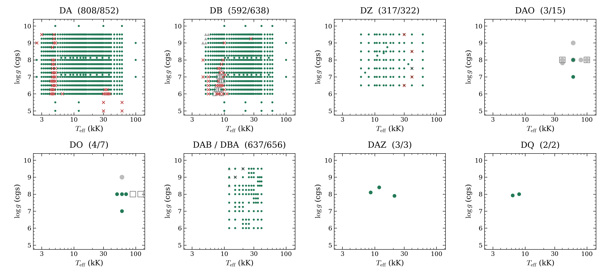

# Precomputed model grids

The selected grid table contains **2,361 numerical completions from 2,499 requests**.
DAB/DBA has **637 accepted coordinates from 656 requests**. The latest update
adds 32 newly calculated knots and eight reused centers in eight selected
patches. It also adds 32 independent test spectra, which remain outside the
predictor mesh. Together with three earlier validation coordinates, there are
35 separate DAB test coordinates. Earlier settings, attempts and archives remain
unchanged.



Each title gives numerical completions divided by requests. Green circles passed
the recorded checks. Red crosses failed a numerical check or encountered an
invalid numerical depth grid. Grey squares reached a time limit. Grey triangles
could not run their requested configuration. Grey circles were not started in the saved selection. Dark grey crosses mark worker crashes.
A separate four-DO/four-DAO batch is running. Its outcomes await verified collection
and have not replaced the saved DO/DAO statuses shown here.
Timeouts remain unfinished. Different compositions can share temperature and
gravity, so symbols can overlap. Blank regions were not requested.

| Family | Numerical completions | Requests | Latest selected source |
|---|---:|---:|---|
| DA | 808 | 852 | October 8 + native validation supplement |
| DB | 592 | 638 | October 8 + cold, validation and retry supplements |
| DZ | 317 | 322 | October 8 + October 11 retries |
| DAO | 1 | 15 | One verified spectrum; follow-up running |
| DO | 1 | 7 | One verified spectrum; follow-up running |
| DAB/DBA | 637 | 656 | October 9/10 + October 11 retries and refinement |
| DAZ | 3 | 3 | October 8 |
| DQ | 2 | 2 | October 8 |

The eight-family figure covers 2,495 requests. The full table retains 2,499,
including four D6, DAH and PG1159 cases omitted from the figure. The production
DAB bank replaces the five earlier standard-quality DAB examples in these counts.
Four repeated DB comparison models are counted once at their original coordinates.
All previous selections remain in [dated snapshots](history/README.md).

## Downloads and spectrum examples

[Contributor draft releases](https://github.com/cheyanneshariat/OpenWD/releases)
hold the original DA/DB/DZ/DAZ/DQ archives, the 326-spectrum DAB archive, the
four-model cold DB supplement, the 118-spectrum native validation supplement,
the 261-spectrum DAB abundance supplement, the 38-spectrum timeout-recovery
supplement and the 104-model DAB refinement archive. The last archive includes
64 new calculations and 40 earlier predictor inputs.
Draft assets require write access to the fork. They are not public downloads until
the releases are published. The original archives remain unchanged.

- [DAB/DBA coverage and spectrum sequences](dab-2026-10-09/README.md) vary
  abundance, temperature and gravity separately. The current selection has
  637/656 accepted points after the [temperature and gravity refinement](refinement-2026-10-11/README.md);
  the original archive contains 326.
- [New DAB knots and 32 independent refinement tests](refinement-2026-10-11/README.md)
  show how halving temperature and gravity spacing changes the errors.
- [New grid points and DAB interpolation tests](validation-2026-10-09/README.md)
  give all 136 follow-up requests, their full settings and remaining gaps.
- [Six-hour retries and the first DAO spectrum](timeout-recovery-2026-10-11/README.md)
  show all 68 outcomes, the nine recovered DAB points and all eight measurable
  earlier DAB interpolation tests. Eight of those targets are now predictor inputs
  in the new refinement.
- [Cold DB and Montreal comparison](db-cold-2026-10-09/README.md) preserve the
  earlier four-model demonstration and its unresolved spectral disagreement.

Wavelengths are vacuum Angstroms. Flux is surface Fλ in
`erg s^-1 cm^-2 Angstrom^-1`, without normalization or resampling.
Different families can use different wavelength grids.

## Source versions and remaining limits

The October 8 grids use `cfe2d2ff99a434cd502696c1eb7b2f5daf8d11c5`.
The production DAB grids and their matching interpolation tests use
`0a74fdbe06596fc145f5169a3b239ddd67053141`. The earlier cold DB supplement
preserves its `0a74fdbe` and `54e401e2` records. The new DB, DA and hot pilots
use merged source `c8329d86c98f956617ec1bb3746181350492ce66`.
[Dataset records](dataset.json) and the full request tables identify each source.
Updating OpenWD does not recompute a saved archive.

Accepted models passed the required native atmosphere and spectrum checks.
The new DA point uses the existing `multigrid_initialization=True` option.
The repaired DAB point uses `photospheric_depth_concentration=2`; its earlier
failed default-mesh attempt remains recorded. Native physics, iteration limits
and acceptance tolerances were unchanged.

DB has 24 nonconvergence cases, five depth-grid errors, five material-domain
stops and 12 six-hour timeouts. DA has 44 numerical failures. DZ has four
numerical failures and one SIGSEGV crash. The D6 example still timed out.
All nine DAB timeouts passed; its 19 remaining gaps are 17 unsupported
configurations and two earlier SIGSEGV crashes. DAO passed after 261.24 minutes,
and remains the only DAO spectrum in this verified selection.
The separate four-DO/four-DAO batch is still running.

The DAB abundance mesh has one-dex spacing. In eight selected patches,
temperature spacing falls from 5,000 to 2,500 K and gravity spacing from 0.5 to
0.25. On 32 fresh independent spectra, linear interpolation improves from
10/32 to 22/32 passing both optical error targets. Ten still miss at least one
target. [The full comparisons](refinement-2026-10-11/README.md) retain these limits.
H/He is fixed within each patch; abundance interpolation and the full grid
remain unqualified for precision fitting.
DB uses the merged gravity repair in the retry, so its improvement cannot be
attributed to a longer time limit alone. The cold DB/Montreal discrepancy remains
unresolved. DZ expansion remains paused for matched external validation models.

Numerical completion does not establish physical accuracy, independent atmosphere
depth convergence, interpolation accuracy or calibrated parameter recovery.
Cool dense-helium DB models retain their experimental-physics labels.
The standalone DA mass-domain experiment remains separate from accepted grid models.

## Reproduce the figures

[The selected status table](progress.csv) preserves detailed outcomes alongside
plot categories. Run in the existing NumPy/Matplotlib environment:

```bash
python docs/grids/plot_grid_progress.py --output output/grid-progress
```

The stable model_id identifies the requested coordinate. The retry table joins
on case_id and records the actual attempt identifier and source/data digest.
Those digests are separate from the original bank identity. New refinement rows
record their native model IDs, full configurations and source/data digest in the
[refinement model table](refinement-2026-10-11/native-models.json).

The [DAB plotting script](plot_dab_spectra.py) reads the original archive and
optionally uses the current selection table for coverage. The
[validation plotting script](plot_grid_validation.py) reproduces the interpolation
figures and metrics from checksummed saved arrays. The [one-dex mesh script](plot_dab_refinement.py)
reproduces the October 10 abundance sequence and its dated coverage. The
[retry plotting script](plot_timeout_recovery.py) reproduces the current DAB
coverage, all eight interpolation comparisons and the first DAO spectrum.
These scripts perform no atmosphere calculation.

The [temperature and gravity refinement script](plot_dab_temperature_refinement.py)
reads the checksummed 104-model archive. It reproduces the new-knot map, paired
errors and two direct-spectrum examples, and rechecks all 256 saved predictions.
