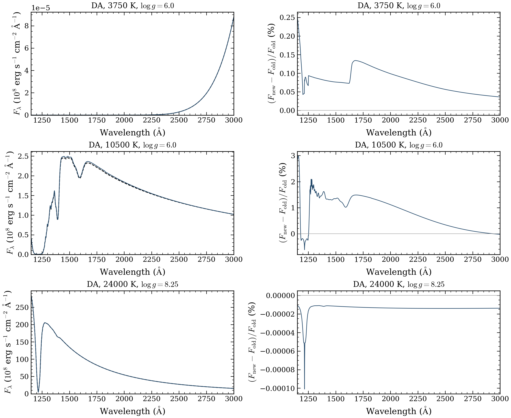
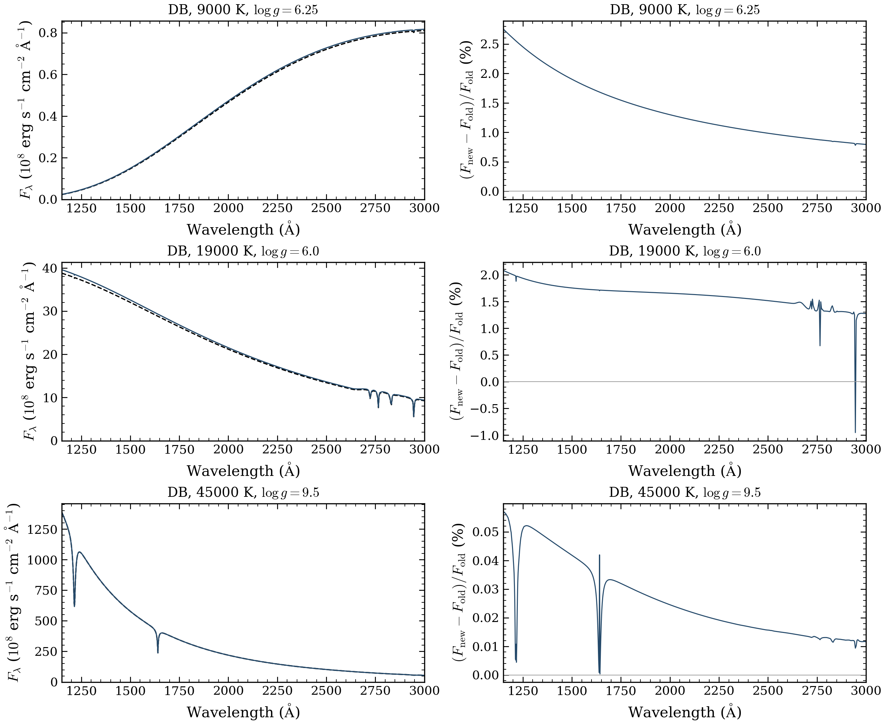

# DA and DB source replacements

All original DA, DB and DAB requests have now run once under frozen source `c103b53f28f3f37707572dbbc83a898807c4b683`. Required native numerical checks accepted **2,057 of 2,146 attempts**. No failed fresh model was retried. Older accepted spectra remain selected wherever a replacement failed.

| Family | Fresh numerical passes | Requests | Retained older spectra | Selected coverage |
|---|---:|---:|---:|---:|
| DA | 838 | 852 | 4 | 842/852 |
| DB | 566 | 638 | 55 | 621/638 |
| DAB/DBA | 653 | 656 | 3 | 656/656 |

The remaining DA/DB stage adds **1,394 accepted results from 1,478 attempts** to the unchanged earlier delivery. It changes exactly 1,394 selected rows and preserves 1,105 others, including every DAB and other-family row. All roles, including held-out tests, remain unchanged. Fifty-eight previously unsuccessful coordinates recover in this stage; the full campaign recovers 82. The global selected table has **2,454 completions from 2,499 requests**, including unchanged families outside DA/DB/DAB.

The [full outcomes](RESULTS.json) preserve unsuccessful fresh attempts separately from selected coverage. Raw wrapper errors remain unchanged; five are diagnosed separately as initial HNC-table domain stops and five as invalid optical-depth grids. Timeouts remain unfinished. Failed measured temperature-stationarity checks remain distinct from unmeasured checks. A small accepted damped step does not override a failed final unrestricted check. The stopping/check mismatch is observed; its root cause and a remedy remain unresolved.

Dense DB spectra retain their declared experimental fixed-depth Feautrier qualification and `release_ready=false`. Numerical acceptance does not establish physical accuracy, independent depth convergence, interpolation accuracy or agreement with observations. The cold-DB/Montreal discrepancies and earlier flux limits remain unresolved. Original DAB interpolation tests, including the historical 22/32 pass count, do not qualify this updated selection.

## Native spectrum comparisons

We compare absolute surface flux at the original vacuum wavelengths. Integrated absolute change is the integral of |new−old| divided by the old integrated flux within each band. No normalization, wavelength resampling or extrapolation is used.

| Family | Exact native pairs | UV median / maximum | Optical median / maximum |
|---|---:|---:|---:|
| DA | 804 | 0.00002289% / 0.920261% | 0.000009556% / 0.394994% |
| DB | 536 | 0.0320922% / 1.69233% | 0.0163102% / 0.798525% |

UV covers 1,150–3,000 Å; optical covers 3,000–10,000 Å. DA has 34 accepted results without an accepted predecessor; DB has 29. One DB 5,000 K/log g 7.5 pair has slightly different 4,000-point wavelength samples (maximum difference 1.86×10⁻⁹ Å). Both arrays are preserved, with no pointwise difference metric. The earlier [DAB comparisons](../da-db-dab-replacements-2026-10-15/README.md) remain unchanged: 634 pairs and 19 recoveries without an accepted predecessor. Across all three families, 1,974 pairs, 82 recoveries and one wavelength mismatch account for every accepted result.





Black dashed curves show accepted older spectra; blue curves show fresh spectra. Right panels show 100 × (new−old)/old. Flux units are physical surface flux; 10⁸ is axis scaling. Each row selects the largest integrated absolute UV change in an explicit temperature group, so these are deliberately selected examples. Panel scales vary. [DA captions](DA_CAPTIONS.md) and [DB captions](DB_CAPTIONS.md) give the coordinates, selection counts and limits. [DA optical PNG](da_all_optical.png), [DB optical PNG](db_all_optical.png), [DA UV PDF](da_all_UV.pdf), [DB UV PDF](db_all_UV.pdf), [DA optical PDF](da_all_optical.pdf) and [DB optical PDF](db_all_optical.pdf) are saved. Actual PNGs and rendered PDFs were inspected.

The [DA comparison records](DA_COMPARISON.json), [DB comparison records](DB_COMPARISON.json) and three-pair [DA](da-comparisons/COMPARISON.json) / [DB](db-comparisons/COMPARISON.json) inputs preserve the metrics. The portable [plotter](plot_native_pairs.py) reads the saved checksummed arrays; it performs no atmosphere calculation:

```bash
python docs/grids/da-db-continuation-2026-10-16/plot_native_pairs.py \
  --inputs docs/grids/da-db-continuation-2026-10-16/db-comparisons \
  --style docs/grids/grid-style.mplstyle --output output/db-comparison
```

## Source, resources and archives

The [source index](SOURCE_INDEX.json) records complete requested/effective settings and each actual native fingerprint. Experimental dense DB uses an explicitly defined request/source/table/spectrum identity because that workflow does not emit the ordinary fingerprint. The source is frozen at `c103b53`, which predates audited upstream `00503a0`. Static inspection found no direct DA/DB adaptive-solver or certificate change in those later commits; it did not measure cold-model equivalence. These results are not labeled as latest upstream.

All eight allocations are terminal. [Inclusive accounting](LATEST_ACCOUNTING.json) gives **12.5616319444 charged CPU node-hours**, including setup, fixed checks, idle time and the 29-second zero-science deployment failure. There is no live reservation. The self-imposed operational guard was 24 node-hours. The earlier DZ/DAZ campaign remains separately settled at 11.2247981771 node-hours.

The additive scientific archive preserves all new attempts, spectra, arrays, comparisons and figures. The existing exact-source bundle and all earlier archives are reused unchanged. [Archive hashes and inventories](ARCHIVES.json) and [actual downloaded draft-byte checks](DRAFT_DOWNLOAD_VERIFICATION.json) provide the exact counts. Releases remain unpublished drafts. **Private permanent HPSS archival is still pending normal interactive account setup.** Scratch is not permanent storage. No merge or release publication is included.
