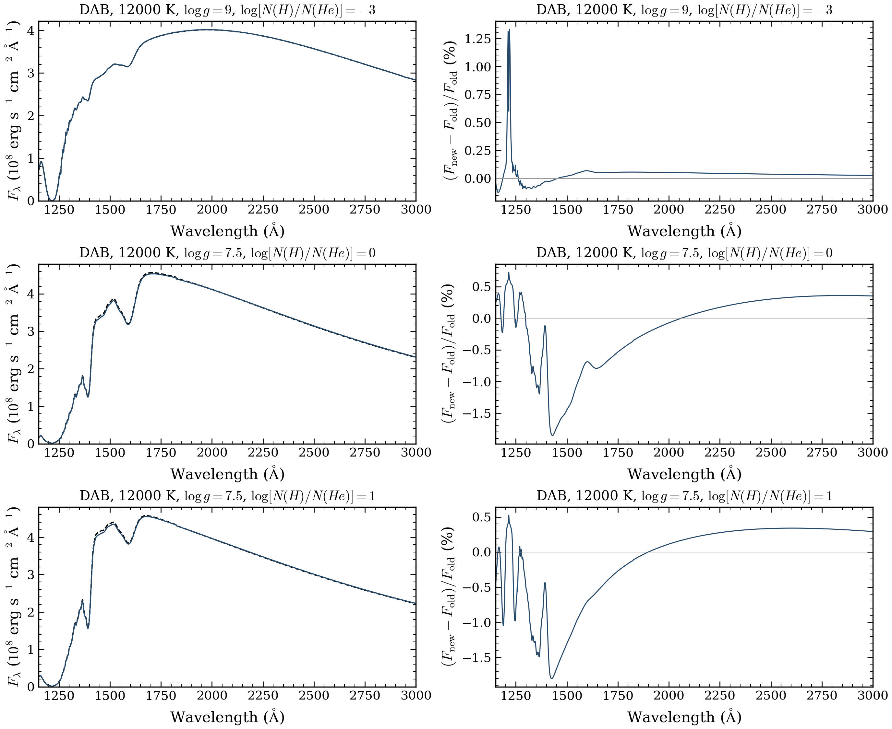
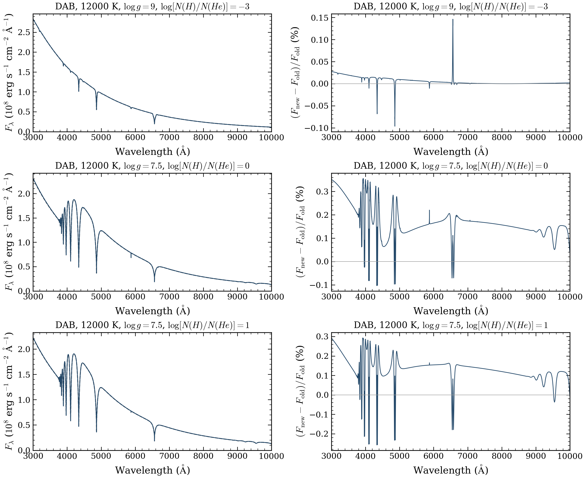

# DA, DB and DAB source replacements

The October 15 campaign used frozen source `c103b53f28f3f37707572dbbc83a898807c4b683`, which includes the merged DA, DB and DAB updates. It attempted 668 existing coordinates once and accepted 663 results under their recorded native numerical checks. All earlier products remain intact.

| Family | Fresh attempts | Accepted | Other outcomes | Bulk held without dispatch |
|---|---:|---:|---|---:|
| DA | 6 | 5 | One native nonconvergence | 846 |
| DB | 6 | 5 | One three-hour timeout | 632 |
| DAB/DBA | 656 | 653 | Two native nonconvergences; one worker crash | 0 |
| Total | 668 | 663 | Five failed or unfinished attempts | 1,478 |

The selected table now has **2,396 numerical completions from 2,499 requests**: DA 811/852, DB 594/638 and DAB 656/656. DAB combines **653 current-source spectra and three retained older accepted spectra**. DA and DB retain their other accepted older products. Exactly 663 mapped rows changed, 24 previously unsuccessful coordinates recovered, and 1,836 other rows stayed unchanged. Stable coordinate IDs and predictor/test roles were preserved. Failed fresh products were not adopted or retried.

The DA 4750 K/log g 7.75 pilot failed the unrestricted temperature-stationarity check: 0.0005976701 exceeded 0.0002. The DB 7000 K/log g 6 pilot reached its three-hour cap with unfinished thermal equilibration. Their dependent bulk runs were withheld. Two DAB requests, 30000 K/log g 6/log(H/He)=-2 and 40000 K/log g 7/log(H/He)=-3, lacked a measured, passed temperature-stationarity check. Their reported restricted corrections being below the tolerance does not supply that missing check. The DAB 12000 K/log g 8/log(H/He)=-3 worker exited with SIGSEGV below its time and memory caps; its cause remains unresolved. All five outcomes remain in [the results](RESULTS.json).

## Inputs and numerical scope

All calculations were public `run_model(..., require_convergence=True)` cold starts without checkpoints. Full original and effective configurations, selection policies, old inputs, outcome categories, time limits and RSS guards are in [the source index](SOURCE_INDEX.json). Coordinates, roles, production quality and numerical tolerances were preserved. The current DA defaults enable the convective seed and lower-boundary extensions. The current DAB defaults remove the 9000 K Allard cutoff and enable the pinned molecular closure; the exact effective configuration and H2–He table hash are recorded separately from the submitted configuration. These intentional source/default changes are part of the comparison.

The pilot used six physical workers, one numerical thread each, an 8 GiB per-model RSS guard and 90–180 minute limits. The DAB bulk used 128 physical workers for 478 requests and 64 for 172 requests, with one numerical thread, 3 GiB per-model RSS guards and 1.5–4.5 hour limits. Both allocations passed five fixed-spectrum checks before dispatch. Source, native extension, full inputs, cold starts, certificates, independent final-spectrum checks, arrays and file hashes were checked after settlement.

One accepted DB 5000 K/log g 8 pilot uses the **experimental fixed-depth dense-helium Feautrier workflow**. Its qualification covers the declared equations and independent wavelength, angular and source checks. It has 4,000 native spectrum points and remains `release_ready=false`; it has no established independent depth or full-physics qualification. Ordinary rows use their actual native effective-request fingerprint. This workflow lacks that fingerprint, so its row uses the explicitly defined request/source/table/spectrum delivery identity in the source index.

## Spectral changes

Comparisons retain identical native vacuum wavelengths and absolute surface flux. No normalization, resampling or extrapolation was applied. There are 639 matched old/new pairs across the bounded campaign and 24 accepted results without an accepted predecessor. DAB alone has 634 pairs and 19 new recoveries. The summaries combine the unchanged pilot receipt with separate bulk comparisons.

| DAB band | Matched pairs | Median integrated absolute change | Largest integrated absolute change |
|---|---:|---:|---:|
| UV 1150–3000 Å | 634 | 0.0002793% | 0.436560% |
| Optical 3000–10000 Å | 634 | 0.0001760% | 0.196603% |
| Full native 900–30000 Å | 634 | 0.0003871% | 0.315767% |

The integrated absolute change divides the integral of the absolute new-minus-old flux by the integral of the old flux in the stated band. Narrow spectral features can have larger pixel differences. [Combined statistics](COMPARISON_SUMMARY.json), [all bulk comparisons](BULK_COMPARISON.json) and [pilot comparisons](PILOT_COMPARISON.json) retain their exact denominators and source versions.



Black dashed curves show the previously selected spectra; blue curves show the fresh c103b53 results. Right panels show 100 (F_new-F_old)/F_old in percent. Each row is the largest integrated absolute UV change among 629 matched bulk pairs in one abundance group: log N(H)/N(He)<=-3, -2 through 0, and >= 1. The 18 accepted bulk requests without an accepted predecessor are separate. Flux is surface F_lambda in erg s^-1 cm^-2 Å^-1, displayed in units of 10^8, at native vacuum wavelengths. [UV PDF](dab_bulk_UV.pdf).



The same three models and curve definitions over 3000–10000 Å. Native sampling is preserved. [Optical PDF](dab_bulk_optical.pdf).

[The three-family pilot UV figure](pilot_UV.png), [UV PDF](pilot_UV.pdf), [optical figure](pilot_optical.png) and [optical PDF](pilot_optical.pdf) show the largest UV change among the matched DA 2, DB 3, DAB 5 pilot subsets. These pilot subsets are not full-family statistics. PNGs and actual rendered PDFs were inspected. The portable [bulk plotting script](plot_bulk.py) reads [the three selected comparison arrays](bulk-comparisons/COMPARISON.json); the [pilot script](plot_pilot.py) reads [its three arrays](pilot-comparisons/COMPARISON.json). Both take `--inputs`, `--output` and `--style`; they do not calculate atmospheres and recheck nine integrated metrics.

These full-source cold comparisons cannot isolate one fix or establish physical accuracy, agreement with observations, independent depth convergence or interpolation accuracy. The [earlier 32 DAB interpolation tests](../refinement-2026-10-11/README.md) remain original-source results; their 22/32 pass count does not qualify this updated selection. Their predictor/test roles remain unchanged, with the 32 tests outside the predictor mesh. The cold DB/Montreal disagreement and the merged DB/DAB flux limits remain unresolved.

## Archives and compute

The [unpublished contributor draft](https://github.com/cheyanneshariat/OpenWD/releases/tag/untagged-07e708e00cdc81a345a2) holds the 413,698,636-byte scientific archive and 239,853,561-byte source bundle. The science archive has 7,439 members, 1,309 NPZ files, 7,939 arrays and 666 native spectrum files: 663 accepted plus three exploratory failed spectra. The source bundle has 2,503 members: 2,500 locked source/data/test files, the actual Linux native extension, executed external H2–He CIA table and provenance. [Archive hashes](ARCHIVES.json) and [actual downloaded draft-byte verification](DRAFT_DOWNLOAD_VERIFICATION.json) confirm member, array and native-spectrum checks. The releases remain unpublished. **A private permanent HPSS copy is still pending normal account setup; scratch is not permanent storage.**

All four registered allocations are terminal. [Final accounting](FINAL_ACCOUNTING_2026-10-15.json) gives **4.6108680556 charged CPU node-hours**, including allocation setup, fixed checks and idle time. Actual scheduler billing is normalized by 256 with measured QOS factors of one. The initial 29-second environment-only failure dispatched no scientific model and remains charged. The pilot, fast and slow stages add 0.3834722222, 2.7044444444 and 1.5219444444 node-hours, respectively. There is no live reservation. The earlier DZ/DAZ campaign remains separately settled at 11.2247981771 node-hours.

The [selection before these replacements](../history/2026-10-15-before-DA-DB-DAB-replacements/README.md) and [three retained older DAB products](RETAINED_OLD_DAB_VERIFICATION.json) preserve the previous source identities. No merge, release publication, scientific retry or optional grid expansion is included.

To reproduce the bulk examples from the delivered arrays and exact style:

```bash
python docs/grids/da-db-dab-replacements-2026-10-15/plot_bulk.py --inputs docs/grids/da-db-dab-replacements-2026-10-15/bulk-comparisons --output output/dab-source-comparison --style docs/grids/da-db-dab-replacements-2026-10-15/plot-style.mplstyle
```

Use `plot_pilot.py` and `pilot-comparisons` for the pilot examples. The [bundled style](plot-style.mplstyle) preserves the delivered serif/mathtext approximation.
