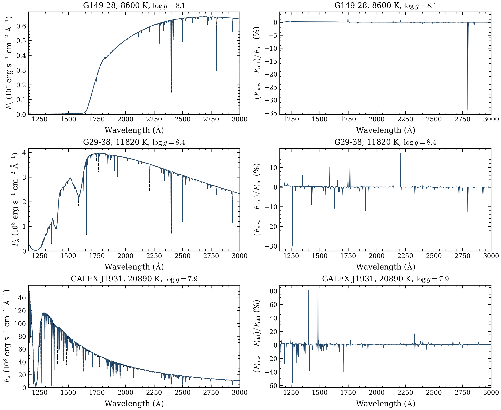
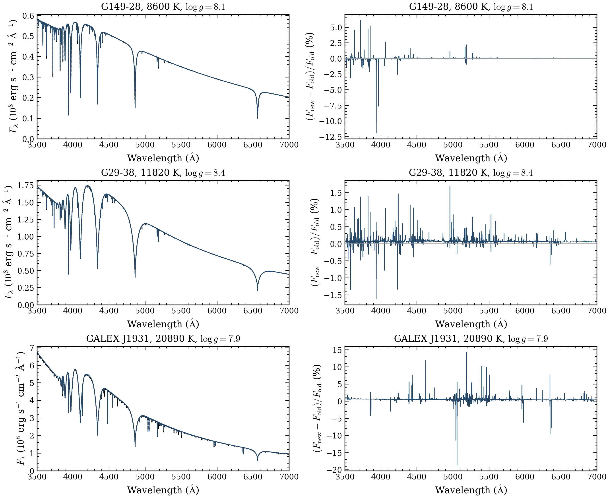

# Three updated DAZ anchors

All three existing DAZ requests passed new public cold starts under source
`e09e7daeaa0695d34e14b55c557ca770fad326af`. They replace the selected G149-28,
G29-38 and GALEX J1931 products from `cfe2d2ff`. The grid still contains
**three DAZ completions from three requests** and **2,368 numerical completions
from 2,499 total requests**. No coordinate was added.

The calculations preserve the old temperatures, gravities, full N(Z)/N(H)
patterns, alpha 0.7 and standard resolution. They adopt the updated Barklem
neutral-H widths, Kurucz electron Stark widths and added Si II transitions.
H2 Lyman/Werner lines remain off. Source, data, runtime, canonical inputs,
cold starts, measured native atmosphere checks and independent spectrum
source equations were verified. All old products remain unchanged.

## Old and new spectra

Every pair has the same **18,901 native wavelengths**. Fluxes are absolute
surface values; no normalization, extrapolation or resampling was used.
The integrated change is the integral of the absolute new-minus-old flux,
divided by the integral of the old flux in the stated band. The peak change
uses each old pixel flux as its denominator. These quantities measure model
differences, not errors against observations.

| Anchor | Temperature (K) | logg | UV integrated change, 1150–3000 Å | Optical integrated change, 3000–10,000 Å | Largest UV pixel change | Local wall time |
| --- | ---: | ---: | ---: | ---: | ---: | ---: |
| G149-28 | 8600 | 8.1 | 0.119551% | 0.023902% | 33.7318% | 3.93 min |
| G29-38 | 11,820 | 8.4 | 0.379264% | 0.073148% | 30.1338% | 4.33 min |
| GALEX J1931 | 20,890 | 7.9 | 2.298116% | 0.537820% | 81.5073% | 2.54 min |



Left panels show the old black dashed spectrum and the new blue solid spectrum.
Right panels show 100 times the new-minus-old flux divided by the old flux.
The wavelength range is 1150–3000 Å. Small integrated changes can coexist with
large changes in narrow metal-line cores. Native UV sampling is retained;
these are not newly resolved COS profiles. [PDF](daz_UV.pdf).



The same curve definitions apply. Panels show 3500–7000 Å; the table uses the
wider 3000–10,000 Å optical band. Physical axis units are scaled by 10^8 for
readability; neither spectrum was fitted or renormalized. [PDF](daz_optical.pdf).

This compares full source/data versions and two cold atmosphere calculations.
It cannot isolate a single metal-profile change. Runtime also changes with
machine and packing, so these local timings do not establish a source-only
speedup. Peak RSS was 0.922–1.027 GiB, with one worker and one numerical thread.

## Scope and retained failure

The native certificates apply to the declared standard depth grid. Independent
depth convergence, interpolation accuracy, observational agreement and
abundance recovery remain unverified. These three anchors do not define a
general DAZ parameter or abundance grid. Known line-wing limitations remain
relevant; rerunning a spectrum does not establish that those physics are fixed.
See [PR24](https://github.com/kareemelbadry/OpenWD/pull/24) and
[PR25](https://github.com/kareemelbadry/OpenWD/pull/25) for the source changes.

The earlier optional DA/H2-off production pilot reached its 4 GiB RSS guard
after 935.24 seconds, with sampled peak RSS 5.546 GiB. It has no adopted verified
spectrum. Five follow-on requests in that original tier were never dispatched.
The three required DAZ replacements are separate fresh attempts on the old
native wavelength grid. The DA case was not retried. An earlier incompatible
Python import remains a separate setup failure before any model calculation.
Native checks and physical inputs were not weakened.

Thus the local scientific attempts are **three DAZ numerical completions and
one optional DA resource stop**. Historical not-started records are retained
and do not add scientific attempts. The broader [grid plan](../update-plan-2026-10-12/README.md)
remains conditional on validation and measured resource costs.

## Verification and download

[Results and certificates](RESULTS.json), [full-band comparison metrics](COMPARISON.json),
and [archive verification](ARCHIVE_VERIFICATION.json) are saved. Verification
read nine old/new native NPZ files with 60 arrays and six old/new spectra.
The archive adds three comparison NPZ files: **12 NPZ files and 69 arrays**
were read after packing, with **115 member hashes** checked.

The compact archive is `OpenWD-DAZ-replacements-20261012.tar.gz`, **5,316,451 bytes**,
SHA256 `a92037ec121eb86b46314511f941b87eaeeb9da3d087a005a429df925537c4c7`.
Local and private persistent copies match. Downloaded draft bytes, all 115 members,
12 NPZ files, 69 arrays and the three accepted spectra also passed verification. The contributor
[development draft](https://github.com/cheyanneshariat/OpenWD/releases/tag/untagged-7ff525d5458bd6c8caf8)
remains unpublished and requires contributor access.

These calculations used the local computer. **Added charged NERSC node-hours
are zero.** The separate DZ batch remains queued. Its reserved hours must not
be reported as actual charges.

To reproduce the figures from the checked arrays, without running a model:

```sh
python plot_comparison.py --inputs . --output reproduced --style ../grid-style.mplstyle
```

The script checks each input hash and rechecks all nine integrated metrics.
The delivered PNGs and rendered PDFs were inspected. Figure text contains
only titles, axes and ticks; definitions and limitations are in these captions.
