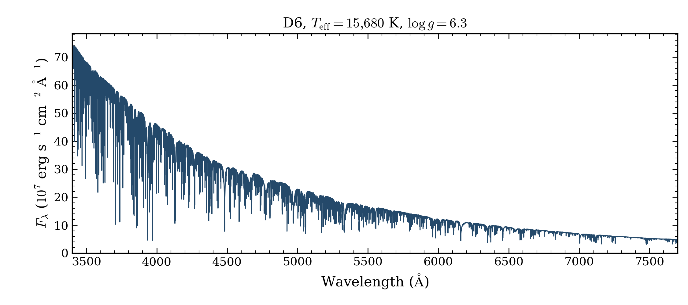

# DB and D6 diagnostic outcomes

The updated-source D6 model passed its required native atmosphere and independent
final-spectrum checks in **4.388 hours**. Both DB models and the original-source
D6 control reached their eight-hour limits. These are four attempts at two
existing coordinates. The accepted D6 replaces its earlier selected timeout;
the mesh now has **2,367 numerical completions from 2,499 requests**.

| Request | Source | Outcome | Wall time, h | Last logged local energy |
|---|---|---|---:|---:|
| DB 7,000 K/log g 6 | c8329d86, time-only control | Eight-hour timeout | 8.001 | 0.3113 |
| DB 7,000 K/log g 6 | 14e2067 | Eight-hour timeout | 8.001 | 0.3692 |
| D6 15,680 K/log g 6.3 | cfe2d2ff, time-only control | Eight-hour timeout | 8.001 | 0.001373 |
| D6 15,680 K/log g 6.3 | 14e2067 | Native checks passed | 4.388 | 0.00002269 |

All source branches passed the required fixed-spectrum preflight. Each atmosphere
started cold, with the full physical request, native limits and tolerances unchanged.
The [requests](requests.csv), [full configurations and source locks](plan.json),
[native outcomes](native-models.json) and [measured log comparison](diagnostic-comparison.json)
retain the attempted configurations and source identities.

## What the controls show

Extra time alone did not complete either original-source control. The DB energy
residual stayed large: in the last logged hour it changed from 0.3153 to 0.3113
for the control and from 0.2653 to 0.3692 for updated source. Neither supports a
blanket extension of stalled DB cases.

The original-source D6 changed phase late and its last logged energy fell from
0.04076 to 0.001373 during the last hour. Its last fractional temperature correction
was still 0.03282. It has no final native certificate or accepted spectrum. This
late progress could motivate a future bounded time test after fresh resource
accounting; it does not establish completion or predict how much more time is needed.

Updated-source D6 completed, but the full source and shipped data changed between
versions. Changes include Rosseland-probe reuse and thermal policy. This comparison
cannot assign the improvement to one change. The unfinished controls provide no
qualified spectra for a spectral agreement measurement.

## Accepted D6 spectrum

The blue curve shows the native absolute surface flux on its saved vacuum
wavelength grid, without normalization, resampling or extrapolation. Its full
nine-element abundance pattern is unchanged and recorded in the request above.
The timed-out models have no accepted final spectra and are listed in the table.
The [PDF](d6_spectrum.pdf) and [reproduction script](../plot_d6_diagnostic.py) use the
same verified product.

The D6 certificate required all-depth flux, local energy, temperature stationarity,
source closure and lower-boundary screening. Its final local energy was
2.269e-5 and temperature stationarity 2.547e-5. The independent final-spectrum
source check also passed. These checks apply to the declared equations on the
structure grid. Independent depth convergence, external physical accuracy and
release readiness remain unverified.

## Archive

The compact archive retains all four attempts, raw logs, exact settings, source
locks, preflight records and the accepted structure and spectrum. It has 59
hashed members, one NPZ with nine native arrays and one accepted spectrum.
Local and private persistent copies match. The [archive receipt](ARCHIVE_VERIFICATION.json)
and [SHA256SUMS](SHA256SUMS) identify its bytes. The contributor draft release
[grid-preview-2026-10-12-diagnostics](https://github.com/cheyanneshariat/OpenWD/releases)
remains unpublished and requires fork write access. Earlier archives and attempts
are preserved.

[Current grids](../README.md) · [Failure review](../failure-review-2026-10-11/README.md)
