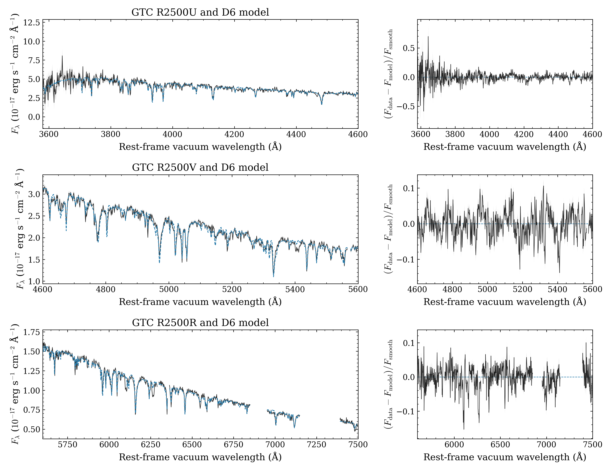

# New D6 model compared with GTC observations

The accepted D6 model reproduces many of the observed metal absorption features
of **SDSS J1637+3631**, with remaining differences in line depths and profiles.
This comparison uses a new reduction of the actual GTC exposures. It uses
neither a digitized figure nor the authors' original reduced coadd.

The model is one benchmark point at **15,680 K, log g 6.3**, with the nine-element
composition from [Hollands et al. (2025)](https://doi.org/10.1093/mnras/staf950).
Those parameters were fitted to these observations with the Koester code. Here
the parameters and abundances are held fixed. This tests OpenWD at that published
solution; it does not independently recover stellar parameters or establish a
full D6 grid. Earlier OpenWD D6 benchmarks already exist.

## Model and data



Black curves show the GTC coadds. Dashed blue curves show the accepted
source-`14e2067` model, convolved with a Gaussian at resolving power **R = 2,500**.
Grey bands show nominal one-sigma statistical errors. For display, pairs of
adjacent pixels and their model predictions are averaged with inverse-variance
weights. Right panels show data minus model, divided by a smooth continuum.
Gaps exclude the recorded sky and telluric regions. All explanatory text is in
this caption; the figure contains only titles, axes and ticks.

The model surface flux is multiplied by a fifth-order smooth data/model ratio
fitted separately to each grism's 50-Å median bins. That scaling absorbs the
unknown solid angle, extinction and smooth calibration differences. The flux
axis therefore does **not** demonstrate absolute continuum accuracy or measure
distance or radius. The saved native surface-flux spectrum is unchanged.

The pipeline wavelengths are already vacuum and heliocentric. The display shifts
them to the stellar rest frame at the fixed published velocity **+384 km/s**;
no velocity is fitted and no second air-to-vacuum correction is applied. The
flux-density coordinate Jacobian is applied with that wavelength shift.

[PDF](d6_gtc_comparison.pdf) · [Measured comparison](COMPARISON.json) ·
[Observed arrays](gtc-coadds.npz) · [Reproduction script](plot_d6_gtc.py)

The NPZ retains each full grism coadd separately. Keys have `blue_`, `green_`
or `red_` prefixes: `wave` is heliocentric vacuum wavelength in Å, `flux` is
in units of 10⁻¹⁷ erg s⁻¹ cm⁻² Å⁻¹, `ivar` is inverse variance in the squared
reciprocal flux units, and `mask` is one for a good pixel. Rest-frame conversion,
comparison-window selection and sky/telluric masks occur only in the script.

## Measured residuals

The table uses all good **unbinned** coadd pixels in the stated windows after
the sky/telluric masks. No pixels are discarded because of disagreement with
the model. RMS is measured relative to the smooth scaled-model continuum,
after the continuum fit. These are conditional residuals, not a reduced
chi-square, pointwise relative errors or pass/fail thresholds.

| Grism | Rest-frame vacuum window, Å | Good pixels | RMS residual | Nominal noise RMS |
|---|---:|---:|---:|---:|
| R2500U | 3,580–4,600 | 1,712 | 12.74% | 10.26% |
| R2500V | 4,600–5,600 | 1,231 | 4.39% | 2.47% |
| R2500R | 5,600–7,500 | 1,470 | 3.90% | 2.09% |

The blue aggregate includes the noisy 3,580–3,750 Å region. A separate
[noise breakdown](BLUE_NOISE_REVIEW.json) gives 26.61% residual RMS there,
with 22.57% nominal noise RMS, and 7.07% residual RMS over 3,750–4,600 Å,
with 4.71% nominal noise RMS. The full blue denominator remains in the table.
Changing R from 2,200 to 2,800 changes these aggregate RMS values by less than
0.08 percentage point. That limited resolution test does not resolve individual
line-profile differences.

## Reduction and calibration checks

[GTC programme GTC71-19A](https://gtc.sdc.cab.inta-csic.es/gtc/) contains twelve
1,200-second J1637 exposures from the 2019 June 8 observing night: three each
with R2500U and R2500V, and six with R2500R, through a 0.6-arcsec slit.
The archive's reduced-data query returned no products. We downloaded all twelve
raw exposures and their associated arcs, five flats per grism, GD153 standards
and eleven bias frames from the following night. The
[archive exposure list](archive-exposures.csv) and [input hashes](input_manifest.json)
identify the actual files.

PypeIt 2.0.1 reduced detector 2, with one stellar trace per exposure. Bias,
flat, arc, sky and cosmic-ray processing precede extraction. The twelve
[extraction checks](extraction_verification.json) record masks, statistical
variances, narrow trace widths, wavelength ranges and heliocentric corrections.
The grism coadds use inverse-variance weights, constant median exposure scaling
and three-sigma outlier rejection. Median signal-to-noise is about 22, 39 and
48 per pixel over the full blue, green and red coadds.

The first R2500V standard extraction rejected valid pixels during profile
fitting. A separate box extraction of GD153 removed the resulting response
artifacts; the science extractions were retained. The standard's raw pixels
were not saturated. The R2500V red edge still has unreliable response, so
R2500R supplies the comparison above 5,600 Å. The complete untrimmed coadds
remain in the observed array file. Blue and red standards use their checked
optimal extractions. Flux calibration uses the archived GD153 reference and
the La Palma extinction curve; telluric bands are masked rather than corrected.

Arc-fit RMS values are 0.117, 0.082 and 0.135 pixel, or approximately 0.068,
0.066 and 0.140 Å. The separate [sky-line check](sky_zeropoint_check.json)
finds offsets from −0.25 to −0.04 Å in green and +0.17 to +0.54 Å in red.
The default pipeline applies no spectral-flexure correction. These offsets
are retained as a wavelength-calibration limitation rather than adjusted to
improve agreement with the model. The blue zero point has no comparable
sky-line check. This comparison cannot support a new precise radial velocity.

The isolated reduction environment also required a spelling correction from
`nsippet` to the declared `nsnippet` wavelength parameter for R2500U. Its
value remains one. The [patch receipt](pypeit-typo-fix.json),
[exact spelling patch and reduction configurations](reduction-configs/),
and [package versions](pypeit-environment.txt) preserve that change. Existing
OpenWD environments and native model settings were untouched. See the
[PypeIt OSIRIS guide](https://pypeit.readthedocs.io/en/release/spectrographs/gtc_osiris.html)
for the detector and standard-star setup.

## Remaining limits

The statistical error bands omit flux-calibration errors, uncertainty in the
fitted continuum, wavelength zero points, resampling covariance and model
uncertainty. Residuals above the nominal noise remain, especially in individual
line depths and profiles. The comparison does not isolate an opacity or
broadening defect. It uses one fixed LTE atmosphere; independent depth
convergence, abundance/temperature/gravity recovery, ultraviolet agreement and
full physical accuracy remain unverified. Its warm, H/He-free scope does not
qualify cooler molecular atmospheres or hotter regimes that need NLTE.

To reproduce the figure, use the unchanged diagnostic model archive and run:

```bash
python plot_d6_gtc.py --model OpenWD-DB-D6-diagnostics-20261012.tar.gz --output figures
```

The script checks the observed-array and native-spectrum hashes before plotting.
The [verification receipt](VERIFICATION.json) records the input accounting and
PNG/rendered-PDF inspection. This adds no model calculations or mesh coordinates.

Based on data from the GTC Archive at CAB (CSIC-INTA), part of the Spanish
Virtual Observatory project. The archive requests acknowledgement of support
from MCIN/AEI through grant PID2023-146210NB-I00 in resulting publications.

[Native D6 and diagnostic outcomes](../README.md) · [D6 model guide](../../../models/D6.md)
