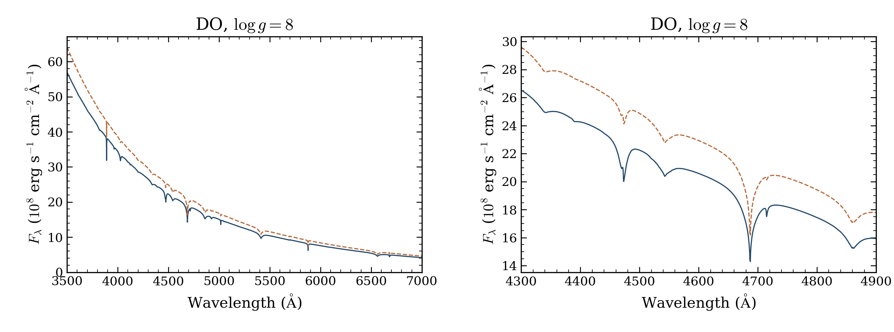

# DO temperature sequence and source control

The new **70,000 K/log g 8** DO model passed the required native checks in
76.87 minutes. A fresh **60,000 K/log g 8** control passed in 91.39 minutes.
This tier brought the mesh to **four accepted DO coordinates from seven requests**.
The [final extension](../hot-extension-2026-10-12/README.md) now brings DO to five of seven.
The control repeats an existing coordinate and does not enlarge the grid.



The solid blue curve is 60,000 K; the dashed orange curve is 70,000 K.
Both have log g 8. The left panel shows 3,500–7,000 Å; the right panel
shows 4,300–4,900 Å. These are absolute surface fluxes at each model's
native vacuum wavelengths, without normalization, smoothing or resampling.

[Spectrum PDF](do_temperature.pdf) · [Inputs and outcomes](requests.csv)
· [Native checks and hashes](native-models.json)

## Matched source control

The 60,000 K spectrum is **byte-for-byte identical** to the earlier `c8329d86`
spectrum over the full saved 900–30,000 Å band. All native wavelengths match.
Its maximum relative and integrated absolute differences are both zero.
This tests one matched coordinate; it does not qualify the whole grid.

Both current runs use `70bca78e82e7b7dd5860ca3e337bd1f83919e09a`.
The earlier control took 272.91 minutes. Code version, node and worker packing
changed, so these timings cannot isolate one implementation change.
[The source comparison](control-comparison.json) retains both spectrum hashes.
Earlier attempts and their source records remain archived.

## Qualification and downloads

Both public cold starts retained their exact standard configurations, native
iteration limits and acceptance tolerances. The atmosphere certificates and
independent fixed-source spectrum checks passed. This is restricted H/He NLTE
without charge feedback. The formal check uses identical mass volumes; independent
depth convergence and physical accuracy remain unverified.

The compact archive includes both native structures and spectra, all raw attempts,
source/input locks and preflight records. All 43 member hashes, four native NPZ
files and 38 arrays were checked. Local and private persistent copies match.
The contributor download is an unpublished draft.

[Archive verification](ARCHIVE_VERIFICATION.json) · [SHA-256](SHA256SUMS)
· [Contributor drafts](https://github.com/cheyanneshariat/OpenWD/releases)

```bash
python docs/grids/plot_do_temperature.py \
  --archive OpenWD-DO-continuation-20261012.tar.gz \
  --output output/do-temperature
```

[The plotting script](../plot_do_temperature.py) checks archived spectra and hashes;
it performs no atmosphere calculation.

The earlier DO 90,000/120,000 K six-hour timeouts remain unfinished.
The 60,000 K/log g 9 coordinate subsequently passed in the final extension.
[Earlier hot outcomes](../hot-2026-10-12/README.md) · [Current grids](../README.md)
