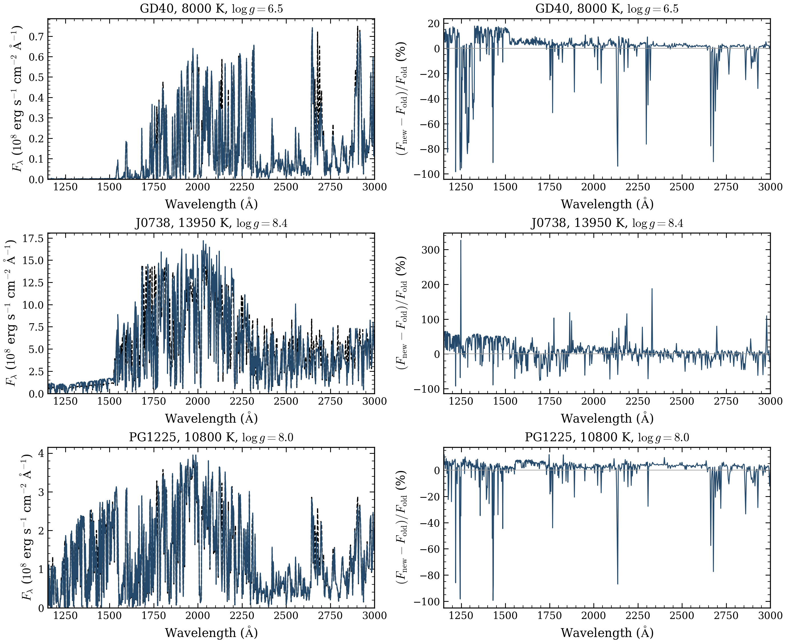
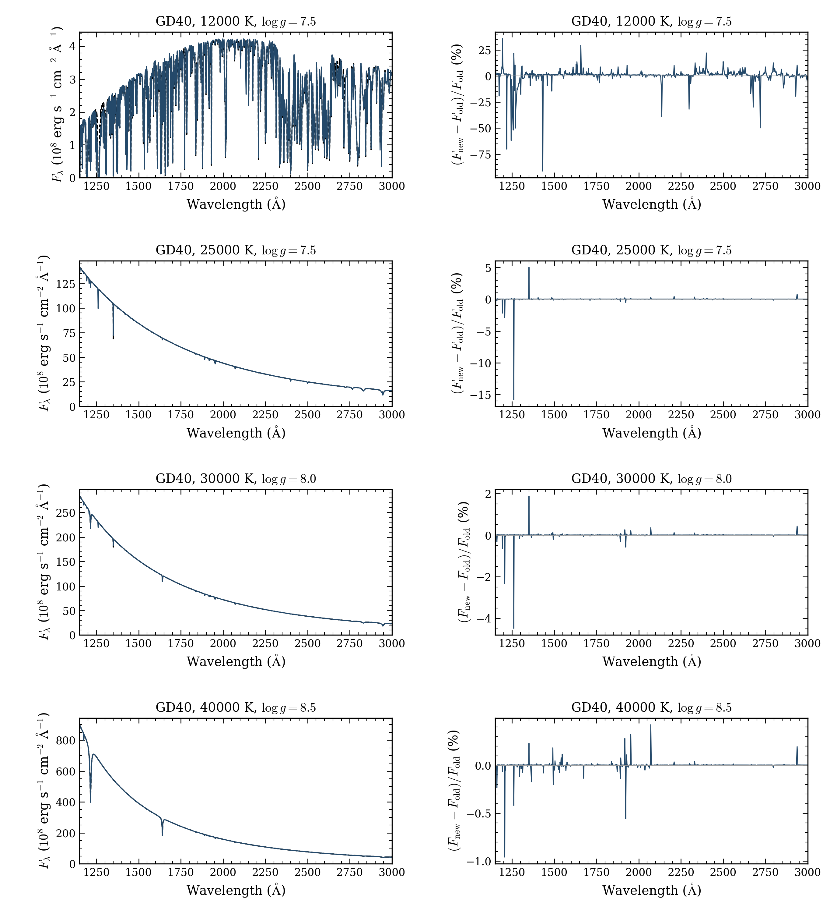

# DZ source replacements

**312 of 322 fresh production requests passed** the native atmosphere certificate
and independent final-spectrum checks. Seven reached their time limits, two
failed numerical convergence checks, and one worker crashed. Every coordinate
ran once; failed models were not retried. Earlier attempts and products remain intact.

The selected DZ grid now has **321 numerical completions from 322 coordinates**:
312 updated-source results and nine retained accepted older spectra. Four
previously unsuccessful coordinates now pass. An older accepted spectrum remains
selected wherever its fresh attempt failed. The selection is therefore mixed-source,
with one remaining numerical failure. Overall coverage is **2,372/2,499**.

[All outcomes, settings and certificates](RESULTS.json) ·
[Source and selected-product index](SOURCE_INDEX.json) ·
[Dated selection before replacement](../history/2026-10-13-before-DZ-replacements/README.md)

## Runs and verification

| Stage | Scientific attempts | Numerical completions | Timeouts | Nonconvergences | Interruptions |
|---|---:|---:|---:|---:|---:|
| Pilot, 59720137 | 8 | 8 | 0 | 0 | 0 |
| Bulk, 59725915 | 310 | 300 | 7 | 2 | 1 |
| Final four, 59733756 | 4 | 4 | 0 | 0 | 0 |
| Total | **322** | **312** | **7** | **2** | **1** |

The bulk retains four planning records marked not started. Those coordinates
ran in the final tier; the records are not four additional scientific attempts.
Registration 59733708 was cancelled while pending, before allocation or model
dispatch. Its scheduler receipt correction did not retry a model.

Every stage used source **1386029e9a911d9d6f7977cfb30af2f24e5f7545**, public cold
starts, the original temperatures, gravities, full abundances, alpha and production
quality, and unchanged native iteration limits and tolerances. New defaults include
Kurucz electron Stark broadening, unified Si II–He profiles and additional Si II
Kurucz transitions. DA 5,000 K, DB 22,000 K, DZ J0738 and DZ PG1225 fixed-spectrum
checks passed before dispatch in each job. Workers used one numerical thread,
distinct physical cores and 3 GiB RSS guards. Model limits were one to three
hours in the bulk and three hours in the pilot and final tier.

Independent collection verified source/native hashes, exact requests, cold starts,
selection policies, native certificates, saved arrays, independent final-spectrum
sources, and matching remote/local bytes. The pilot verified 96 files and 72 arrays
in eight NPZs; the bulk verified 3,389 files and 2,718 arrays in 302 NPZs, including
two exploratory failed outputs; the final tier verified 52 files and 36 arrays
in four NPZs. Failed outputs are retained and not adopted. The full source bundle
verifies 2,191 locked source/data/test files and the actual Linux native extension.

The final four took 41.01–49.16 minutes, with peak RSS 0.831–0.877 GiB. Machine,
packing and source changes prevent a source-only speedup claim. The two numerical
failures retain failed stationarity or solver checks. The SIGSEGV cause remains
unresolved. Timeouts are unfinished calculations.

## Exact old/new spectra

**308 accepted spectra have an accepted predecessor at identical native
wavelengths.** Four recovered cases have no accepted old spectrum. Comparisons
use absolute surface flux without normalization, resampling or extrapolation.
Earlier selected products passed unchanged file-hash checks.

The metric divides the integral of the absolute new-minus-old flux difference
by the integral of the old flux. It measures model change, not observational error.

| Band (vacuum Å) | Matched spectra | Median integrated absolute change | Maximum |
|---|---:|---:|---:|
| UV, 1150–3000 | 308 | 0.616382% | 17.592554% |
| Optical, 3000–10000 | 308 | 0.137889% | 8.880420% |
| Full native band, 900–30000 | 308 | 0.347982% | 12.677858% |

[Combined metrics](COMPARISON_SUMMARY.json) ·
[304 pilot/bulk comparisons](BULK_COMPARISON.json) ·
[Four final comparisons](TAIL_COMPARISON.json)

Black dashed curves are accepted older spectra; blue curves are updated models.
Right panels show 100 × (new − old)/old at identical native wavelengths. Each
metal pattern shows its largest integrated UV change among the 304 pilot/bulk
matches. Titles give temperature and gravity. Flux is surface Fλ in the stated
physical units; 10⁸ is axis scaling only. These are synthetic comparisons, not
observational abundance fits. The [optical figure](bulk_optical.png) covers
3500–7000 Å; integrated optical metrics use 3000–10000 Å.
[UV PDF](bulk_UV.pdf) · [Optical PDF](bulk_optical.pdf).

The four final GD40 cases are ordered by temperature. Curves and differences use
the definitions above. Their maximum integrated UV change is 2.476025%.
[Optical figure](tail_optical.png) · [UV PDF](tail_UV.pdf) ·
[Optical PDF](tail_optical.pdf). Both PNGs and rendered PDFs were inspected;
all twelve integrated metrics were rechecked.

Full-source cold-model differences cannot isolate one fix. Numerical certificates
do not establish physical accuracy, independent depth convergence, interpolation
accuracy or unbiased abundance recovery. The earlier cool-DZ synthetic UV
disagreement remains unresolved; it is not an observational benchmark.

## Archives and cost

The [bulk development draft](https://github.com/cheyanneshariat/OpenWD/releases/tag/untagged-5d7ab766bb9dadfbc6dd)
holds the 375,865,625-byte archive, SHA256
254a92783745016cb855f29d2d26af691e0dd9f6b0e71aef75f533c16426908f.
All 3,729 members, 606 NPZs and 3,630 arrays passed verification. Its source bundle
contains locked source/data files and the actual Linux extension. Local and
private persistent copies match. Full downloaded draft bytes passed member,
array and native-spectrum checks through a stream after a partial download filled
the disk. That incomplete download remains preserved.

The [final-tier development draft](https://github.com/cheyanneshariat/OpenWD/releases/tag/untagged-d40ef95c6da2bbadffa5)
holds the 4,106,701-byte archive, SHA256
72a0f7b000821bb7449b0f5b98a4de5457ec1255053b9cfc8324f61b2cb419bf,
with 94 members, eight NPZs and 48 arrays. It also carries the unchanged
2,648,677-byte pilot archive, SHA256
63c02f1374d9451259a1b78cd9f5b26ea2146c737f7f019d807679c8dd7cdf35.
The pilot and bulk were not recalculated, recollected or archived again.
Draft assets require contributor access and remain unpublished.

[Bulk archive checks](BULK_ARCHIVE.json) · [Actual bulk draft download](BULK_DRAFT_DOWNLOAD.json) ·
[Final archive checks](TAIL_ARCHIVE.json) · [Final and pilot draft downloads](TAIL_DRAFT_DOWNLOAD.json)

All nine registered allocations are terminal. **Final inclusive charge is
11.2247981771 CPU node-hours, within the 13-hour cap.** The original five-job
phase used 7.0207074653, the pilot 0.15138671875, the bulk 3.9994444444, and
the final tier 0.05325954861. The cancelled pending registration adds zero.
[Accounting](FINAL_ACCOUNTING.json) uses full elapsed allocation time, billing/256
and actual QOS factors of one, including setup, checks and idle time.
No live reservation remains. Optional grid expansion has not been submitted.

## Reproduce the plots

The compact inputs reproduce displayed curves without a model calculation:

    python plot_bulk.py --inputs bulk-comparisons --output reproduced-bulk --style ../grid-style.mplstyle
    python plot_tail.py --inputs tail-comparisons --output reproduced-tail --style ../grid-style.mplstyle

Each script verifies input hashes and integrated metrics. Full matched arrays,
attempts, settings and source locks remain in the archives. Plot text contains
only titles, axes and ticks; curve definitions belong in these captions.
