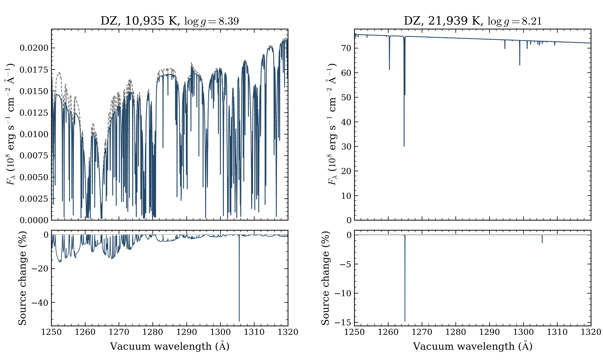
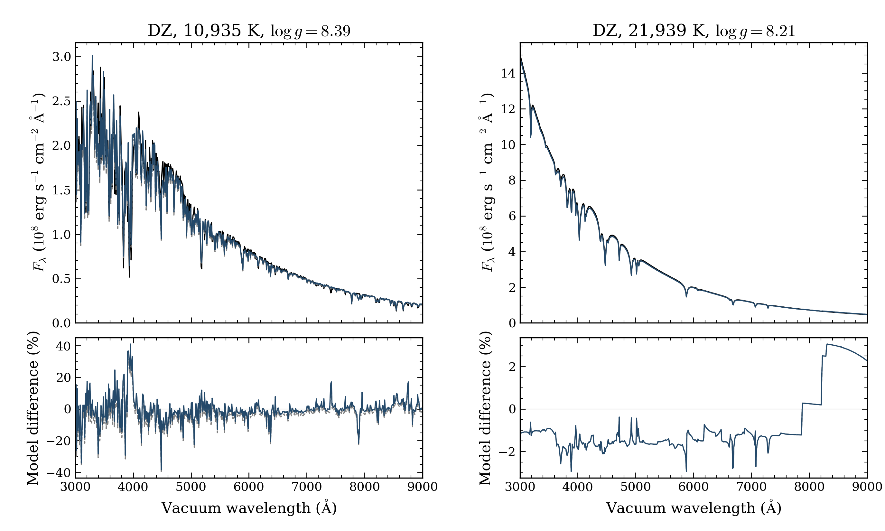

# Small DZ validation after the October 12 update

Both updated-source DZ benchmarks passed native atmosphere and independent
final-spectrum checks from public cold starts. The **10,935.02 K/log g
8.38524868** case completed in **9.35 minutes**; the **21,939.00 K/log g
8.21005085** case completed in **9.52 minutes**. These repeat two existing
collaborator benchmark coordinates. They add no points to the selected grid.

The tests use source `1386029e9a911d9d6f7977cfb30af2f24e5f7545`, after
[PR25](https://github.com/kareemelbadry/OpenWD/pull/25). That update changes
DZ Si II–He UV profiles, adds missing Kurucz Si II transitions between existing
levels, and includes host ions in the metal microfield. DAZ neutral-H broadening
also changes upstream; this tier tests DZ only. All supported abundances,
temperature, gravity, H/He, standard numerical limits and tolerances were retained.
No stellar parameters or flux normalization were fitted.

## Compare spectra before solving new structures

We first synthesized each saved original structure under `70bca78` and `1386029`.
Each source restored temperature, pressure, mass density, electron density,
column mass and optical depth within the recorded tolerance. Both used the same
14,376 vacuum-wavelength points: the earlier output grid plus a common
0.05 Å sampling of 1,150–1,500 Å. Thus no wavelength interpolation separates the
old and new OpenWD curves. The fixed spectra passed independent source checks;
they do not certify equilibrium under the changed physics.



Grey dashed curves use `70bca78`; blue solid curves use `1386029`. Each pair
uses the same saved structure and physical input composition. The lower panels
show 100 × (updated/baseline − 1), with the baseline absolute surface flux as
the denominator. The figure shows 1,250–1,320 Å. Peak line-core differences can
be much larger than the integrated band difference.

[UV figure PDF](fixed_uv.pdf) · [Full 1,150–1,500 Å view](fixed_full_uv.png)
· [Full UV PDF](fixed_full_uv.pdf) · [Fixed-spectrum metrics](FIXED_RESULTS.json)

| Fixed original structure | Maximum sampled UV change | Integrated absolute UV change | Integrated absolute optical change |
|---|---:|---:|---:|
| 10,935 K | 51.215% | 0.545146% | 0.00460247% |
| 21,939 K | 14.874% | 0.00258478% | 0.000001342% |

UV metrics use 1,150–1,500 Å (7,578 sampled points). Optical metrics use
3,000–9,000 Å (4,760 points). Integrated absolute differences divide the integral
of |updated − baseline| by the integral of the baseline. No normalization,
continuum fitting or extrapolation was used. The cool UV maximum occurs near
1,305.60 Å; the warm maximum occurs near 1,265.00 Å. The cool optical maximum is
5.522% at a sampled line feature, despite its small integrated difference.
These are changes between models, not accuracy estimates against observations.

We then solved two new atmospheres from public cold starts. Each retained its
original supported composition and required native convergence. Neither used a
saved atmosphere as its initial state. Both models passed all-depth flux,
local energy, stationarity, source closure and lower-boundary checks.
Final-spectrum independent source errors were
6.41 × 10⁻¹⁶ and 8.62 × 10⁻¹⁶. No native tolerance or iteration limit was weakened.

## Compare with the collaborator spectra

The external references are **collaborator synthetic models, not observations**.
Their exact code version and physical prescriptions remain unknown. The earlier
conversion is retained: physical air wavelengths to vacuum, Fν = 4πHν, then
Fλ per Å = Fνc/λ². Its wavelength/frequency integral checks passed. OpenWD omits
Li, Be, Cl and K from these input compositions because they were unsupported in
the existing benchmark setup; their spectral effect is not proven negligible.



Black curves show the collaborator models; grey dashed curves show `70bca78`
synthesis on the saved historical structures; blue curves show the updated
public cold-start models. Every displayed curve uses 10 Å flux-averaged bins.
The lower panels divide each OpenWD-minus-reference difference by the
collaborator's absolute surface flux in that bin. There is no continuum fit.
The warm reference comparison has visible steps above about 7,800 Å; their
origin is not established and they remain in the reported denominator.

[Optical figure PDF](cold_optical.pdf) · [All comparison metrics](RESULTS.json)

| Case and band | Baseline fixed RMS | Updated fixed RMS | Updated cold-start RMS |
|---|---:|---:|---:|
| 10,935 K, UV | 93.169% | 93.247% | 92.643% |
| 10,935 K, optical | 7.9894% | 7.9882% | 7.8192% |
| 21,939 K, UV | 1.2313% | 1.2339% | 1.2308% |
| 21,939 K, optical | 1.6559% | 1.6559% | 1.6555% |

UV uses 35 bins over 1,150–1,500 Å; optical uses 600 bins over 3,000–9,000 Å.
RMS is the root-mean-square fractional difference from the reference flux.
Each RMS gives equal weight to the retained 10 Å bins. The cool UV disagreement
remains very large. At fixed structure, the new opacity slightly worsens that
binned reference comparison. The updated cold structure improves it modestly,
but does not resolve it. The warm comparison remains close with almost no
change in the broad-band RMS. There is no demonstrated broad accuracy gain
for these two reference models.

The cool cold spectrum differs from the updated fixed-structure spectrum by
9.387% integrated absolute flux in the UV and 2.948% in the optical. The warm
changes are 0.003219% and 0.0008407%. The saved structures were originally
calculated under `33176c8`; the cold models use `1386029`. Their differences
combine relaxation under changed opacity with intervening full-source changes,
including solver policy. This tier has no new `70bca78` cold-start pair, so it
cannot assign cold-structure differences to PR25 alone.

## Runtime checks and preserved failure evidence

The first isolated local runtime reused an older native library. It lacked
seven interfaces present in the current C source and failed both DZ frozen
spectrum controls. Those outputs and logs were retained as provisional evidence;
they were not used for the delivered metrics or cold starts.

Separate snapshots reused the native library from the existing validation
environment only after exact C/header/setup equality checks. Both upstream DZ
frozen-spectrum tests then passed at unchanged tolerances, including the chained
historical controls. Eleven silicon and host-ion component tests also passed.
The matched fixed-structure tier was repeated under this checked runtime before
cold starts. Source, data, original inputs and frozen adapters remained unchanged.
The source snapshot lacks Git metadata, so the Git-dependent validation wrapper
could not run; the exact two public pytest cases it selects were run directly.

[Runtime recovery record](RECOVERY_NOTE.json) · [Preflight verification](PREFLIGHT_VERIFICATION.json)
· [Preflight log](PREFLIGHT_PASSED.log) · [Component log](COMPONENT_TESTS.log)

Cold-start partition warnings were preserved. Both final models passed their
required native checks; warnings alone do not establish a physical defect or
explain the earlier DZ crash.

## Qualification, budget and remaining limits

These are two numerically qualified DZ models at the stated standard resolution,
plus four exploratory fixed-structure syntheses. They do not qualify the full
DZ grid, abundance interpolation, high-resolution line shapes, independent
depth convergence or physical accuracy. No observed spectrum was fitted or tested
in this tier. The original source-tagged selected grid remains 2,368/2,499, with
DZ 317/322. Earlier DZ failures and the crash remain unresolved.
Broader DZ expansion stays paused until matched comparisons with observations
and reference-model provenance resolve the material physical disagreements.

The entire follow-up ran locally with one numerical thread per child, sequential
execution, 3 GiB RSS caps and one-hour cold-start wall caps. The two cold workers
used 1,120.85 CPU seconds in total; local CPU time is not an HPC allocation charge.
No scheduler allocation was submitted. **Added charged CPU node-hours: 0.**
The cumulative scheduler-derived charge remains **7.0207074653**, or **7.0207**,
below the original **13-hour** ceiling. The **5.9793-hour** balance remains unspent.
The completed original phase and its 80-attempt denominator remain separate from
this additional two-cold/four-fixed tier.

[Budget record](BUDGET.json) · [Original phase accounting](../hot-extension-2026-10-12/phase-accounting.json)

## Products and reproduction

[Native verification](VERIFICATION.json) retains both certificates and exact
requests. Twelve new-tier NPZ files and 86 arrays were read; the compact archive
also preserves both original input structures, bringing its totals to 14 NPZ
files and 104 arrays. All archive member hashes, native cold spectra, fixed
spectra and source/data/input locks were checked. Original attempts, archives and
the D6/GTC products remain unchanged. The contributor model archive stays in an
unpublished draft release.

[Archive receipt](ARCHIVE_VERIFICATION.json) · [Archive checksum](SHA256SUMS)
· [Actual draft download verification](DRAFT_DOWNLOAD_VERIFICATION.json)
· [Contributor drafts](https://github.com/cheyanneshariat/OpenWD/releases)

```bash
python docs/grids/dz-validation-2026-10-12/plot_dz_validation.py \
  --output output/dz-validation
```

The script checks the saved array hashes and reproduces three PNG/PDF pairs.
It performs no atmosphere calculation. [Current grids](../README.md)
