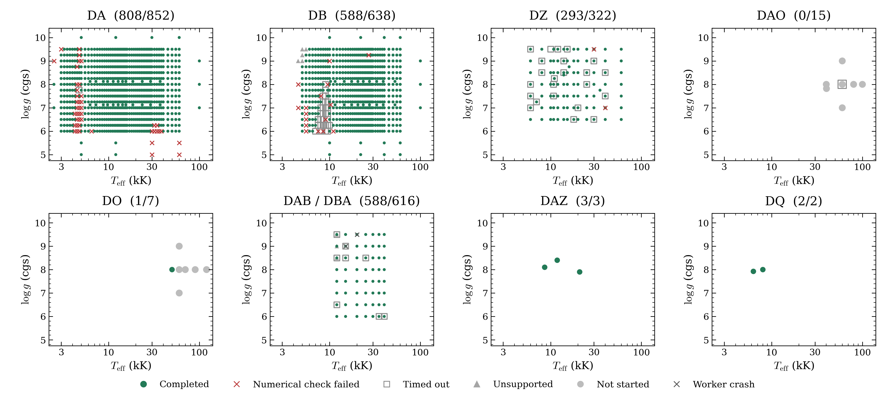

# Grid selection before the six-hour retries

This October 10 snapshot has 2,283 numerical completions from 2,459 requests.
It preserves the prior selected table, dataset, coverage figure and source text.
The [October 11 update](../../timeout-recovery-2026-10-11/README.md) adds 38 accepted
models at existing coordinates. Earlier files remain unchanged.

[Previous selected table](progress.csv) · [Previous dataset](dataset.json)
· [Figure PDF](grid_progress.pdf) · [Original README text](README.snapshot.txt)

The original README text retains its original relative links for provenance;
those links were relative to the former docs/grids parent directory.
