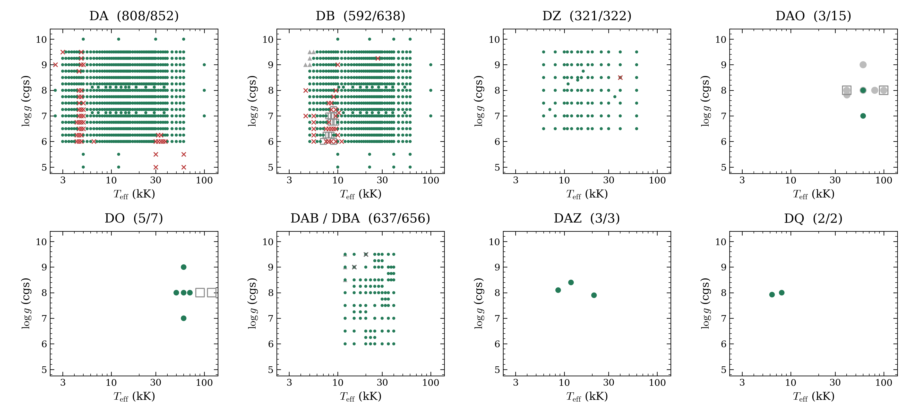

# Selection before DA, DB and DAB replacements

This dated selection contains 2,372 numerical completions from 2,499 requests: DA 808/852, DB 592/638, DAB 637/656. Use the [current page](../../README.md) for later source replacements.

The [selected table](progress.csv), [dataset](dataset.json), [PDF](grid_progress.pdf) and [original page text](README-before.txt) preserve this stage.
