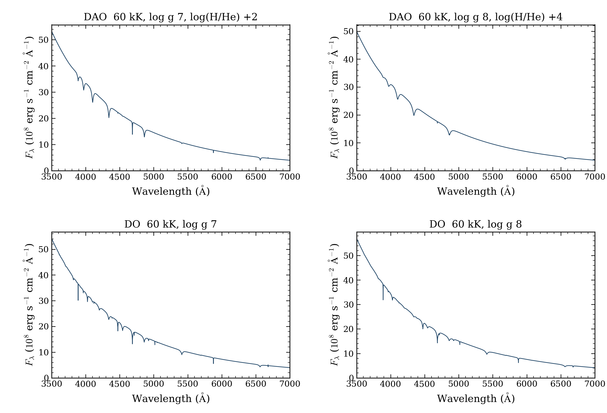
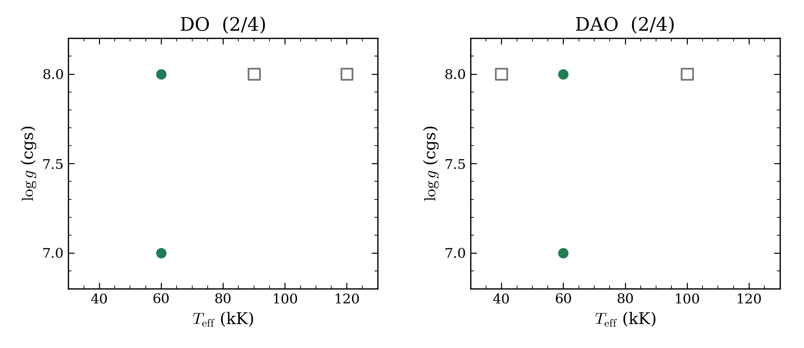

# DO and DAO spectra

Four of eight fresh cold-start models passed the required native atmosphere and
final-spectrum checks. Two DO and two DAO models reached the six-hour resource
limit. All eight outcomes, full inputs and raw attempts remain recorded.
The current selection now contains **3/7 DO and 3/15 DAO spectra**. These runs
replace eight previously unattempted rows; they add no new coordinates.

| Family | Teff, K | log g | log10[N(H)/N(He)] | Outcome | Hours |
|---|---:|---:|---:|---|---:|
| DAO | 40,000 | 8 | 0 | Six-hour timeout | 6.00 |
| DAO | 60,000 | 8 | 4 | Passed native checks | 4.84 |
| DAO | 100,000 | 8 | 2 | Six-hour timeout | 6.00 |
| DAO | 60,000 | 7 | 2.0 | Passed native checks | 4.72 |
| DO | 60,000 | 8 | — | Passed native checks | 4.55 |
| DO | 90,000 | 8 | — | Six-hour timeout | 6.00 |
| DO | 120,000 | 8 | — | Six-hour timeout | 6.00 |
| DO | 60,000 | 7 | — | Passed native checks | 1.82 |

[Full settings and outcomes](requests.csv) · [Native checks and spectrum hashes](native-models.json)
· [Archive verification](ARCHIVE_VERIFICATION.json) · [SHA-256](SHA256SUMS)

## Accepted spectra



Each panel shows one accepted spectrum at 60,000 K. The top panels are DAO;
the bottom panels are DO. Titles give gravity and, for DAO, the hydrogen-to-helium
number ratio. The plot shows 3,500–7,000 Å at the saved native wavelengths.
Flux is absolute surface Fλ, with no normalization, smoothing or resampling.
The archive preserves the full 900–30,000 Å spectra and native structures.
The two DAO panels change both gravity and abundance; they do not isolate either effect.

[Spectrum PDF](hot_spectra.pdf)

## Timeouts remain unfinished



Green circles passed the recorded native checks. Open grey squares mark
six-hour timeouts. Each title gives accepted models divided by four requests
in this batch. Blank regions were not requested. No spectrum from a timed-out
attempt is plotted as accepted.

The last-hour logs are nearly stationary for DAO at 40,000 K and DO at 90,000 K.
DAO at 100,000 K changes substantially, but its last logged energy residual grows.
DO at 120,000 K also has a growing energy residual. These logs do not support
blanket time extensions. Small flux or energy residuals alone do not establish
convergence; temperature stationarity, source closure and boundary checks still
need a final certificate. The raw log samples are in the native model table.

[Outcome PDF](hot_outcomes.pdf)

## Scope and reproduction

All eight runs use source `c8329d86c98f956617ec1bb3746181350492ce66`, standard
public settings and fresh cold starts. Native iteration limits and tolerances
were unchanged. This is restricted H/He NLTE, with NLTE charge feedback off.
The independent final-spectrum check solves the fixed-source formal problem
on identical mass volumes. It does not test an independently refined depth grid
or full physical accuracy. The accepted atmosphere certificates require all-depth
flux, local energy, temperature stationarity, source closure and boundary screening.

The checksummed archive retains all eight attempts, four accepted spectra,
eight accepted NPZ files and 90 arrays. All 81 archive member hashes were checked.
It is held locally and in private persistent storage. A contributor draft release
holds a copy; publication remains pending.

```bash
python docs/grids/plot_hot_spectra.py \
  --archive OpenWD-DO-DAO-representatives-20261012.tar.gz \
  --output output/hot-spectra
```

[The plotting script](../plot_hot_spectra.py) checks the archive and spectrum hashes
before plotting. It performs no atmosphere calculation.

[Current grids](../README.md) · [Failure review](../failure-review-2026-10-11/README.md)
