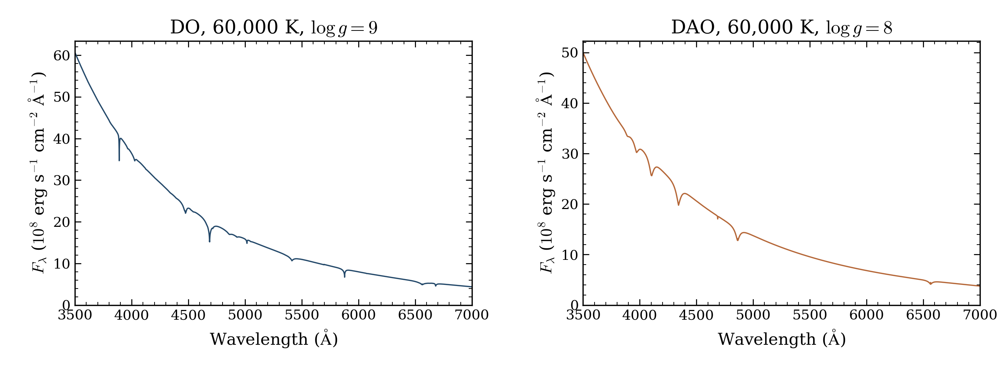

# Final DO/DAO results and phase overview

Both final models passed the required native atmosphere and spectrum checks.
The **60,000 K/log g 9 DO** public cold start completed in **148.03 minutes**.
The **60,000 K/log g 8 DAO**, with log(H/He) = +4, completed in **253.13 minutes**.
The DO adds one previously unattempted coordinate. The DAO repeats an accepted
coordinate to check the current source. The selected mesh now contains
**2,368 numerical completions from 2,499 requests**, including **DO 5/7**,
**DAO 3/15**, and one D6 benchmark.



The blue curve shows DO at log g 9; the orange curve shows DAO at log g 8 and
log(H/He) = +4. Each panel shows 3,500–7,000 Å at the native vacuum wavelengths.
Flux is the absolute surface flux, without normalization, smoothing or resampling.
These different compositions and gravities are separate model examples.

[Figure PDF](hot_extension.pdf) · [Exact requests and outcomes](requests.csv)
· [Native certificates and hashes](native-models.json)

## Matched DAO source check

The new DAO spectrum is **byte-for-byte identical** to its earlier `c8329d86`
spectrum over the full 900–30,000 Å saved band. Native wavelengths match exactly;
maximum relative and integrated absolute differences are zero in the optical
3,000–10,000 Å band and the full band. The earlier attempt took 290.14 minutes.
The current attempt took 253.13 minutes. Source, node and worker packing changed,
so the timing difference cannot isolate a particular implementation change.

[Source comparison and spectrum hashes](control-comparison.json) · [Frozen inputs](plan.json)

Both models use `70bca78e82e7b7dd5860ca3e337bd1f83919e09a`. Their exact standard
requests, public cold starts, native tolerances and iteration limits were retained.
Required DA 5,000 K and DB 22,000 K fixed-spectrum preflights passed before dispatch.
The independent fixed-source formal check uses identical mass volumes. The hot
models retain restricted H/He NLTE without charge feedback. Independent depth
convergence and full physical accuracy remain unverified.

## What this phase accomplished

OpenWD calculates white-dwarf atmosphere structures and their emergent spectra
for specified temperature, gravity and composition. A saved grid avoids repeating
those expensive calculations when exploring or fitting spectra. Missing coordinates
and inaccurate interpolation can still limit that use.

The five allocations produced **80 fresh attempts: 73 numerical completions and
seven timeouts**. Attempts include repeated source checks and independent validation
spectra; they are not 80 new predictor coordinates.

| Stage | Fresh attempts | Numerical completions | Timeouts | Role |
|---|---:|---:|---:|---|
| DAB refinement | 64 | 64 | 0 | 32 new knots and 32 independent tests |
| Original DO/DAO batch | 8 | 4 | 4 | Representative hot coordinates |
| DB/D6 diagnostics | 4 | 1 | 3 | Two existing coordinates under two source versions |
| DO continuation | 2 | 2 | 0 | One new coordinate and one repeated source check |
| Final DO/DAO tier | 2 | 2 | 0 | One new coordinate and one repeated source check |
| Total | 80 | 73 | 7 | All allocations settled |

The [DAB refinement](../refinement-2026-10-11/README.md) halves temperature and
gravity spacing in eight selected patches at fixed H/He. All 64 fresh models
passed native checks. On 32 independent optical test spectra, linear interpolation
improves from **10/32 to 22/32** passing both the 3% maximum-relative and 1%
integrated-absolute error targets. Local log-flux PCHIP improves from **11/32 to
22/32**. Worst maximum-relative errors fall from 29.72% to 14.33% for linear
interpolation and from 19.46% to 8.06% for PCHIP. Ten targets still miss at least
one error target for each refined method. These results qualify the measured
patch tests; abundance interpolation, the whole grid and precision parameter
recovery remain unverified.

The [original hot batch](../hot-2026-10-12/README.md) retains four accepted models
and four six-hour timeouts: DAO 40,000 K/log g 8/log(H/He) = 0, DAO 100,000 K/log g 8/
log(H/He) = +2, and DO 90,000/120,000 K at log g 8. Their final-hour residuals do
not support blanket extensions. The [DO continuation](../do-continuation-2026-10-12/README.md)
adds 70,000 K/log g 8 and a byte-identical 60,000 K source check.

The [DB/D6 diagnostics](../diagnostics-2026-10-12/README.md) recovered the updated-source
D6 J1637 benchmark after 4.388 hours. Both DB 7,000 K/log g 6 attempts and the
original-source D6 attempt reached eight-hour limits. DB local-energy residuals
remained large. The original D6 attempt made late progress, which could motivate
a future bounded investigation; it has no final certificate or spectrum.
Full source and input data changed between the D6 versions, including Rosseland
probe reuse and thermal conditioning. The successful updated run cannot establish
which change caused completion or provide a spectrum comparison with unfinished
original-source controls.

### D6 and actual GTC observations

The [verified GTC comparison](../diagnostics-2026-10-12/gtc-comparison/README.md)
uses all 12 raw exposures, independently reduced with PypeIt, and the unchanged
accepted native D6 spectrum. The conditional RMS residuals are **12.74% blue**
from 1,712 pixels, **4.39% green** from 1,231, and **3.90% red** from 1,470.
The comparison holds published stellar parameters, +384 km/s velocity and R = 2,500
fixed, and fits a fifth-order continuum separately for each grism.

This is one composition-specific J1637 benchmark, not a D6 parameter grid or the
first-ever OpenWD D6 spectrum. The GTC observations and Koester fit were already
published by [Hollands et al.](https://doi.org/10.1093/mnras/staf950).
Because those stellar parameters were fitted to the same observations, agreement
here is a conditional implementation comparison, not independent parameter recovery.
Many line features agree, but line-depth and profile differences remain.

Short-wavelength blue noise is substantial. A failed green GD153 optimal-profile
extraction was retained and repaired with supported box extraction. The unreliable
green red edge is excluded in favor of the red grism above 5,600 Å. Measured sky
zero-point offsets span −0.25 to −0.04 Å in green and +0.17 to +0.54 Å in red;
the blue zero point remains unchecked. Calibration and resampling covariance are
not included in the displayed statistical uncertainties. The continuum fit prevents
an absolute SED test. No new precise velocity, independent depth convergence,
physical-accuracy certificate or independent stellar-parameter fit is claimed.

## Remaining grid gaps

The full selected table contains **131 entries without complete numerical spectrum
qualification**. Their recorded outcomes remain separate:

| Selected outcome | Entries |
|---|---:|
| Numerical nonconvergence | 73 |
| Invalid numerical depth grid | 5 |
| Worker crash or infrastructure interruption | 3 |
| Unsupported configuration or material-domain stop | 22 |
| Timeout | 16 |
| Structure certified; spectrum unverified | 2 |
| Not started | 10 |

The three diagnostic timeouts are additional attempts at existing coordinates;
they are not three extra selected-grid gaps. The earlier 118-flag file remains a
historical snapshot. It must not be read as the current unresolved count.
The [failure review](../failure-review-2026-10-11/README.md) preserves the original
flags, raw outcomes and measured timeout behavior. Status-only records do not
establish a physical cause. DAB's two earlier crashes and the DZ crash remain
unresolved. The cold DB/Montreal discrepancy remains unresolved; DZ expansion
stays paused for matched external validation.

A native numerical pass means the stated equations passed the recorded checks on
the declared structure grid. It does not establish independent depth convergence,
interpolation accuracy, physical accuracy against observations or release readiness.
Those tests require their own evidence. No additional model allocation was started
for this final handoff.

## Final charged CPU node-hours

All five allocations completed with exit code 0. These are allocation outcomes;
individual worker timeouts are recorded above. Terminal `sacct` records give
**7.0207074653 charged CPU node-hours**, rounded to **7.0207**, below the **13-hour** cap.

| Allocation | Full allocation wall hours | Allocated node fraction | Charged CPU node-hours |
|---|---:|---:|---:|
| 59686815: DAB | 3.255000 | 256/256 | 3.255000 |
| 59686816: original hot | 6.136944 | 104/256 | 2.493134 |
| 59699007: diagnostics | 8.199444 | 22/256 | 0.704640 |
| 59702899: DO continuation | 1.568889 | 22/256 | 0.134826 |
| 59705250: final DO/DAO | 4.264444 | 26/256 | 0.433108 |
| Total | | | **7.020707** |

The calculation uses full terminal allocation elapsed time times the billing TRES
fraction of the node. Actual node `CfgTRES.billing` is 256; the shared partition
allocates cores and memory, so these fractions already include the memory-driven
resource footprint. Both recorded QOS usage factors and the Perlmutter CPU factor
are 1. Setup, preflight and idle time are included; worker CPU time alone is not
used. [NERSC charging policy](https://docs.nersc.gov/jobs/policy/) specifies fractional
charging for shared jobs and actual elapsed time for the allocated resources.
[NERSC resource policy](https://docs.nersc.gov/policies/resource-usage/) describes
allocation charging and the separate daily Iris ledger update.

This is the scheduler-derived actual charge under that policy. A separate finalized
Iris ledger statement was not downloaded. The earlier **12.621944** number was a
conservative guard with a pending allocation reserve, not this charge.

[Accounting JSON](phase-accounting.json) · [Accounting CSV](phase-accounting.csv)
· [Terminal allocation and quota records](allocation-records.txt)
· [Partition and QOS factors](billing-configuration.txt)

## Archive and reproduction

The compact archive retains both native structures and spectra, all raw attempts,
source/configuration records and fixed-spectrum preflights. All **43 member hashes**,
four NPZ files, **45 arrays** and both native spectra were checked. Local and
private persistent archive hashes match. [The actual draft download](DRAFT_DOWNLOAD_VERIFICATION.json)
rechecks every member, native array and spectrum. The contributor release remains an
unpublished draft, accessible to contributors with write access.

[Archive verification](ARCHIVE_VERIFICATION.json) · [SHA-256](SHA256SUMS)
· [Contributor drafts](https://github.com/cheyanneshariat/OpenWD/releases)

```bash
python docs/grids/plot_hot_extension.py \
  --archive OpenWD-DO-DAO-extension-20261012.tar.gz \
  --output output/hot-extension
```

[Portable plotting script](../plot_hot_extension.py) · [Current grids](../README.md)
