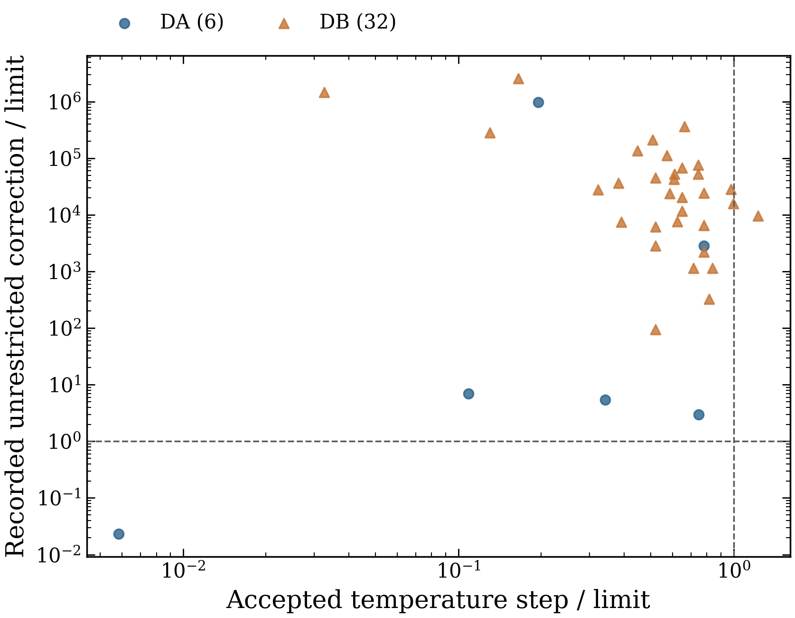
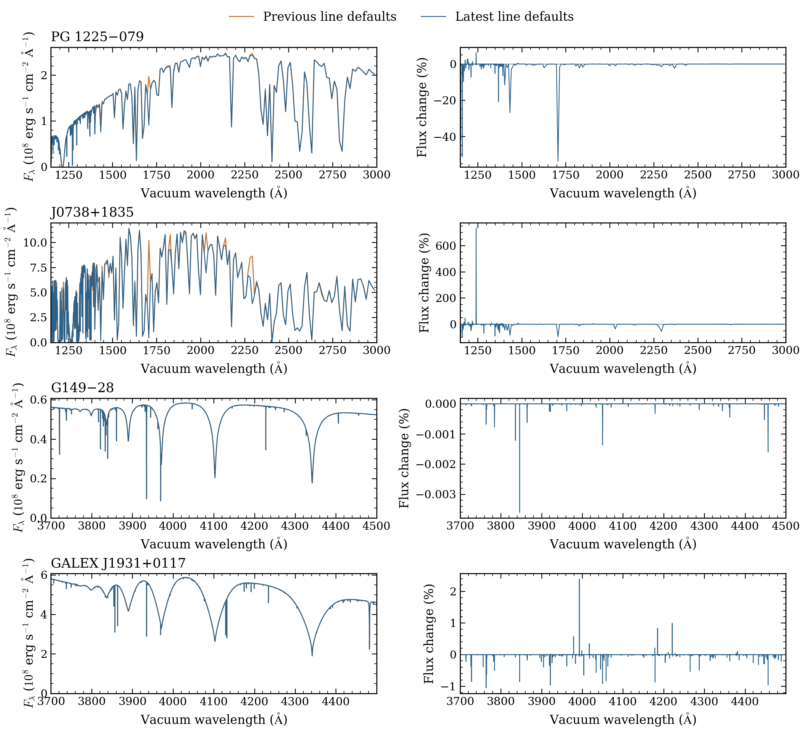
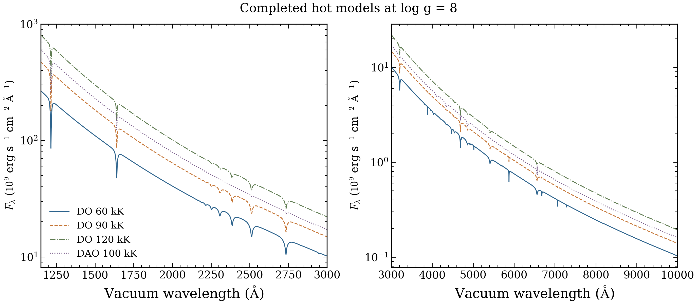
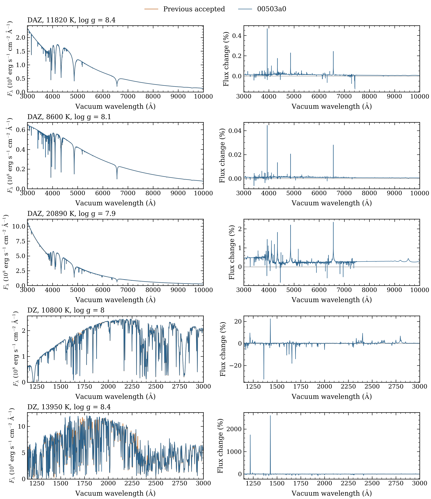
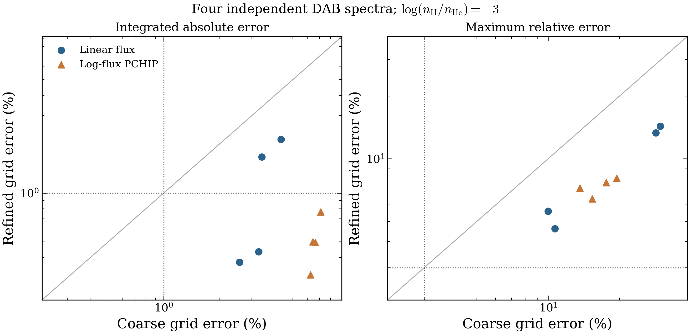

# Latest-source validation, October 16

The 23 cold models under source `00503a0dd22a028e38741b90d53d9e18a8731545` finished on October 16. Independent checks accepted 22 results; DAO at 40,000 K hit its six-hour limit. This source still matches upstream main on October 17. The selected table is unchanged, and the earlier DA/DB/DAB campaign remains tied to `c103b53`.

| Check | Cold requests | Purpose |
|---|---:|---|
| DO/DAO | 5 | Repeat four older timeouts after the upstream solver changes, with one successful DO control. |
| DZ/DAZ | 5 | Check two DZ and three DAZ anchors with the new metal-line defaults. |
| DAB/DBA | 13 | Calculate nine interpolation inputs and four independent test spectra in one patch. |

The [full requests](REQUESTS.json) preserve configurations and roles. The four hot failure cases run only if the DO control passes. Required native tolerances remain unchanged. No automatic scientific retry or grid expansion is included. PG1159's limited spectrum qualification remains distinct from full convergence.

Fourteen focused tests passed on both macOS and Linux. Six fixed-atmosphere spectral controls passed locally. These checks protect software behavior and saved spectra; they do not certify cold-model convergence.

## Why some DA/DB solves stop without qualification

The saved review covers 51 native failures: 14 DA and 37 DB. In 36 cases, the accepted temperature step is below its limit while the recorded unrestricted correction fails. The final native certificate correctly rejects those results. The relevant solver and certificate files are unchanged between `c103b53` and latest main.

Circles show DA and triangles DB. Dashed lines mark the native limits. Thirty-eight saved failures have both a measured correction check and a positive accepted step; 36 lie left of the vertical line and above the horizontal line. Unmeasured checks and dense-DB qualification records are omitted. All plotted models failed their final qualification. [PDF](stopping_check.pdf) and [saved checks with the analytic example](DIAGNOSIS.json) are included.

A constructed two-variable problem reproduces the stopping disagreement in the current driver. Its equations have no real root. An existing explicit convergence callback prevents the false driver-level pass in that example. This identifies a stopping-contract weakness; it does not establish the physical cause or a successful atmosphere correction. Domain stops, invalid optical-depth grids and unfinished timeouts remain separate.

## Metal-line changes on identical atmospheres

Orange uses the previous Kurucz line defaults; blue uses latest main. Left panels show absolute surface flux and right panels the percentage change. DZ panels show the ultraviolet; DAZ panels show their available optical samples near 3700–4500 Å. All changes remain visible, including large fractional changes in weak UV flux. No spectrum was normalized or resampled. The two DZ sampled UV bands change by 0.676% and 3.78% in integrated absolute flux difference. These are model differences, not observational fit scores.

Both line policies passed their native source checks for all four saved atmospheres. The previous policy recovered its immutable controls at their existing tolerances. [PDF](line_policy_changes.pdf), [comparison records](COMPARISON.json) and the four saved array pairs ([PG1225](dz-pg1225.npz), [J0738](dz-j0738.npz), [G149−28](daz-g149_28.npz), [GALEX J1931](daz-galex1931.npz)) preserve the inputs and outputs. These fixed-state checks do not establish atmosphere equilibrium, depth convergence or physical accuracy.

## Cold-model results

The DO control at 60,000 K passed. DO at 90,000 and 120,000 K and DAO at 100,000 K also passed, including population convergence. These three coordinates previously timed out. The new experiment includes all intervening source changes and does not isolate one solver change. DAO at 40,000 K remains unfinished: it used 12.09 GiB below its 24 GiB cap, then received SIGTERM at the six-hour limit. It has no final certificate or spectrum, and was not retried.

All five metal anchors passed their native numerical checks. The matched cold DZ spectra change by 0.509% and 5.066% in integrated absolute UV flux difference. The three DAZ optical changes range from 0.000994% to 0.3605%. These differences include atmosphere and source changes; the fixed-atmosphere comparison above isolates the line policy more closely.

The [15 exact native pairs](terminal-2026-10-17/NATIVE_PAIRS.json) comprise nine DAB inputs, five metal anchors and the DO control. All nine DAB input spectra are identical to their `c103b53` predecessors on the native grid. These comparisons measure source differences, not physical accuracy.

## Independent interpolation

Nine inputs and four withheld targets passed their native numerical checks under the same source. The four targets lie outside the predictor mesh in one patch: 15,000–20,000 K, log g 7–7.5 and log H/He = −3.

Refinement reduces errors, but **none of the four targets passes both accuracy limits** over 3000–10000 Å. Refined log-flux PCHIP has a 0.498% median integrated absolute error and an 8.06% worst pointwise error. The limits remain 1% and 3%, respectively. This patch is insufficient for the stated interpolation accuracy. The old 22/32 result does not qualify the updated selection.

The [full metrics](terminal-2026-10-17/DAB_INTERPOLATION.json) retain all eight coarse/refined method variants. Spectra and predictions retain native wavelengths without normalization or extrapolation. Only the two band endpoints are evaluated linearly for the historical interval metric. Independent depth convergence and observed-spectrum accuracy remain untested.

Job `59857587` finished at 17:13 Pacific on October 16. Its actual 70 billing CPUs and 28,723-second allocation give **2.1816514757 CPU node-hours**, including setup, controls and idle time. No live reservation remains. The earlier 12.5616319444-hour DA/DB/DAB and 11.2247981771-hour DZ/DAZ campaigns remain separate. [Terminal accounting](terminal-2026-10-17/ACCOUNTING.json) and [verification](terminal-2026-10-17/TERMINAL_VERIFICATION.json) preserve these records.

All 242 output-file hashes, 26 NPZ files/245 arrays and 22 native spectra passed remote and actual local-copy checks. The three new PNGs and rendered PDFs were inspected. [PDFs, captions, saved arrays and the portable plotter](terminal-2026-10-17/README.md) are included.

Monitoring was stopped at Cheyanne's request and remains off. Private permanent archival remains pending. No merge or release publication is included.

The portable [metal plotter](plot_metal_changes.py) and [stopping-check plotter](plot_stopping_check.py) read the saved arrays and checks. They use the included [plot style](plot-style.mplstyle) and perform no atmosphere calculations.
