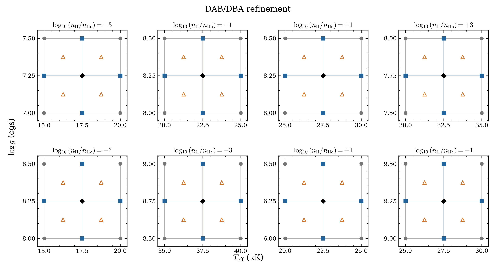
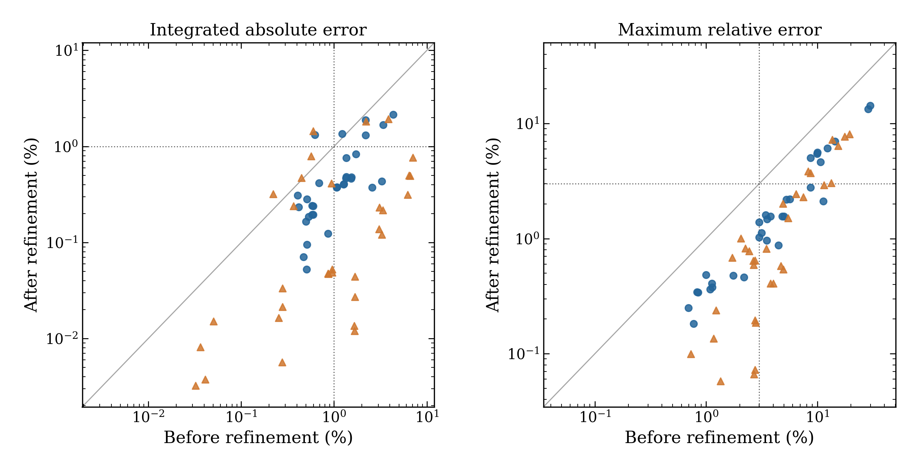
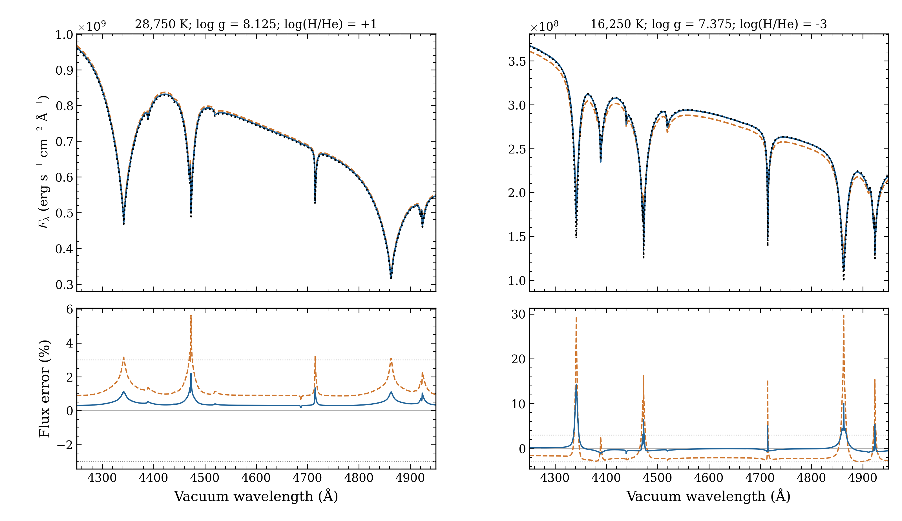

# DAB/DBA temperature and gravity refinement

This update adds **40 grid coordinates** in eight selected patches: 32 new
calculations and eight reused center models. Temperature spacing falls from
5,000 to 2,500 K and log g spacing from 0.5 to 0.25. H/He stays fixed within each
patch. The selected DAB/DBA mesh now has **637 accepted models from 656 requests**.
Its 17 unsupported configurations and two earlier worker crashes remain recorded.
The one-dex abundance planes still span log10[N(H)/N(He)] = −6 to +4.



Grey circles mark the original corners. Blue squares mark new knots, and black
diamonds mark reused centers. Orange triangles mark the 32 new test spectra.
The tests remain outside the predictor mesh. The eight centers were earlier
development targets; they are now inputs and provide no independent test of
the refined predictor. This update refines selected patches, rather than every
cell in the grid.

## Independent interpolation tests

All 64 fresh calculations passed the required native atmosphere and final-spectrum
checks. All 32 new test spectra have matching, qualified predictor inputs.
We compare absolute surface flux on identical native wavelengths over
3,000–10,000 Angstrom. We use no normalization, extrapolation or failed-corner
substitution. Both targets must pass: **3% maximum relative error** and
**1% integrated absolute error**. The integrated error is the integral of the
absolute flux difference divided by the integral of the direct spectrum.

| Predictor | Both targets pass | Median integrated error | Worst maximum error |
|---|---:|---:|---:|
| Coarse linear flux | 10/32 | 1.072% | 29.72% |
| Refined linear flux | 22/32 | 0.390% | 14.33% |
| Coarse local log-flux PCHIP | 11/32 | 0.946% | 19.46% |
| Refined local log-flux PCHIP | 22/32 | 0.086% | 8.06% |



Each symbol represents one independent spectrum. Points below the diagonal
have smaller errors after refinement. Blue circles use linear flux interpolation.
Orange triangles use shape-preserving piecewise cubic interpolation (PCHIP) in
log flux. Dotted lines mark the 1% integrated and 3% maximum targets.
Local PCHIP uses complete 2×2 coarse and 3×3 refined patches, first along
temperature and then gravity. This differs from the earlier 16-corner
development comparison. The production interpolator is unchanged.

Ten tests still miss at least one target for refined linear interpolation.
Ten also miss a target for local PCHIP. The counts do not certify the remaining
grid or abundance interpolation. Numerical checks and these interpolation tests
do not establish physical accuracy, independent depth convergence or unbiased
parameter recovery.



Black dotted curves show direct OpenWD calculations. Orange dashed curves show
coarse linear interpolation; blue curves show refined linear interpolation.
The upper panels show absolute surface flux and the lower panels show fractional
errors. Dotted horizontal lines mark ±3%. The display spans 4,250–4,950 Angstrom; reported metrics use the full
3,000–10,000 Angstrom interval. These examples show a recovered pass and a
remaining large error. They are not a random sample of the 32 tests.

## Models, archive and reproducibility

The [model table](native-models.csv) distinguishes 32 new knots, 32 fresh tests,
eight reused centers and 32 older corners. Its [full configurations](native-models.json)
and [execution plan](plan.json) identify the inputs and source locks.
The [32 comparison records](comparison.json) contain all eight interpolation
methods. [Stage checks](STAGE_VERIFICATION.json), [archive checks](ARCHIVE_VERIFICATION.json)
and [selection checks](INTEGRATION_VERIFICATION.json) record the numerical and
bookkeeping scope. The [figure checks](VERIFICATION.json) record render inspection.

The [contributor draft releases](https://github.com/cheyanneshariat/OpenWD/releases)
contain `OpenWD-DAB-refinement-20261011.tar.gz` under
`grid-preview-2026-10-11-dab-refinement`. Draft assets require fork write access;
they are not public downloads. The archive has **104 native models**, including
all predictor inputs, full requests, certificates, spectra, arrays and attempt
logs. Only 64 models were newly calculated. All 104 NPZ files and 936 native
arrays were read; 1,101 archive member hashes were checked. Local and private
HPC home copies were verified. Scratch is not the sole copy.

Archive size: 74,216,623 bytes. SHA256:

```text
029ab23abb72320696d974321747ebbeffe4e091af66eb47fb7d5e5da06451f4
```

All DAB models use source `0a74fdbe06596fc145f5169a3b239ddd67053141` and
public cold starts. Native physics, tolerances and iteration limits are unchanged.
The source/data digest is
`2938a3602c7ff1b7753cc8574acf23016c64e3a0fbd5c4d1566aa344b6b597da`;
it is distinct from the identity recorded for the original October 8 bank.
Saved spectra use vacuum Angstrom and surface Fλ in
`erg s^-1 cm^-2 Angstrom^-1`, with no normalization or resampling.

After downloading the draft archive, run in a Python 3.9+ NumPy/Matplotlib environment:

```bash
python docs/grids/plot_dab_temperature_refinement.py \
  --archive /path/to/OpenWD-DAB-refinement-20261011.tar.gz \
  --output output/dab-temperature-refinement
```

The script verifies the archive and native test-spectrum hashes, recomputes the
metrics from all 256 saved predictions, and writes three PNG/PDF figures.
The archive contains the frozen numerical adapters and full source/data locks
for reproducing the atmosphere calculations separately.

This page records the completed DAB stage. The separate
[four-DO/four-DAO batch](../hot-2026-10-12/README.md) finished with four numerical
completions and four six-hour timeouts. Those models are separate from the DAB
results here. The cold DB/Montreal discrepancy remains
unresolved. Use the [current grid page](../README.md) for the full selection and
[dated history](../history/README.md) for the earlier counts.
