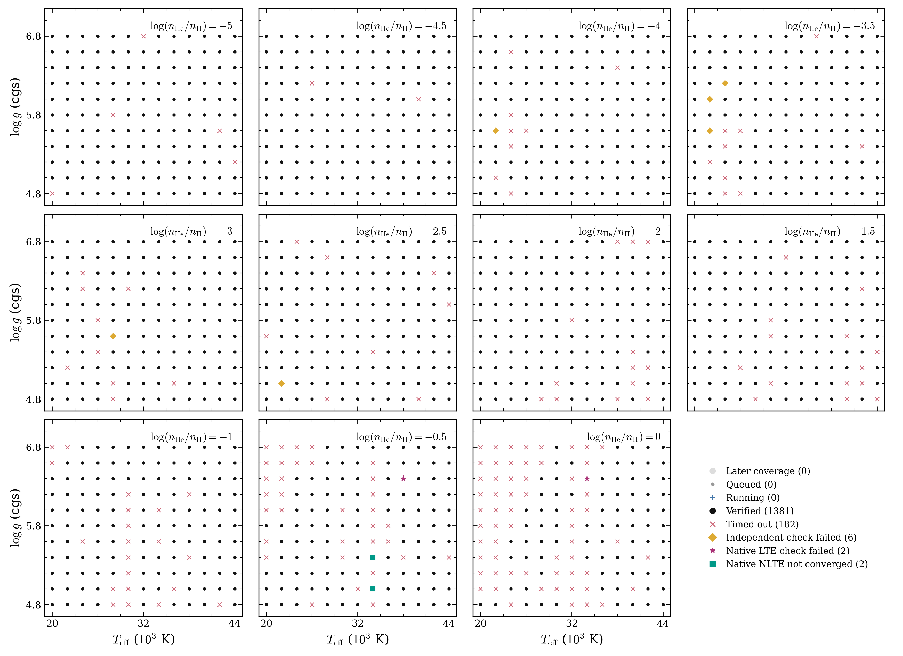
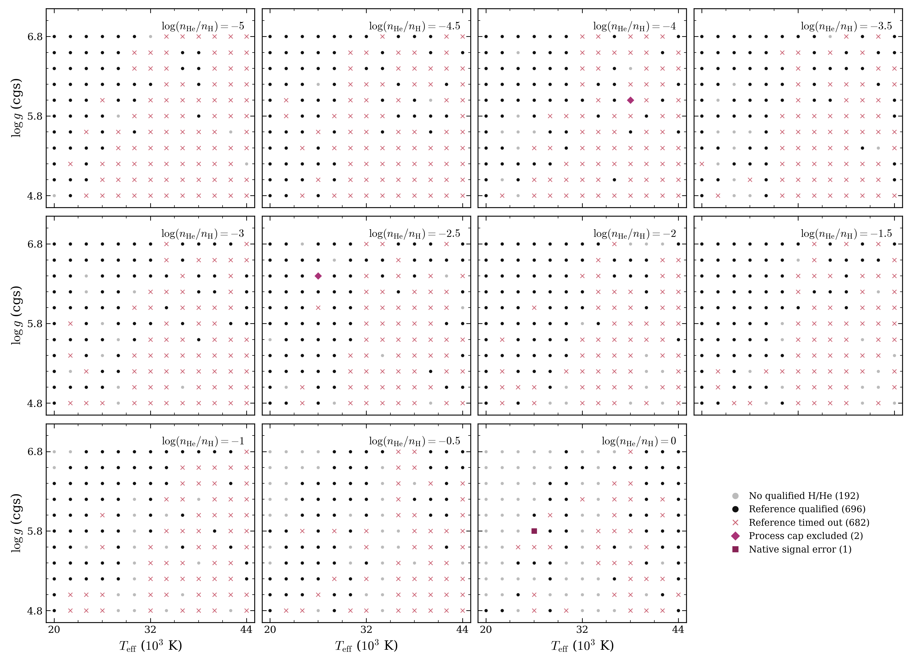
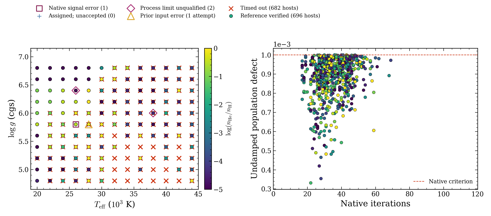

# Precomputed sdB H/He and reference-metal spectra

[Documentation home](../../README.md) · [sdB model guide](../../models/sdB.md)

This experimental snapshot contains **1,381 numerically qualified H/He spectra**
and **696 qualified reference-metal spectra**. Every requested calculation has a
terminal outcome. Failed points remain explicit gaps. Numerical qualification
does not establish physical accuracy, independent depth convergence, interpolation
accuracy or calibrated stellar-parameter uncertainties.

The data archives are staged in an **unpublished draft release** on the author’s
fork. They are available to authorized repository collaborators, not public
downloads. See [release metadata](data-release.json) for the actual release and
asset identities. Publication of those assets remains a separate step.

## Requested coordinates and outcomes

| Axis | Requested values |
| --- | --- |
| Effective temperature | 20,000–44,000 K, every 2,000 K |
| log10 surface gravity, with g in cm s⁻² | 4.8–6.8, every 0.2 dex |
| log10(nHe/nH) | −5 to 0, every 0.5 dex |

The full request has 13 × 11 × 11 = **1,573 unique coordinates**.

| Calculation | Qualified | Explicit gaps | Pending |
| --- | ---: | ---: | ---: |
| H/He, 1,573 coordinates | 1,381 | 192 | 0 |
| One reference mixture per qualified H/He host | 696 | 685 | 0 |

H/He gaps comprise 176 LTE timeouts, six HYBRID timeouts, six failures of the
original ordinary-rate independent check, two native LTE check failures and two
native NLTE nonconvergences. A HYBRID timeout retains its earlier passed LTE
checks; it is not measured native NLTE nonconvergence. Reference gaps comprise
682 timeouts, two process-time exclusions and one native SIGSEGV with unresolved
cause. Convergence reported after the process cap does not qualify a spectrum.
One historical invalid-input attempt and seven sensitivity calculations are
excluded from the reference table. Originals and raw failures remain preserved
in the research archive; they are not distributed as usable fitting spectra.

[](hhe-coverage.pdf)

Each panel fixes log10(nHe/nH). Black points are qualified; the other symbols
identify timeouts and the three check-failure classes. Every requested point has
a terminal outcome. No spectrum is supplied at the 192 H/He gaps.

[](reference-coverage-by-helium.pdf)

Gray marks the 192 coordinates without qualified H/He. Black marks 696 qualified
reference spectra. Pink crosses mark 682 reference timeouts; purple diamonds
mark two process-cap exclusions; the purple square marks one native signal error.

## Files and downloads

- [model-index.csv](model-index.csv) lists all coordinates, both signs of the
  helium ratio, numerical eligibility, native spectrum paths and SHA-256 hashes.
  Paths are relative to the extracted `sdb-2026-10-25` directory. Empty paths
  mean no qualified spectrum. Boolean eligibility means numerical qualification
  under the scope below, not validated inference or interpolation.
- [fitting-masks.json](fitting-masks.json) gives the exact accepted and failed
  host-ID sets. Each reference spectrum belongs to its own qualified H/He host.
- [manifest.json](manifest.json) enumerates all **5,535 unmodified NPZ files**:
  1,381 H/He spectra, populations and LTE atmospheres, plus 696 reference spectra
  and populations. Each member has a byte count, SHA-256 hash and archive name.
- [qualification.json](qualification.json) records each accepted model’s numerical
  defect and original terminal/delivery proof hashes. Reference entries include
  native iterations, platform-specific binary hashes and actual X/H inputs.
  These compact projections are not the full original execution proofs.
- [provenance.json](provenance.json) identifies the frozen source, original
  catalog/membership hashes, exclusions and qualification boundaries.
- [reference-composition.json](reference-composition.json) defines the prescribed
  number fractions and their conversion to X/H.
- [verify_snapshot.py](verify_snapshot.py) checks the metadata without importing
  OpenWD or NumPy. An optional data check verifies the extracted file bytes.

Download the metadata archive, four data archives and `SHA256SUMS` from the draft
release linked in `data-release.json`. The metadata archive includes this guide
and these tables. In a new directory containing those six downloaded files:

```bash
shasum -a 256 -c SHA256SUMS
tar -xzf sdb-2026-10-25-metadata.tar.gz
tar -xzf sdb-2026-10-25-HHe-01.tar.gz
tar -xzf sdb-2026-10-25-HHe-02.tar.gz
tar -xzf sdb-2026-10-25-reference-metals-01.tar.gz
tar -xzf sdb-2026-10-25-reference-metals-02.tar.gz
python sdb-2026-10-25/verify_snapshot.py --data-root sdb-2026-10-25
```

All archives extract beneath the same `sdb-2026-10-25` directory. Archives contain
regular files only. Extraction requires about 6.3 GB, in addition to the downloaded
archives. Do not overwrite an existing data directory. The repository contains
metadata and figures; the large numerical products remain release assets.

## Spectrum conventions and fitting

Native `spectrum.npz` files use `wavelength_vacuum` in Angstroms and `flux` for
surface Fλ in erg s⁻¹ cm⁻² Å⁻¹. They retain their original wavelength samples and
absolute normalization. Nominal H/He support is 3000–9200 Å at 0.05 Å sampling;
reference-metal support is 3700–7000 Å at 0.02 Å sampling. Use each saved file’s
actual support. No convolution, continuum fitting, resampling or extrapolation
was applied for this snapshot.

The helium axis is **log10(nHe/nH)**. A fitter using log10(nH/nHe) must reverse
the sign. A logarithmic helium *fraction of all particles* is a different axis.
Match the old grid’s actual abundance definition before comparing labels.

These files support exploratory atmospheric fitting conditional on the
prescribed reference composition where qualified spectra exist. A fitter must
handle RV, air/vacuum conversion, per-epoch instrumental resolution, rotation,
continuum treatment and the explicit point masks. Validate its interpolation
support separately. Do not fill failed cells or bridge unresolved holes by
silently treating this as a complete rectangular grid.

**Independent metal-abundance axes are absent.** A joint fitter that frees C, N,
S or Ca cannot substitute these reference spectra for an abundance grid. No
observed data, fitted parameters, chains or inference code were changed in this
campaign. Parameter uncertainties and observational inference calibration remain
to be tested in the fitting workflow.

## Composition and numerical qualification

The reference mixture has C/N/O/Si/S in NLTE and Ca in LTE. For each host,

```text
nH = (1 - original_listed_metals_number_fraction_sum) / (1 + 10**log10(nHe/nH))
log10(nX/nH) = listed_log10_number_fraction[X] - log10(nH)
```

The retained original full-list metal fraction sum is 0.00017682026456456874.
Only the six requested elements contribute to these metal calculations; the
other listed backgrounds are omitted. The formula prescribes the X/H inputs,
not a self-consistent metal-blanketed atmosphere composition. Varying helium
therefore changes converted X/H. Exact inputs are retained for every qualified
host in `qualification.json`.

The H/He calculations use an LTE structure and electron density, followed by
NLTE H/He line formation with H I 16 levels, He I 14 terms and dominant-state
helium conservation. The production mesh starts at 80 depths. Specifically
reviewed same-run lower-domain adaptations can finish at 84 depths. The
H/He population solve uses 200/200/200 iteration chunks. Qualification requires
measured, passed native LTE checks, native NLTE convergence and the original
ordinary-rate independent population defect ≤ 10⁻⁴. Saved-array validity and
source/runtime/input/process identity checks also passed. These numerical
criteria do not prove independent depth convergence.

The metal calculation holds its own accepted H/He structure, electron density
and populations fixed. Native qualification uses undamped defect < 0.001 where
population fraction ≥ 10⁻⁶ and Rosseland optical depth ≥ 10⁻⁶, with 120 iterations,
a 2700-second process cap and 16 GiB RSS cap. Each native worker uses one
physical core and one numerical thread. The original source/runtime, reference
inputs, host proofs, CLI, owned process identity, affinity, observer history,
source-after integrity and saved-array checks remain part of qualification.

[](metal-coverage-convergence.pdf)

The left panel projects different helium ratios onto temperature and gravity;
points and failure markers can overlap. The historical invalid-input triangle
shares a projection with a subsequently qualified correct-reference host.
The right panel shows only the 696 qualified reference spectra. Native-converged
process-cap exclusions are omitted. Its dashed line is the native defect
criterion, not an observational accuracy requirement.

Metal qualification is **native-only**. Independent full-metal ordinary-rate
qualification and self-consistent blanketing have not been established.
Carbon and sub-ppm calcium limitations remain. The unresolved SIGSEGV does not
identify a physical boundary or prove the absence of a shared implementation
bug. The numerical grid should retain these limitations in any scientific use.

## Source, preservation and package checks

The frozen calculation source is
[`e75a113c514b7ef0738092353a0ef94fc005f7ca`](https://github.com/kareemelbadry/OpenWD/tree/e75a113c514b7ef0738092353a0ef94fc005f7ca).
This documentation PR does not recompute the spectra under current OpenWD.
Original terminal and local-delivery proof hashes remain attached to each
accepted model. The earlier retained models and the Resnick continuation used
different platform-specific native binaries; reference binary hashes remain
explicit. Three retained production-pilot models use their original accepted
history, including one later, first independent check after the original
allocation ended. No native pair was repeated for packaging.

Packaging checks exact coordinate membership, qualification/mask consistency,
composition conversion and each new archive member’s bytes against the saved
accepted hash. It does not rerun a solver, reload scientific arrays, repeat a
completed scientific verifier or promote a failed model. Original spectra,
raw failures, full execution records and older grid versions are preserved.
The [figure record](figures.json) binds the unmodified inspected PNG/PDF exports.

These are OpenWD-generated research outputs. Source-code licensing and
[third-party data attribution](../../../THIRD_PARTY_NOTICES.md) remain distinct;
no input atomic or line-profile tables or observed spectra are redistributed in
these data archives. Credit OpenWD and the relevant atomic/profile sources when
using the calculations scientifically.
