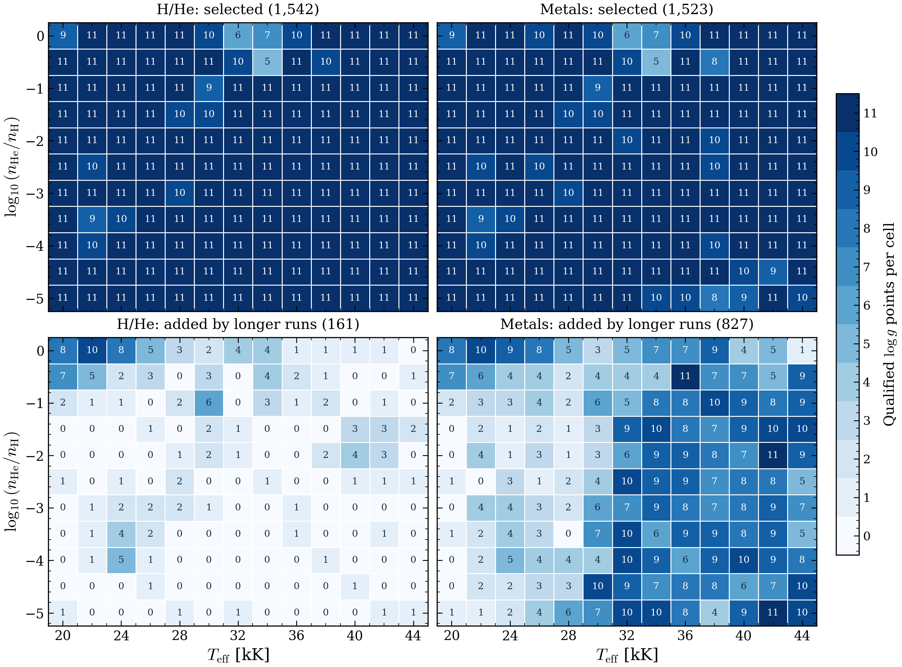

# sdB grids

[Documentation home](../../README.md) · [sdB model guide](../../models/sdB.md)

This snapshot contains precomputed spectra for sdB fitting. The selected files passed the numerical and saved-file checks described below. All requested attempts have finished. Failed points remain masked.

| Models | Passed checks | Gaps |
| --- | ---: | ---: |
| H/He | 1,542 | 31 |
| Metals | 1,523 | 19 |

The request covers 1,573 coordinates: 20,000–44,000 K in 2,000 K steps, log g = 4.8–6.8 in 0.2 dex steps, and log10(nHe/nH) = −5 to 0 in 0.5 dex steps. The Metals row counts one fixed mixture at each of the 1,542 accepted H/He hosts. The 31 other coordinates lack a usable H/He host.

[](figures/grid-coverage.pdf)

Each cell counts spectra across the 11 gravities. The upper panels show all selected spectra. The lower panels show 161 H/He and 827 metal additions from the longer runs. Zero means no qualified spectrum at those coordinates.

## Downloads and checks

The files are staged in a new [unpublished draft release](https://github.com/cheyanneshariat/OpenWD/releases/tag/untagged-939a39e8c7ad36e6de41). Access requires permission on the author's repository. The earlier snapshot and draft assets remain separate.

Download the eight native-data archives, the metadata archive and `sdb-2026-10-26-SHA256SUMS`. Use a new directory with at least 20 GB free. Then run:

```bash
shasum -a 256 -c sdb-2026-10-26-SHA256SUMS
tar -xkzf sdb-2026-10-26-metadata.tar.gz
for archive in sdb-2026-10-26-HHe-*.tar.gz sdb-2026-10-26-Metals-*.tar.gz; do
    tar -xkzf "$archive"
done
python sdb-2026-10-26/verify_snapshot.py --data-root sdb-2026-10-26
```

All archives use the same new `sdb-2026-10-26` directory. They contain regular files only. The verifier checks exact coordinate sets, masks, composition conversions and file bytes. It does not load model arrays or run OpenWD.

- `model-index.csv` lists all requested coordinates, outcomes and relative spectrum paths. An empty path means no selected spectrum.
- `fitting-masks.json` gives the exact accepted and failed host-ID sets.
- `manifest.json` lists all 7,672 unmodified NPZ files, their sizes, hashes and archive names.
- `qualification.json` records numerical defects and compact original proof hashes. Full execution records remain in the research archive.
- `metals-composition.json` records the prescribed composition and helium conversion.
- `provenance.json` records source and snapshot identities. No spectra were recomputed for packaging.

## Spectrum conventions and fitting

Native spectra use `wavelength_vacuum` in Angstroms and `flux` for surface Fλ in erg s⁻¹ cm⁻² Å⁻¹. H/He spectra nominally cover 3000–9200 Å at 0.05 Å sampling. Metal spectra cover 3700–7000 Å at 0.02 Å sampling. Use each saved file's actual support. The files retain their native samples and normalization; no convolution or resampling was applied.

The helium axis is **log10(nHe/nH)**. A fitter using log10(nH/nHe) must reverse its sign. A helium fraction of all particles is a different quantity.

These grids support exploratory temperature, gravity and helium fits conditional on the fixed metal composition. The fitter must handle RV, air/vacuum conversion, per-epoch resolution, rotation, continuum treatment and point masks. Interpolation needs a separate check. Do not fill failed cells or interpolate across unresolved holes.

Independent metal-abundance axes are absent. A joint fitter that frees C, N, S or Ca cannot use these spectra as an abundance grid. No observed data, fitted parameters or chains were changed. Physical accuracy, observational accuracy and calibrated parameter uncertainties remain unestablished.

## Numerical checks and limits

H/He uses a fixed LTE structure and electron density, followed by H I 16-level and He I 14-term NLTE line formation with MALI and dominant-state helium conservation. The population solve uses 200/200/200 iteration chunks. Accepted models passed measured native LTE and NLTE checks and the original ordinary-rate independent population defect ≤10⁻⁴. Saved arrays and source/runtime/input/process identities also passed their checks. The production mesh starts at 80 depths; exact reviewed same-run adaptations can end at 84. Independent depth convergence remains unestablished.

Metals use C/N/O/Si/S in NLTE and Ca in LTE on each model's accepted H/He structure, electron density and populations. Native checks require undamped defect <0.001 above population fraction 10⁻⁶ and Rosseland optical depth 10⁻⁶, with at most 120 iterations. The original process cap was 2700 s; the longer attempts used 5400 s. The supervised process clock governs acceptance. An internal summary or scheduler exit code alone is insufficient.

Longer H/He attempts used 7200 s for LTE and 18000 s for HYBRID, with the original 1800 s independent-check limit. Source, physics, iterations, tolerances and memory caps were unchanged. Failed reruns were not retried again.

The prescribed abundance conversion is:

```text
nH = (1 - original_listed_metals_number_fraction_sum) / (1 + 10**log10(nHe/nH))
log10(nX/nH) = listed_log10_number_fraction[X] - log10(nH)
```

The original full-list metal fraction sum is 0.00017682026456456874. Only the six requested elements are calculated; other listed backgrounds are omitted. This is not a self-consistent metal-blanketed atmosphere. Metal models have native numerical checks, not the H/He independent ordinary-rate check. Carbon and sub-ppm calcium limits remain. Physical and precision-abundance accuracy remain unestablished.

The 31 H/He gaps are five timeouts, six independent-check failures, three native LTE check failures and 17 native NLTE nonconvergences. The 19 metal gaps are 14 timeouts, one native iteration failure, two process-cap exclusions and two native signal failures. One historical invalid-input attempt and seven sensitivity models are excluded from the selected metal table. Raw failures and all earlier products remain preserved.
