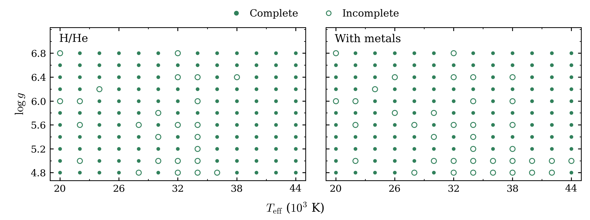

# Grid coverage

The final grids contain 1,542 hydrogen-and-helium spectra and 1,523 spectra with metals.

Each point is one temperature and surface gravity. Filled circles have spectra at all 11 helium abundances. Open circles have at least one missing spectrum. The helium abundances span log10(He/H) = −5 to 0.

The metal spectra include hydrogen and helium, with C/N/O/Si/S in NLTE and Ca in LTE at one fixed composition. The two panels show separate grids; their counts are not added together. Failed points remain masked. Physical accuracy and interpolation accuracy are not established.

[Data and fitting notes](../README.md) · [Earlier heatmap](coverage-temperature-gravity.pdf) · [Detailed coverage and additions](grid-coverage.pdf) · [Earlier figure caption](CAPTION.md)
