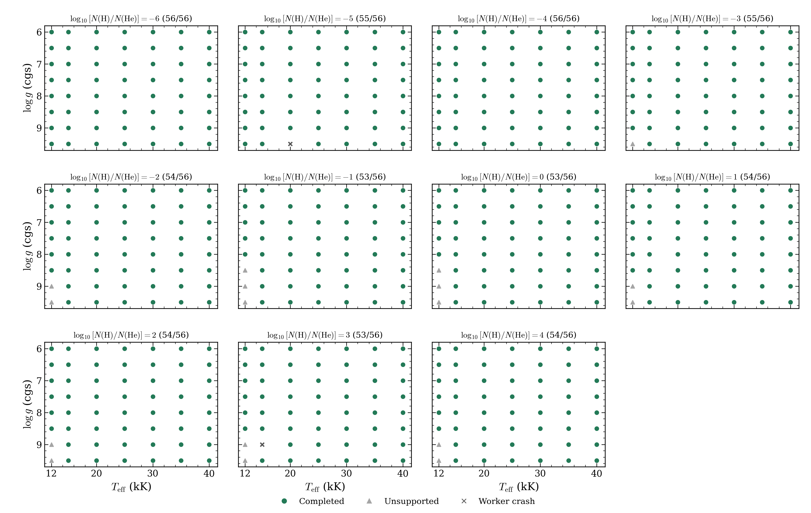
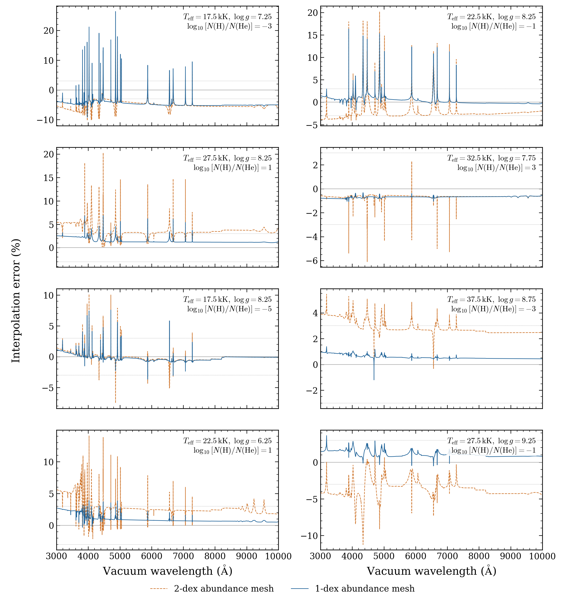
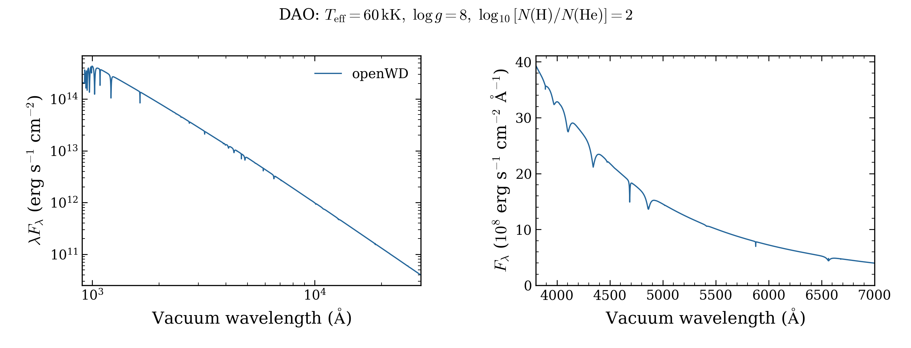

# Models recovered with six-hour runs

Fresh Perlmutter runs recovered **38 of 68 previously timed-out models**. Each
model had a six-hour resource cap. Native physics settings, iteration limits,
acceptance tolerances and wavelength grids were retained. The selected table now
has **2,321 numerically accepted models from 2,459 requests**; no parameter points
were added.

| Family | Retried | Accepted | Remaining outcome |
|---|---:|---:|---|
| DAB/DBA | 9 | 9 | None of these retries remains unfinished |
| DB | 29 | 4 | 13 numerical failures; 12 six-hour timeouts |
| DZ | 27 | 24 | Two numerical failures; one SIGSEGV crash |
| DAO | 1 | 1 | The other 14 grid requests were not part of this run |
| DA | 1 | 0 | Numerical checks failed |
| D6 | 1 | 0 | Six-hour timeout |

[All 68 outcomes and full settings](requests.csv) · [Current family table](../progress.csv)
· [Package size and SHA-256](PACKAGE_VERIFICATION.json) · [All grids](../README.md)

A native numerical failure can end a run before the six-hour cap. These failures
are separate from timeouts and crashes. The DZ worker exited with SIGSEGV at
40,000 K/log g 7.5 with its full recorded metal pattern. Its cause remains
unresolved; this is not evidence that the requested atmosphere is physically
impossible. Original attempts and archives remain intact.

DB uses the merged gravity repair at `c8329d86`, whereas its earlier timed-out
models used `cfe2d2ff`. Its four recoveries therefore cannot be attributed to more
time alone. DAB uses matching source `0a74fdbe`; DZ retains `cfe2d2ff`; DA and DAO
retain their previous `c8329d86` source. The archive records exact source commits,
source/data hashes and complete configurations.

## DAB/DBA coverage



The mesh now has **597 accepted models from 616 coordinates**. It spans
12,000–40,000 K, log g 6–9.5 and log10[N(H)/N(He)] from −6 to +4 in one-dex
steps. Each panel holds abundance fixed and gives accepted models divided by
56 requests. Green circles passed the native atmosphere and independent
final-spectrum source checks. Grey triangles mark unsupported configurations;
dark crosses mark worker crashes. Blank regions were not requested.

All nine DAB timeouts passed. The 19 remaining gaps are **17 unsupported
configurations and two earlier SIGSEGV crashes**. The unsupported points select
the native cool molecular workflow outside its supported gravity; that workflow
currently requires log g 8 and production quality. No atomic fallback or modified
gravity was used. Eleven independent validation coordinates remain outside the
616-point grid denominator.

The saved [eleven-abundance spectrum sequence](../dab-1dex-2026-10-10/dab_abundance_sequence.png)
still holds temperature at 20,000 K and log g at 8. Those spectra did not change.
The [new selected DAB table](dab-selected-requests.csv) records the recovered
coordinates; the earlier [October 10 snapshot](../dab-1dex-2026-10-10/README.md)
preserves its original counts and files.

[Coverage PDF](dab_coverage.pdf)

## All eight interpolation comparisons are now measurable



Each target is an independently calculated, numerically accepted cold-start
model. Orange dashed curves use the earlier two-dex abundance mesh. Blue solid
curves use bilinear interpolation in temperature and log g at the target's exact
abundance in the one-dex mesh. The spectra share identical native wavelength
samples and absolute surface Fλ. No normalization, extrapolation or wavelength
resampling was applied. Dotted lines mark the exploratory ±3% target.

Only **two of eight** tests meet both optical targets: maximum relative error
at most 3% and integrated absolute error at most 1%, over 3,000–10,000 Å.
Maximum errors span **1.08–26.38%**; integrated errors span **0.513–4.384%**.
The previously missing test at 22,500 K/log g 8.25/log(H/He) −1 is now measurable:
its integrated error is **0.930%**, but its maximum error is **16.33%**. Recovering
that corner completes the comparison; it does not make this cell accurate enough
for the stated target.

Temperature and gravity spacing still need refinement before precision fitting.
These differences compare OpenWD calculations and do not measure physical
accuracy against observations or another atmosphere code.

[Residual PDF](interpolation_residuals.pdf) · [Corners, weights and metrics](interpolation/comparison.json)

## First accepted DAO model



The DAO model has temperature **60,000 K**, **log g 8** and
**log10[N(H)/N(He)] = 2**. It passed after **261.24 minutes**. The figure shows
the saved native spectrum over 900–30,000 Å and the optical interval
3,800–7,000 Å. Flux is absolute surface Fλ in `erg s^-1 cm^-2 Angstrom^-1`
at vacuum wavelengths.

This is the native restricted H/He NLTE treatment, with NLTE charge feedback
turned off. Its atmosphere passed the required all-depth equilibrium checks.
The independent fixed-source formal solution passed on identical mass volumes;
this does not test an independently refined depth grid. The other 14 requested
DAO points remain unattempted. This one accepted model is not a full DAO grid.

[DAO PDF](dao_spectrum.pdf) · [Exact plotted spectrum hash](plot_provenance.json)

## Download and reproduce

The contributor draft release has tag `grid-preview-2026-10-11-timeout6`.
[Draft assets](https://github.com/cheyanneshariat/OpenWD/releases) require write
access until publication. `OpenWD-timeout-recovery-20261011.tar.gz` contains all
38 accepted native spectra and saved outputs, their numerical checks and full
settings, the 68 outcomes, remaining diagnostics, execution receipts and file checksums. Earlier
archives remain unchanged.

All 659 remote/local file hashes matched. The 39 saved NPZ files and their
359 arrays in accepted attempts were read without pickle and checked for finite
values. All 38 native spectra were finite, ordered and nonnegative. The portable
archive's 529 files match their packaged hashes. Passing these checks does not
establish physical accuracy, independent atmosphere-depth convergence or
calibrated parameter recovery. The cold DB/Montreal discrepancy remains unresolved.

Both batch jobs ended normally on October 11: the full-node grid job ran for
6 h 6 min 19 s, and the shared DAO/D6 job ran for 6 h 8 min 55 s. They remained
within the conservative 9.75 charged-node-hour reservation ceiling. The final
Iris charge has not been refreshed. No additional allocation was launched.

```bash
tar -xzf OpenWD-timeout-recovery-20261011.tar.gz
(cd OpenWD-timeout-recovery-20261011 && shasum -a 256 -c SHA256SUMS)
python docs/grids/plot_timeout_recovery.py \
  --inputs docs/grids/timeout-recovery-2026-10-11 \
  --bank OpenWD-timeout-recovery-20261011 \
  --output output/timeout-recovery
```

The script checks the saved input and displayed-spectrum hashes and performs no
atmosphere calculation. It exports the DAB coverage, interpolation residuals and
DAO spectrum as PNG/PDF. The [overview script](../plot_grid_progress.py) reproduces
the current family figure from the saved selection table.
