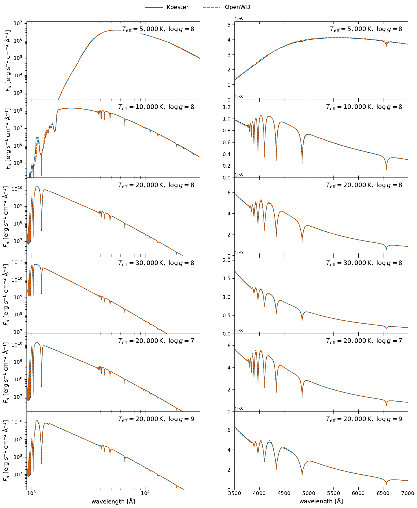
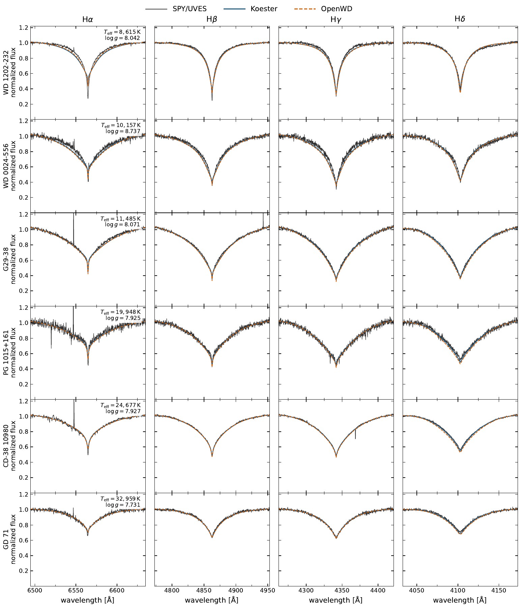
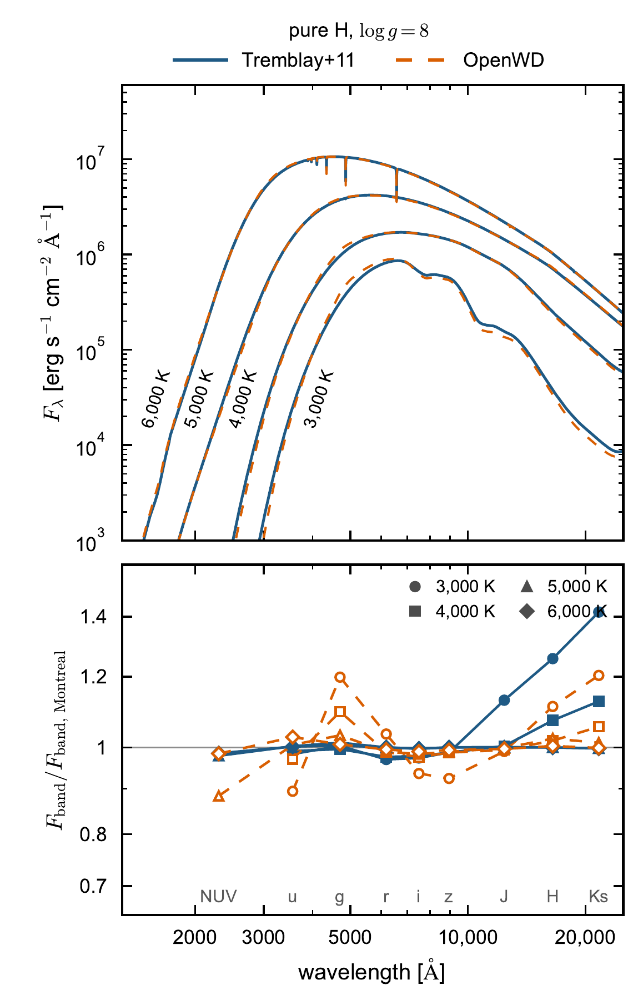

# DA module

[Model guide](README.md) · [Getting started](../getting-started.md)

`compute_da` solves a pure-hydrogen plane-parallel LTE atmosphere in
hydrostatic and radiative/convective equilibrium. It includes Hummer--Mihalas
occupation probabilities, correlated Q-MHD microfields, dissolved-series
opacity, H-/H2/H2+/H3+ chemistry at low temperature, and ML2/alpha=0.7
convection.

Hydrogen bound-bound opacity spans Lyman through Brackett. Charged-particle
profiles use the Tremblay--Bergeron tables. Neutral-H Balmer broadening uses
Ali--Griem below 10,000 K and Barklem at higher temperatures. The validated
Lyman policy uses the fixed TLUSTY/Allard Ly-alpha table at 9000--13,000 K,
temperature-dependent supplied Allard profiles at higher temperature, and the
independent cool neutral-H/H2 wing below 9000 K.

```bash
python examples/one_shot_da.py --teff 12000 --logg 8.0 \
  --quality standard --output results/da-12000-8.0
```

Warm standard models normally take minutes; cool convective production models
can take tens of minutes. `quick` verifies the interface but is not a science
atmosphere. Wavelengths are vacuum Angstrom and output fluxes are surface
`F_lambda`.

Protected cold starts reach 3000 K at log g = 8, with additional checks at
4000, 5000, and 20000 K. See [tested points](../tested-temperature-ranges.md)
and [limitations](../limitations.md) for settings and the scope of that evidence.

## Paper comparisons

The paper tests both the predicted spectral-energy distribution and the
resolved Balmer profiles. The grid comparison uses six fixed parameter pairs:
5000, 10000, 20000 and 30000 K at log g = 8, plus log g = 7 and 9 at
20000 K. Each OpenWD atmosphere is relaxed at its own temperature and gravity
with the pure-H EOS, line profiles and ML2/alpha=0.7 convection described above.
The blue curves are the public Koester DA grid distributed through SVO; they
are comparison spectra, not input atmospheres for OpenWD.

[](../assets/da-paper-grid.pdf)

[Download the grid comparison (PDF)](../assets/da-paper-grid.pdf).
The left panels show the UV--IR distribution and the right panels the optical
spectrum. Both curves are surface `F_lambda`, with no fitted flux scale or
continuum normalization. This tests continuum and line agreement at the
displayed points, rather than certifying every model between them.

The observed comparison holds the parameters from
[Koester et al. (2009)](https://doi.org/10.1051/0004-6361/200912531)
fixed for six SPY/UVES stars, spanning 8615--32959 K. OpenWD calculates an
atmosphere at each parameter pair; the Koester reference is bilinearly
interpolated to the same values. Both predictions are convolved to
`R = 18500` and normalized with the same local sideband procedure as the
observations, since the echelle spectra are not spectrophotometric. Observed
pixels are median-binned to 0.20 Å for display.

[](../assets/da-paper-spy.pdf)

[Download the SPY comparison (PDF)](../assets/da-paper-spy.pdf).
G29-38 and PG 1015+161 contain trace metals, but the displayed broad Balmer
profiles are tested with pure-H models. The close agreement between the two
codes does not remove their shared cool-star line-core residuals: the
one-dimensional LTE and local-convection approximations still matter.
These are the archived paper curves; current synthesis defaults and their
separate regression checks are described below.

### Cool DAs

Below about 6000 K the continuum is shaped mainly by the collision-broadened
red wing of Ly-alpha in the ultraviolet and blue optical, and by H2--H2
collision-induced absorption in the infrared. OpenWD builds the Ly-alpha wing
below 9000 K from the quasi-static H--H and H--H2 profiles of
[Rohrmann et al. (2011)](https://doi.org/10.1111/j.1365-2966.2010.17716.x), with
the temperature dependence of the molecular wing from
[Sahu et al. (2025)](https://arxiv.org/abs/2511.00151). Hydrogen photospheres
stay far less dense than helium ones: at 3000 K and log g = 8 the density at
Rosseland depth 2/3 is about 0.03 g cm^-3 (0.004 g cm^-3 at 4000 K), compared
with about 1 g cm^-3 for pure helium. The DA EOS therefore has no dense-fluid
corrections.

[](../assets/da-cool-comparison.pdf)

[Download the cool-DA comparison (PDF)](../assets/da-cool-comparison.pdf).
OpenWD models are fresh `run_model` production cold starts at 3000--6000 K and
log g = 8. The top panel compares them with the 1D grid of
[Tremblay et al. (2011)](https://doi.org/10.1088/0004-637X/730/2/128), and the
bottom panel shows band-averaged fluxes relative to the Montreal synthetic
photometry, which uses the models of
[Blouin et al. (2018)](https://doi.org/10.3847/1538-4357/aad4a9) below 5000 K
and of Tremblay et al. above. Bands more than 1000 times fainter than the peak
of the spectral energy distribution are omitted.

- At 5000 and 6000 K, OpenWD agrees with Tremblay et al. to within about 3% from
  SDSS u to 2MASS Ks; GALEX bands differ by up to 10%.
- At 4000 and 3000 K, OpenWD is fainter in GALEX NUV (by 25% and a factor of
  about 2) and brighter in SDSS g (by 10% and 20%). Both reference grids use the
  Ly-alpha wing of
  [Kowalski & Saumon (2006)](https://doi.org/10.1086/509723), so this most
  likely reflects the different wing; it is the main uncertainty of cool DA
  models below about 4500 K.
- In the near-infrared at 3000--4000 K, OpenWD lies between the two reference
  grids and closer to Blouin et al.

## Radiative atmospheres with convection disabled

Set `DAConfig(mixing_length_alpha=None)` to solve a radiative atmosphere.
The solver enforces local heating/cooling balance from its first iteration;
it skips the ML2 gradient conditioner when there is no convective transport.
Its energy solve uses a fresh temperature-response matrix with consistent
equation weights on every step.

For `quality="production"`, the initial 100-layer grid gets up to 40 Newton
iterations. If it fails equilibrium, the code interpolates that numerical
seed onto 200 layers and solves the same equations again. This resolves
steep hydrogen-ionization transitions that can stall the coarser grid. At
`quality="standard"` a failed 40-layer solve is re-solved on 100 and then
200 layers in the same way; converged solves are never refined. Doubling
from 40 does not work for G 76−48: neither 80 nor 160 layers recover. A supplied
finer radiative restart retains its depth resolution. Temperature, gravity,
chemistry, opacity prescriptions, convection and convergence tolerances are
unchanged. The finer atmosphere must pass its own complete equilibrium
certificate; exhausting the attempts still returns an unconverged warning.
The refinement and initial failure diagnostics are recorded in atmosphere
metadata under `radiative_depth_refinement`.

This path also serves the default DAH prescription on a nonmagnetic atmosphere
when the field suppresses convection.
The G 76−48 regression uses 6680 K and log g = 7.96, with molecular chemistry,
zero magnetic field in the structure calculation and convection disabled.

## Spectrum synthesis

`compute_da` uses monotone cubic (PCHIP) source interpolation by default to
reduce coarse-depth-grid flux bias:

```python
import numpy as np
from wd_spectra import DAConfig, compute_da

result = compute_da(
    DAConfig(effective_temperature=12000, logg=8, quality="standard"),
    np.geomspace(100, 1_000_000, 6000),
)
```

This is a cold start. Cubic interpolation changes only the final spectrum calculation:
the atmosphere solver, depth grid, opacities and convection are unchanged.
Scattering is solved consistently with the cubic interpolation, with a
separate source-closure check. There is no fitted flux scaling or imposed
bolometric normalization, and failure does not select another method.
The selected method is recorded in `result.spectrum.metadata`.

On the checked 12000-K, log-g=8 standard model, this reduces the broad sampled
flux deficit from about 2% to about 0.02%, adding roughly 1-2 seconds of
transfer work. It can also change normalized Balmer profiles by about 1-2%
on that 40-layer grid. Wavelength, depth and full-physics validation remain
separate requirements. To explicitly reproduce the former interpolation
method, pass `synthesis_transfer="formal-linear"`; this does not undo physics
corrections in the EOS. Both methods are independently source-checked.
Low-level synthesis routines retain their explicit legacy defaults, including
the directional-intensity interface. Other public models' synthesis defaults
are unchanged.

## Flux conservation (2026-10-01)

Two numerics settings are on by default:

- `photospheric_depth_concentration` concentrates the structure depths
  across 0.01 < tau < 10 at an unchanged point count. For DA the default is
  3 on the 40-layer standard mesh and 1 for 100 layers. With 40 layers the
  steep 10-12 kK hydrogen photosphere left 0.5% excess flux at 1 (0.2-0.3%
  at 3). The 100-layer production mesh already resolves it.
- `synthesis_transfer_depth_refinement=4` subdivides each depth interval for
  the final formal solution.

Before, the 40-point standard structures emitted up to 2-3% more than
sigma Teff^4. The bare-grid formal solution partly cancelled this, so the
totals looked right while the structure was not. Standard-quality totals
are now within about 0.75% (see the [DZ guide](DZ.md) for the method). Setting
both to 0 and 1 restores the previous numerics.

## Cold-start seed and lower boundary (2026-10-14)

Two defaults fix the 44 DA failures of the October 8 grid (PR 18), most of
them between 4250 and 5000 K and in hot low-gravity models.

- `convective_seed=True`. The gray Eddington seed sets the column-mass grid
  that the solver keeps. In cool, dense hydrogen its steep Rosseland opacity
  packs Rosseland depths 1-100 into a few per cent of the column mass at up
  to three times the convective temperature (13,265 K at the bottom of the
  4500 K, log g = 7 seed, where the converged model has 5,225 K). From there
  the solver stalled at about 0.75 sigma Teff^4. Where the gray seed is
  convectively unstable at Rosseland depth one (gray gradient above the
  adiabatic one; 3000-14,000 K at log g = 8), the seed now follows the
  Schwarzschild-limited gradient min(gray, adiabatic) below that depth, on
  layers spaced in pressure, down to the seed's own `tau_max`. Radiative
  seeds (20,000 K and hotter) are unchanged. `convective_seed=False` restores
  the gray seed.
- `lower_boundary_extensions=4`. The seed bottom was fixed at Rosseland
  depth 100, which lets hot low-gravity models leak radiation (escape bound
  0.002-0.005 against the 0.002 screen). A cold solve that fails the
  lower-boundary screen, alone or with other checks, is re-solved cold with a
  4x deeper bottom and proportionally more layers. 0 disables it.

Production cold starts on the new defaults pass all five certificate gates at
4250/6.0, 4500/7.0, 4750/7.75, 5000/7.25, 6500/6.0 and 3000/9.5 (Teff/log g;
former failures), at the canary points 3000, 4000 and 5000 K (log g = 8), and
at 6000, 8000, 10,000, 12,000 and 14,000 K (log g = 8), in 8-31 minutes. The
former hot failures 30,000/5.0, 32,000/6.0, 34,000/6.25 and 38,000/6.0 pass
after one extension, in 7-8 minutes. The canary spectra change by less than
3e-5 of the peak; their column-mass grids change below depth one, and the
cold references were recaptured. 2500 K, log g = 9 still misses the
all-depth flux gate (0.0039) in its deep convection zone. LTE DA models above
about 40,000 K are not a substitute for NLTE.

## H2 Lyman and Werner lines (opt-in)

Cool hydrogen white dwarfs show far-UV H2 Lyman (B-X) and Werner (C-X) lines
from vibrationally excited ground-state levels (Xu et al. 2013). Set
`DAConfig(h2_lyman_werner_lines=True)` to add them to the final spectrum.
The H2 lines enter only the final spectrum, but they require molecular
chemistry. The option therefore enables molecules above 12,000 K, where they
are otherwise off by default, and raises an error if `include_molecules=False`.
At or below 12,000 K the atmosphere is unchanged. Above it, the molecular EOS
changes the structure: by up to about 2% in temperature for the 12,300-12,800 K
stars below.

- Line data: Kurucz's `h2bx`/`h2cx` lists, bundled and checksum-verified (see
  `src/wd_spectra/data/molecular/README.md`). Only transitions between
  measured levels contribute opacity; every transition sets the upper-level
  branching ratios. Bound and dissociative decay rates of the levels
  tabulated by Abgrall, Roueff & Drira (2000) are theirs.
- Lower levels: LTE, from the EOS H2 density and the same Barklem & Collet
  partition function. Collisional dissociation and formation keep the
  molecule close to LTE where the lines form; photodissociation is negligible
  there.
- Source functions: not LTE. The B and C upper levels decay in about 1 ns, so
  each line has the fluorescent source function from upper-level statistical
  equilibrium:
  `S/B = [sum A_branch (J/B)_branch + A_c + C_u] / [A_u + A_c + C_u]`.
  Radiative dissociation `A_c` comes from Abgrall, Roueff & Drira (2000) and
  electron de-excitation `C_u` from van Regemorter. The mean-intensity ratio
  `J/B` comes from a separate metal-free transfer solution on a 1 Å grid over
  845-1850 Å. The branch lines are treated as optically thin.
- Profiles: Voigt, with thermal Doppler width and damping from the bound plus
  dissociative decay rates.

With LTE source functions the predicted lines are much too strong. With the
fluorescent source function, the line strengths fitted to HST/COS G130M spectra
at fixed published parameters are as follows. `k` scales the model H2
absorption depth; `k = 1` means the predicted depth matches.

| Star | Type | chi^2 off -> on | fitted `k` |
|---|---|---|---|
| WD 2341+322 | DA, 12,787 K | 1.15 -> 0.99 | 0.94 +- 0.03 |
| GD 31 | DA, 12,265 K | 0.67 -> 0.68 | 0.43 +- 0.03 |
| GD 133 | DAZ | 2.37 -> 1.47 | 1.14 +- 0.01 |
| G29-38 | DAZ | 3.26 -> 2.71 | 0.78 +- 0.01 |

These chi^2 values are over 1153-1437 Å, with ISM and airglow masked. GD 31's
published temperatures disagree, which may explain its weak observed lines.
Runtime increases by up to about 15% in these models. The option is off by
default, so all existing regression controls are unchanged.
