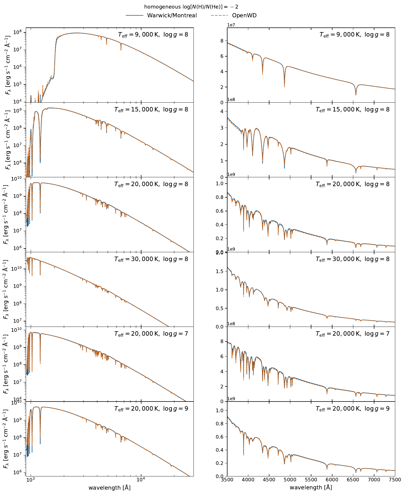

# DAB/DBA module

[Model guide](README.md) · [Getting started](../getting-started.md)

`compute_dab` defaults to one homogeneous atomic H/He layer in LTE; it is not a
stratified thin-hydrogen-layer calculation. Hydrogen and helium share the
charge-neutrality solution and nonideal occupation-probability EOS. The module
combines the DA hydrogen opacity/profile treatment with the DB helium profiles
and uses ML2/alpha=1.25 convection.

```bash
python examples/one_shot_dab.py --teff 20000 --logg 8.0 --log-h-he -2 \
  --quality standard --output results/dab-20000-8.0
```

`--log-h-he` means `log10[N(H)/N(He)]`. Standard calculations typically take
3--20 minutes, with cool mixtures and low-gravity production models slower.

## Paper comparison

The paper fixes `log_hydrogen_to_helium = -2` and compares six homogeneous
H/He atmospheres with the Montreal DB/DBA grid of
[Cukanovaite et al. (2021)](https://doi.org/10.1093/mnras/staa3684).
The temperature sequence is 9000, 15000, 20000 and 30000 K at log g = 8;
two additional models have log g = 7 and 9 at 20000 K. The composition is
one hydrogen nucleus per 100 helium nuclei throughout the atmosphere.

[](../assets/dab-paper-grid.pdf)

[Download the comparison (PDF)](../assets/dab-paper-grid.pdf).
Each OpenWD structure is relaxed with the shared H/He charge-neutrality
solution, the hydrogen and helium opacities, and ML2/alpha=1.25 convection.
Both species therefore affect the temperature structure as well as the
final spectrum. The left panels show 900--30000 Å surface flux and the right
panels show the optical hydrogen and helium features. Neither curve is
rescaled or continuum-normalized for the plot, and the comparison grid does
not provide OpenWD's temperature structure.

This is a fixed-composition comparison between atmosphere codes, not an
observational abundance fit or a test of a stratified H/He layer. The archived
paper spectra and the current molecular cold-start checks below answer
different questions; the six plotted points do not validate cooler mixtures.

## Cool mixtures and the molecular closure

`run_model(DABConfig(...), output_directory)` runs every metal-free DAB with the
in-process molecular H/He closure: H2, H2+, H-, H3+, HeH+, H/He ionization,
H2-He/H2-H2 collision-induced absorption and neutral Ly-alpha wings, at any
temperature and gravity. The molecular terms vanish where molecules are absent,
so neighbouring grid models share one set of physics; there is no switch at a
molecular threshold or at log g = 8. The H2 screen is recorded in the run
manifest for provenance only. DABs with trace metals keep the atomic mixture
and are refused where the screen indicates molecular chemistry.
`compute_dab` stays atomic unless `include_molecules=True`.

Even where molecules are rare, the closure changes the far UV: at 12000 K,
log10 N(H)/N(He) = 0, the molecular and atomic spectra differ by up to 17%
(log g 8) and 32% (log g 9) near 1083 A, mainly from H2 Lyman/Werner
absorption, but by at most 0.1-0.3% in the optical and 0.001% in total flux.

Production cold starts pass all five certificate gates at 7500, 8000, 9000 and
10000 K (log g 8, log10 N(H)/N(He) = -2) and at 12000 K (log g 8 and 9) and
15000 K (log g 9) for log10 N(H)/N(He) = 0. These are individual points, not a
guaranteed interval; 7250 and 5000 K remain unqualified. The pinned HITRAN
`H2-He_2011.cia` table is required. See
[cool-model setup](../getting-started.md#cool-helium-and-mixed-atmospheres),
[tested points](../tested-temperature-ranges.md), and
[physical limitations](../limitations.md#physical-approximations).

## Lyman-alpha profiles below 9000 K (2026-10-13)

`DABConfig(allard_minimum_effective_temperature=None)` is the default: the
delivered Allard Lyman profiles are used at every Teff. The tables start at
9000 K, so cooler local gas uses the 9000-K table, as the cool upper layers of
9000-K models already did. At 8000 K, log g = 8 and log10 N(H)/N(He) = -2 this
follows the Cukanovaite et al. (2021) DBA model to +25-30% over 1150-1500 A,
as at 9000 K; the previous cool neutral-H wing treatment over-predicted
1150-1300 A by a factor of ~50. The optical continuum changes by about 1%.
Pass a number to restore a Teff cutoff. This has not been checked below 8000 K.

## Flux conservation (2026-10-01)

Two numerics settings are on by default:

- `photospheric_depth_concentration=1` concentrates the structure depths
  across 0.01 < tau < 10 at an unchanged point count.
- `synthesis_transfer_depth_refinement=4` subdivides each depth interval for
  the final formal solution.

Before, the 40-point standard structures emitted up to 2-3% more than
sigma Teff^4. The bare-grid formal solution partly cancelled this, so the
totals looked right while the structure was not. Standard-quality totals
are now within about 0.75% (see the [DZ guide](DZ.md) for the method). Setting
both to 0 and 1 restores the previous numerics.

## Trace metals

`DABConfig(abundances={...})` adds trace metals to the homogeneous atomic
H/He atmosphere. Abundances are **log10 N(Z)/N(H)**, as for DAZ. Thus, the
host can be hydrogen-rich (DABZ, DAZB) or helium-rich (DBAZ).

- The H/He EOS, the hydrogen frequency grid and the thermodynamic
  derivatives are those of the metal-free mixture.
- The metals share its charge closure at fixed H and He nuclei densities.
- The metals add bound-bound and Verner/phfit2 bound-free opacity to the
  structure (opacity-sampled at R = 1000) and to the final spectrum.
- `maximum_metal_charge` (default 4) can be one value or a mapping by
  element.
- `metal_classical_electron_stark=True` adds the SYNSPEC classical electron
  width to metal lines that have no tabulated Stark width.
- Molecular mixtures with metals are rejected. They do not run without the
  metals.

Use DZ for helium-dominated stars with little hydrogen: its He EOS treats
hydrogen as a trace species. Use DAB for hydrogen-rich or mixed hosts. With
metal opacity, the solver takes its Rosseland depth scale from the full
structure opacity. Thus, compare structures on column mass.

The bundled Stout Ni, Cu and Zn IV–VI ions contain only forbidden lines. By
default, these stages add charge and partition functions, but no E1
absorption. `metal_line_supplements` adds optional E1 lines. The default
`()` uses Stout only.

- `"rauch-zn-cu"`: the HFR lines of Rauch et al. for Zn IV–V (2014) and
  Cu IV–VI (2020), attached to Stout levels. No levels are added. See the
  [data README](../../src/wd_spectra/data/runtime/cache/metal-opacity/rauch-zn-cu/README.md).
- `"kurucz-fe-ni"`: Kurucz measured-level lines of Fe IV, Fe VII and
  Ni IV–VI, with Kurucz damping constants, added between level pairs that
  Stout does not connect. Kurucz levels that Stout does not have are added
  (31, 20 and 140 for Ni IV–VI). At 35800 K, they increase the Ni VI
  partition function by 1.4%. Fe V, Fe VI and Ni VII are excluded, because
  some of their Kurucz levels would duplicate Stout levels.

At the HS 0209+0832 parameters (35800 K, log g = 7.90, log H/He = 1.90), a
standard cold start with all metals at log N(Z)/N(H) = -20 reproduces the
metal-free preset. The difference is |dT/T| < 7 × 10⁻⁴ on column mass below
the top layer and 0.14% in the emergent flux. The
[development note](../development/niobium.md) gives the nine-metal model and
its comparison with the observed far-UV spectrum.
