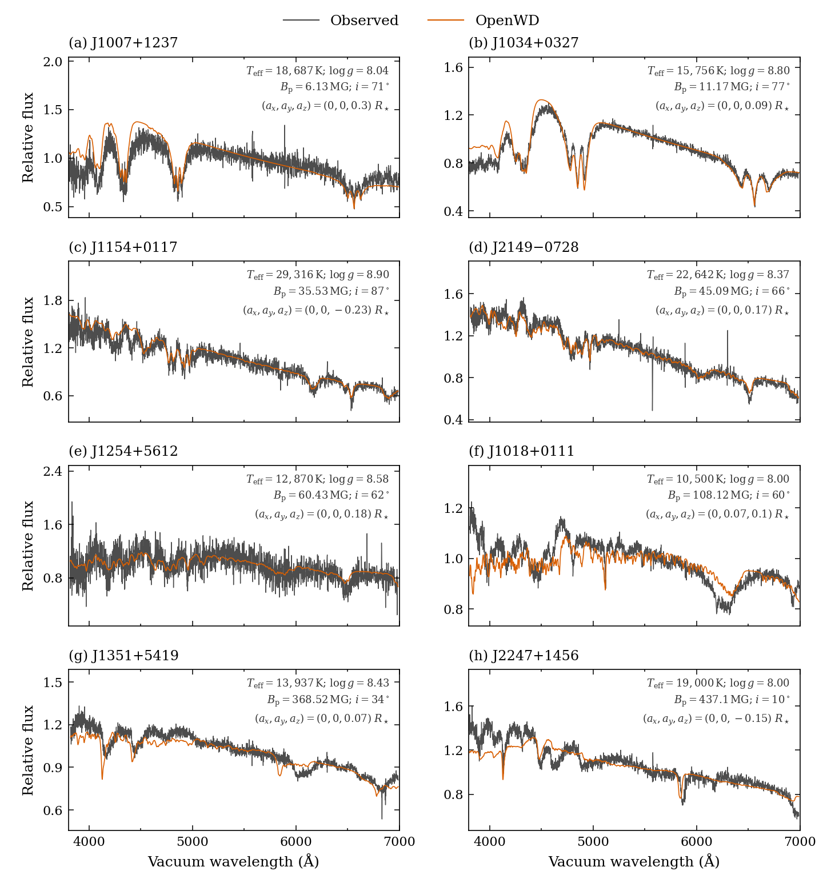

# DAH module

[Model guide](README.md) · [Getting started](../getting-started.md)

`DAHConfig` predicts disk-integrated optical spectra of magnetic,
pure-hydrogen white dwarfs. The default uses a nonmagnetic DA atmosphere,
normalized Kurucz/Griem Balmer components and scalar Stokes-I magnetic
transfer. Above 1 MG it adds **stationary-state RWA photoionization and the
magnetic Saha/HM EOS** (Rohrmann 2026) in each surface cell. Convection is
suppressed above a projected-area mean field of 0.05 MG. The 2026 paper
comparison used the zero-field EOS and continuum instead; that prescription
remains available as `paper_dah_config(...)` (see
[the paper prescription](#the-paper-prescription)).
The output covers vacuum wavelengths from 3400 to 8000 Å and is surface
`F_lambda` in erg s⁻¹ cm⁻² Å⁻¹.

## Quick start

This example uses the fixed published geometry of J1007+1237, whose mean
visible field is about 5.20 MG (the dipole polar parameter is 6.13 MG):

```python
import numpy as np
from wd_spectra import DAHConfig, run_model

config = DAHConfig(
    effective_temperature=18_687, logg=8.04,
    magnetic_field_megagauss=6.13,
    field_geometry="dipole", dipole_inclination_deg=71,
    dipole_offset_radius=(0.0, 0.0, 0.30),
    quality="production",
)
run = run_model(
    config, "results/j1007",  # choose a new directory
    wavelength=np.arange(3600.0, 7100.01, 0.5),
    require_convergence=True,
)
print(run.convergence_verified)
```

The atmosphere is computed from scratch. No downloaded model grid, research
patch, observed spectrum or previous atmosphere is required. To return a
`ModelResult` in memory, use `compute_dah(config, wavelength)`; inspect
`result.atmosphere.metadata["equilibrium_certificate"]` before using it.
`run_model` saves the configuration, spectrum, atmosphere and diagnostics
and can require a successful certificate.

The equivalent one-shot command is:

```sh
python examples/one_shot_dah.py --teff 18687 --logg 8.04 \
    --field-mg 6.13 --geometry dipole --inclination 71 --offset 0 0 0.30 \
    --quality production --require-convergence --output results/j1007-cli
```

`examples/dah_paper.py` accepts any of the eight paper object keys and holds
its temperature, gravity and geometry fixed. It uses the paper prescription by
default; `--prescription default` selects the current public default.
`quality="production"` is the paper resolution (initially 100 depth points
and four synthesis angles). `standard` uses the ordinary smaller structure
grid; `quick` is only a smoke test and is not a convergence guarantee.

## Field geometry

| Input | Meaning |
| --- | --- |
| `field_geometry="uniform"` | One modulus over the disk; the default geometry. |
| `field_angle_deg=None` | Isotropic field directions for the uniform model; a number fixes the angle to the line of sight. |
| `field_geometry="dipole"` | Centered or displaced dipole integrated over the visible surface. |
| `magnetic_field_megagauss` | Uniform modulus, or polar field of the **undisplaced** dipole. |
| `field_strength_definition="visible-mean"` | Instead normalize a dipole to the projected-area mean modulus. |
| `dipole_inclination_deg` | Angle between the dipole axis and the line of sight. |
| `dipole_offset_radius=(ax, ay, az)` | Displacement in stellar radii in the magnetic-axis frame: z along the dipole axis, line of sight in the x–z plane. |
| `disk_field_bins=21` | Compress the resolved surface quadrature into field bins; `None` retains all cells. |
| `disk_component_drift_angstrom=None` | Opt-in dipole binning by estimated component drift; takes precedence over `disk_field_bins` (see below). |

The atomic regime is selected from a bound on the **continuous visible
surface maximum**, not a compressed bin mean or the polar input parameter.
Bounds are exact for axial offsets and conservative for transverse offsets;
the result records `visible_field_bounds_exact` and the field interval.
An offset dipole with a polar field below 100 MG can have local fields above
100 MG. The 100-MG scale is not a universal accuracy cutoff.

Each compressed bin is synthesized at one mean field. In the tested
high-field examples, components move rapidly between the default bins,
leaving discrete copies rather than a resolved field-spread profile.
Larger `disk_field_bins` values and `None` remain supported. They change
compression, not raw surface resolution; the new option also uses a denser
surface grid. Explicit dense grids are available at the lower level through
`dipole_surface_cells`.
`disk_component_drift_angstrom` builds bins from a 192 × 384 (or denser)
visible-surface grid. The bin edges lie at equal steps of the accumulated
drift ∫ max|dλ/dB| dB on a 4001-point field grid. The screen uses Balmer
components inside the output window (±100 Å) with at least 1% of their
parent line's strongest `energy × dipole-strength` proxy, not their
temperature-dependent LTE opacity. This is an estimated drift budget
within each interval, not a bound on adjacent bin means or spectral error.
Components outside the screen, broad wings, angular compression and finite
raw-surface resolution still require convergence checks. Requests needing
more than 4096 drift intervals fail rather than silently coarsen.

Each field interval also retains up to eight limb-cosine subgroups. Their
projected weights and mean limb cosines preserve disk integration when
component drift is negligible, including at zero field. The subgroups
share the interval's mean field, so they reuse its opacity and radiation
source calculation; their field–ray angles are averaged separately. The
result reports distinct field bins and limb rays separately.

With 16 Å, the archived J1018+0111 and J1351+5419 calculations use 130 and
267 field bins. These archived runs preceded the independent limb sampling;
their spectra and timings describe the earlier one-ray-per-field version.
The option is slower than the 21-bin default because every field bin needs
an opacity/source calculation and each limb subgroup needs an emergent ray.
See the
[disk-quadrature benchmark](../development/history/dah-disk-quadrature-2026-10-08.md)
for measured accuracy and cost. Start with 16 Å for these cases and tighten
it for your target and instrumental resolution; it is not a universal
accuracy setting. The option is off by default and does not change the
frozen paper predictions. `result.metadata["domain_notes"]` records the
scope of this numerical estimate and the unchanged physics approximations.

## Default physics

1. **Structure.** The shared adaptive Newton solver converges an ordinary
   nonmagnetic DA atmosphere. The zero-field DA opacities, including its
   usual unified Balmer profiles, determine the structure. The magnetic
   Kurucz/Griem spectrum is then computed on that temperature–pressure
   structure. The certificate establishes equilibrium of the **nonmagnetic
   structure**, not radiative equilibrium with magnetic opacities in every
   surface cell. This scope is explicit in the model metadata.
2. **Line shapes.** `balmer_profile="kurucz-griem"` implements the historical
   Kurucz (1970) / Griem Stark approximation (SAO Report 309, section 5.14;
   `STARK`, printed p. 243). Each parent-line shape is divided by its own
   infinite-frequency-detuning integral, independently of the output mesh,
   and multiplied by the ordinary LTE oscillator strength and HM/Q-MHD
   population and occupation factors. No width or opacity multiplier is
   fitted. The historical profile has no separate Doppler convolution,
   neutral self broadening or unbroadened central component.
3. **Magnetic components.** If every visible field is at most 1 MG, Hα–H22
   use normal Zeeman triplets, with Δν = eB/(4πm_e c). Otherwise Hα–H12 use
   H2db wavelengths and relative strengths, including Boltzmann populations
   of the split n=2 substates. H13 and higher are omitted in this regime.
   The reader restores the archived mirror components with the physical
   sign of m. Cells below the complete table's 0.0470103-MG floor use an
   analytic normal-triplet continuation.
4. **Line strength.** `normalize_balmer_strength=True` divides each H2db
   parent line's complete component weights by their depth-dependent sum,
   **including stimulated emission at each component frequency**, before
   angular weighting. The isotropic integrated strength equals that of the
   zero-field parent. The ray-specific integral need not be field independent.
   Components translate the parent profile in frequency; finite templates
   span 900–25000 Å and are never renormalized to the requested output window.
5. **Transfer.** `polarized_transfer="scalar-stokes-i"` integrates rays with
   their local π/σ angular weights and limb cosines. The coherent-scattering
   source is solved for each cell's angle-averaged opacity. Dipole quadrature
   starts at 8 limb × 16 azimuth nodes and refines to resolve displaced polar
   caps. Field-bin compression splits bins crossing 1 MG.
6. **Continuum and chemistry.** Above 1 MG each surface cell re-evaluates
   the magnetic Saha/HM equilibrium (Landau-quantized free charges, H2db
   substate energies, centered-motion transverse masses) on the fixed
   temperature–pressure structure, and replaces the zero-field H I
   bound-free opacity of n=1–8 with stationary-state RWA cross sections for
   each polarization, continued below each shifted edge by the dissolved-level
   closure. Free–free absorption and scattering keep their zero-field form;
   cyclotron absorption is off. At or below 1 MG the zero-field EOS and
   continuum are used. Molecular chemistry, H⁻ and H₃⁺ are included for
   weak-field models at or below 12000 K and omitted at strong fields.

   The RWA reproduces Rohrmann's published opacities to 0.02 dex up to
   47 MG and agrees with the Zhao & Stancil (2007) quantum cross sections
   to within about 0.3 dex up to 211 MG. At 235 MG individual transitions
   differ by 1–2 dex, so above 200 MG of visible field the continuum is
   uncertain; such requests record a `domain_notes` entry. On ten SDSS
   objects at fixed published parameters it improved the line-level fit for
   eight and worsened J2247+1456 (437 MG); see the
   [2026-10-25 change note](../development/history/dah-rwa-default-2026-10-25.md).

The normal convection policy uses ML2/α=0.7 below 0.05 MG and no convection
above it. An explicit positive `mixing_length_alpha` overrides this policy.
For a strictly radiative DA control at any field, use
`DAConfig(mixing_length_alpha=None)`. A radiative structure that fails its
certificate is re-solved on doubled layers with unchanged physics and fresh
convergence checks: 100 → 200 at `production`, 40 → 100 → 200 at `standard`;
see the [DA guide](DA.md#radiative-atmospheres-with-convection-disabled).
The mean-field magnetic structure uses the same ladder. G 76−48 (6680 K,
log g=7.96) and the mean-field J1018+0111 (10500 K) motivated these repairs.
They do not establish an entire cool radiative grid or remove the observed
line-core discrepancies.

## Results at published parameters

The comparison below uses the current default (RWA photoionization and the
magnetic EOS above 1 MG) at these fixed values, ordered by dipole polar field.
The first four have continuous visible maxima below 100 MG; the remaining
objects test the prescription at higher fields, and J1351 and J2247 exceed the
RWA's tested range of about 200 MG.

| Object | Teff (K) | log g | Bp (MG) | i (deg) | (ax, ay, az) |
| --- | ---: | ---: | ---: | ---: | --- |
| J1007+1237 | 18687 | 8.04 | 6.13 | 71 | (0, 0, 0.30) |
| J1034+0327 | 15756 | 8.80 | 11.17 | 77 | (0, 0, 0.09) |
| J1154+0117 | 29316 | 8.90 | 35.53 | 87 | (0, 0, −0.23) |
| J2149−0728 | 22642 | 8.37 | 45.09 | 66 | (0, 0, 0.17) |
| J1254+5612 | 12870 | 8.58 | 60.43 | 62 | (0, 0, 0.18) |
| J1018+0111 | 10500 | 8.00 | 108.12 | 60 | (0, 0.07, 0.10) |
| J1351+5419 | 13937 | 8.43 | 368.52 | 34 | (0, 0, 0.07) |
| J2247+1456 | 19000 | 8.00 | 437.10 | 10 | (0, 0, −0.15) |

[](../assets/dah-paper-unscaled.pdf)

[Download the single-scale comparison (PDF)](../assets/dah-paper-unscaled.pdf)
or the [paper's smoothly rescaled comparison (PDF)](../assets/dah-paper-rescaled.pdf).

The figure above uses one flux scale per object. The
[smoothly rescaled version](../assets/dah-paper-rescaled.png) used in the
paper additionally applies the disclosed continuum correction (factors 0.78–1.16);
neither version changes the stellar parameters. Both are synthesized on the
same certified nonmagnetic structures as the 2026-09-29 paper-prescription
figure; only the magnetic continuum and EOS differ. Relative to that
prescription the default mainly brightens the blue end of J1018, reshapes
J1351 redward of 6000 Å, and over-absorbs J2247 at 4100–4450 Å. Observations are SDSS/BOSS spectra
and the Hardy et al. comparison data. J1007 uses SDSS plate 5328, MJD 55982,
fiber 66; its spectrum is not velocity shifted or dereddened. J1034 uses
the previously photometrically recalibrated observation.

The model spectra in the figure are the approved default controls in
[tests/data/approved_regressions/dah_rwa_default_2026_10_25](../../tests/data/approved_regressions/dah_rwa_default_2026_10_25/README.md);
the earlier paper-prescription spectra remain immutable controls in
[tests/data/dah_paper](../../tests/data/dah_paper/README.md). Fixed-state tests
exercise both with atmosphere iteration forbidden. Separate cold-start canaries
for J1007 and J1254 create new structures and require all five equilibrium
gates as well as absolute-flux agreement with the approved default spectra.

```sh
python tools/validate.py spectra --case dah-j1007+1237
python tools/validate.py cold --case dah-j1007+1237 --case dah-j1254+5612
python tools/validate.py cold --case da-radiative-g76-48
```

Bundled observational controls are available through
`wd_spectra.validation.magnetic_da`; `research/validate_dah_observed.py`
runs their public models and saves comparisons. `chi2_scale` and
`chi2_cubic` are noise-weighted χ² per pixel (3820–6950 Å) after one flux
scale, and after a cubic multiplicative continuum that isolates the magnetic
features from flux calibration. They use the survey inverse variances bundled
with the spectra; GH Leo has none, so its noise is estimated from the
high-pass scatter. Compare χ² between models of one object. The older
`feature_rms` is dominated by photon noise for most of these spectra and is
kept only for continuity. Its fitted velocity and
single 5200–6100 Å scale belong to the comparison, never the atmosphere or
spectrum calculation. Smooth rescaling used in one paper-figure variant is
also a plotting operation: a positive quadratic correction in log flux.
It can absorb flux-calibration error **or** a physical continuum error.
The unscaled variant is necessary for assessing continuum agreement.

## The paper prescription

`paper_dah_config(**parameters)` returns a `DAHConfig` with the prescription
of the 2026 paper figure (the default until 2026-10-25): the same structure,
lines and transfer as the default, but the zero-field EOS and H I bound-free
continuum at all fields. It accepts stellar, geometry, transfer and numerical
inputs and rejects attempts to change the prescription's physics;
`DAH_PAPER_PRESCRIPTION` lists the fixed switches. Transfer defaults to scalar
Stokes I, as in the paper figure; `polarized_transfer="full-stokes-iquv"`
keeps the same physics.

```python
from wd_spectra import paper_dah_config

paper = paper_dah_config(
    effective_temperature=18_687, logg=8.04, magnetic_field_megagauss=6.13,
    field_geometry="dipole", dipole_inclination_deg=71,
    dipole_offset_radius=(0.0, 0.0, 0.30), quality="production",
)
```

The frozen paper spectra in `tests/data/dah_paper` test this preset; the
approved default spectra on the same atmospheres are in
`tests/data/approved_regressions/dah_rwa_default_2026_10_25`.

## Other physics options

The previous coupled magnetic treatment remains explicitly selectable:

```python
from dataclasses import replace

coupled = replace(
    config,
    atmosphere_structure="mean-field",
    balmer_profile="unified", normalize_balmer_strength=False,
    polarized_transfer="full-stokes-iquv",
    include_magnetic_eos=True, include_rwa_photoionization=True,
    include_centered_motion=True,
)
```

Above 1 MG this solves one structure at the projected-area mean field with
angle-averaged H2db Balmer opacity, the selected continuum and optional
magnetic Saha/HM chemistry. The structure uses the same `balmer_profile` and
`normalize_balmer_strength` as the synthesis (before 2026-10-25 it always used
unified, unnormalized profiles). Below 1 MG it retains the DA-structure
approximation. `balmer_profile="unified"` selects the ordinary zero-field
Stark and neutral-broadening templates; `normalize_balmer_strength=False`
retains the field-dependent H2db total oscillator strength.

`include_rwa_photoionization` (default `True`) selects stationary-state
rigid-wavefunction H I photoionization through n=8 with shifted
dissolved-level edges. `include_magnetic_eos` (default `True`) selects
Landau-quantized charged particles and H2db stationary energies in the
Saha/HM closure. `include_centered_motion` (default `True`) controls the
transverse-mass weighting in both the EOS and RWA populations. Each can be
switched off individually; the paper preset switches off all three.

Full IQUV transfer includes dichroism and magneto-optical dispersion at each
cell. By default only disk-integrated Stokes I is returned. Full IQUV transfer works with both
line prescriptions: each magneto-optical profile is the Kramers–Kronig partner of
its absorption profile, and template nodes that round to the same frequency
are merged before the transform. Polarized output uses the separate signed
geometry described below; the legacy compressed geometry is intensity-only.
The predicted Q/U/V have not been validated against polarimetry.
`include_cyclotron_absorption=True` additionally uses
magneto-ionic free-free and Thomson coefficients with a Doppler-broadened
cyclotron resonance. Its broad optical absorption at hundreds of MG is not
supported by all comparison objects and remains off by default.

## Opt-in polarized output

Set `return_stokes=True` together with full transfer. A built-in dipole also requires
`disk_field_bins=None`; drift-based compression is unsupported for polarization.
The existing intensity calculation and two-column `spectrum.txt` remain the
default when the option is off.

Polarized output inherits the selected physics. `DAHConfig` uses RWA
photoionization, the magnetic EOS and centered-motion populations above 1 MG;
`paper_dah_config(..., return_stokes=True, polarized_transfer="full-stokes-iquv")`
keeps the historical paper prescription. Selecting the returned Stokes columns
or rotating the sky reference axis does not change the underlying atmosphere's
request identity. Changing the opacity or EOS settings still invalidates a
previous structure claim. The saved spectrum records its output convention as
`stokes_output_revision="signed-sky-stokes-optical-v1"` separately from the
atmosphere's physics revision.

```python
from wd_spectra import DAHConfig, run_model

config = DAHConfig(
    effective_temperature=15_000, logg=8.0,
    magnetic_field_megagauss=0.5,
    field_geometry="dipole", dipole_inclination_deg=60,
    disk_field_bins=None,
    polarized_transfer="full-stokes-iquv", return_stokes=True,
    sky_position_angle_deg=30,
)
run = run_model(config, "results/dah-stokes", require_convergence=True)
spectrum = run.spectrum  # StokesSpectrum, also a Spectrum
i = spectrum.surface_flux_lambda
q = spectrum.surface_flux_q_lambda
u = spectrum.surface_flux_u_lambda
v = spectrum.surface_flux_v_lambda
```

`compute_dah` returns the same `StokesSpectrum` inside its `ModelResult`.
All four arrays are disk-integrated surface fluxes in
erg s⁻¹ cm⁻² Å⁻¹. `run_model` saves `stokes.txt` with vacuum wavelength,
I, Q, U, V, and reloads it through `run.spectrum`. Form Q/I, U/I and V/I
from these summed arrays. An average of individual cell fractions generally
differs from the disk fraction.

The output adopts the optical convention of
[Landi Degl'Innocenti, Bagnulo & Fossati (2007)](https://arxiv.org/abs/astro-ph/0610262):
z points toward the observer, Q is parallel minus perpendicular to the chosen
sky x-axis, positive U is at 45° counterclockwise from that axis when facing
the source, and positive V is clockwise electric-vector rotation seen facing
the source. The sky x-axis may be chosen as celestial north.
`sky_position_angle_deg` rotates the field map counterclockwise from sky x;
for the dipole it orients the projected dipole axis, and for a fixed uniform
direction it gives the projected field azimuth. This is an instantaneous
viewing geometry. A rotation phase model and Doppler velocities are not
included.

The formal solver's native local signs remain unchanged. In the normal-triplet
limit its circular coefficients use blue minus red. The new output converts
local `(I,Q,U,V)` to `(I,Q,-U,-V)` before the sky rotation. This maps the
whole propagation/emission system to the red-minus-blue coefficients of
[Piskunov & Kochukhov (2002), Eqs. 6–7](https://doi.org/10.1051/0004-6361:20011517).
Converting V alone would leave the magneto-optical U sign inconsistent.
This declared convention must still be matched to the convention of each
observational reduction.

In the IAU/IEEE convention, positive V is counterclockwise when facing the
source; see [van Straten et al. (2010), section 2.1](https://arxiv.org/abs/0912.1662).
With the **same sky axes**, convert the exported optical spectrum using
`v_iau = -spectrum.surface_flux_v_lambda`; I, Q and U are unchanged.
This differs from the native-local conversion above, which also changes U
before rotating its local reference axis. Labels such as “right circular”
are insufficient without specifying the viewing direction and convention.

A controlled regression fixes the physical polarity using an isolated
Gaussian Hβ normal triplet at 0.5 MG and a Milne–Eddington source increasing
inward. A longitudinal field toward the observer gives positive optical V
at the blue σ component and negative V at the red component; reversing the
field reverses V while retaining I. The check compares the coupled transfer
with an independent analytic circular-mode solution. Real Stark profiles
can have additional reversals within a wing, so this benchmark is not a rule
for the sign of every blue or red sample in a stellar spectrum.

Signed dipole cells retain both polarities and their projected-field azimuths.
Local Q/U are rotated into the common sky basis before the projected-area
sum. Uniform models with `field_angle_deg=None` include balanced polarities
and orthogonal projected axes; their isotropic average gives zero Q/U/V.
For a specified uniform direction, angles above 90° point away from the
observer. Uncompressed dipoles need more transfer rays than the legacy
21-bin calculation, so start with a short wavelength interval.

### Custom surface maps

Pass `surface_cells=` to `compute_dah` to supply a multipole or a map at a
chosen rotation phase while retaining the public atmosphere and physics
configuration:

```python
import numpy as np
from wd_spectra import DAHConfig, compute_dah
from wd_spectra.magnetic import SurfaceCells

# Two cells illustrate the interface; qualify a stellar map's resolution.
cells = SurfaceCells(
    field_strength_megagauss=np.array([0.5, 0.5]),
    field_ray_cosine=np.array([0.6, -0.6]),
    ray_mu=np.array([0.4, 0.8]),
    projected_weight=np.array([0.25, 0.75]),
    field_azimuth_rad=np.array([0.1, 1.2]),
)
result = compute_dah(
    DAHConfig(effective_temperature=15_000, logg=8.0,
              polarized_transfer="full-stokes-iquv", return_stokes=True),
    np.linspace(4800.0, 4930.0, 261),
    surface_cells=cells,
)
```

Supply matching one-dimensional arrays for nonnegative
`field_strength_megagauss`, signed `field_ray_cosine` in [−1,1], `ray_mu` in
(0,1], nonnegative `projected_weight` summing to one, and `field_azimuth_rad`
measured counterclockwise from sky x facing the source. The weights already
include projection; synthesis multiplies their sum by π, with no extra limb
factor. Azimuths may be omitted for intensity-only output. All arrays are
validated and copied before atmosphere computation. Optional
`field_bounds_megagauss=(minimum, maximum)` must enclose the supplied moduli;
provide conservative bounds if the sampled cells omit a continuous extremum,
and set `field_bounds_exact=False` for an inexact bound.

The supplied map replaces the configuration's built-in uniform/dipole
geometry controls, including `magnetic_field_megagauss` and `disk_field_bins`.
Its maximum field selects the atomic regime, and its projected-area mean
modulus controls convection and the optional mean-field magnetic structure.
A cell with zero field (a null point of a multipole map) takes the unsplit
zero-field lines and continuum, also when the map's maximum selects H2db.
Temperature, gravity, quality and the opacity/EOS choices still come from
`DAHConfig`. `sky_position_angle_deg` additionally rotates the supplied
azimuths; `disk_component_drift_angstrom` is rejected for custom maps.
The caller computes the phase-dependent map; rotation and Doppler shifts
are not implemented by this argument.

The actual field distribution, projected weights and bounds enter the
atmosphere request identity. Changing only viewing angles or sky orientation
allows reuse of a matching shared structure; changing its magnetic inputs
invalidates that claim. Spectrum metadata saves the complete effective map
and its `surface_geometry_sha256`, separately from
`structure_geometry_sha256`, so the saved configuration's geometry defaults
cannot be mistaken for the supplied cells. Use `save_model_result` to retain
this metadata with an in-memory result.

`dipole_surface_cells(..., signed_geometry=True, n_field_bins=None)`
and `uniform_field_surface_cells(..., signed_geometry=True)` construct such
cells. The former exposes `n_mu`/`n_azimuth` for surface-resolution checks.
At a longitudinal field the projected axis is degenerate; any assigned
azimuth gives the same result because local Q/U vanish.
For diagnostic transfer on an atmosphere already in hand, the low-level
`synthesize_magnetic_hydrogen_spectrum(..., return_stokes=True)` remains
available from `wd_spectra.magnetic`.

Analytic transfer, signed cancellation, basis rotation, zero-field and
save/reload tests check this interface with both the current defaults and the
paper prescription. They do not establish accuracy of
high-field polarized line profiles. Check depth, wavelength and surface
resolution for a target; the raw default grid has no universal polarimetric
error bound. The shared atmosphere and line-profile approximations below
still apply. Output metadata explicitly records `polarimetry_validated=False`.

## Limitations and references

This is an approximate LTE spectral prescription, not a simultaneous
Stark–Zeeman calculation or a reproduction of unpublished Jordan/Moss code.
H2db substitutes for their component data. The accepted input range
(5000–40000 K, log g 7–9.5 and fields within the atomic tables) is wider
than the tested sample; table coverage does not establish physical accuracy.
At high fields, stationary components can have widths quite unlike a
translated zero-field profile. Magnetic Lyman/Paschen/Brackett data,
thermally decentered atoms are absent. Polarimetric output remains unvalidated
against observations. Strong-field
molecular chemistry is absent, which limits cool-star applications.
Agreement with eight objects does not guarantee an unbiased parameter fit.
The RWA bound-free opacity is an approximation (rigid wavefunctions); it is
tested against quantum cross sections only up to ~200 MG and fails at the
1–2 dex level per transition by 235 MG.
At zero field the default still uses Kurucz/Griem profiles; select unified
profiles to recover the ordinary DA line-profile limit.

The full-IQUV dispersion transform treats each sampled absorption profile as
piecewise linear in frequency and zero outside its mesh. Kurucz/Griem wing
values can be nonzero at the mesh ends; the exact transform then diverges at
those endpoints. Returned endpoint values retain the existing finite convention.

Scientific use should cite the relevant ingredients and observational sources:

- [Kurucz (1970), SAO Special Report 309](https://articles.adsabs.harvard.edu/pdf/1970SAOSR.309.....K), section 5.14 and `STARK` on p. 243: historical Griem-based shape.
- [Moss et al. (2024)](https://doi.org/10.1093/mnras/stad3825), section 4.2: scalar, nonmagnetic-atmosphere, normalized-component prescription.
- [Schimeczek & Wunner (2014)](https://doi.org/10.1016/j.cpc.2013.09.023) and [H2db data](https://doi.org/10.18419/DARUS-2118): component wavelengths, dipole strengths and energies.
- [Hardy, Dufour & Jordan (2023)](https://doi.org/10.1093/mnras/stad196): offset-dipole parameters and comparison spectra.
- [Vera-Rueda & Rohrmann (2024)](https://doi.org/10.1051/0004-6361/202449627): field geometry and the J1018/J2247 comparisons.

[Release notes and regression controls](../development/history/dah-release-2026-09-29.md)
describe the integration and radiative convergence repair; the
[2026-10-25 clean-up](../development/history/dah-cleanup-2026-10-25.md)
records the standard-quality convergence ladder and the χ² validation scores.
Data attribution and redistribution details are in
[third-party notices](../../THIRD_PARTY_NOTICES.md).
