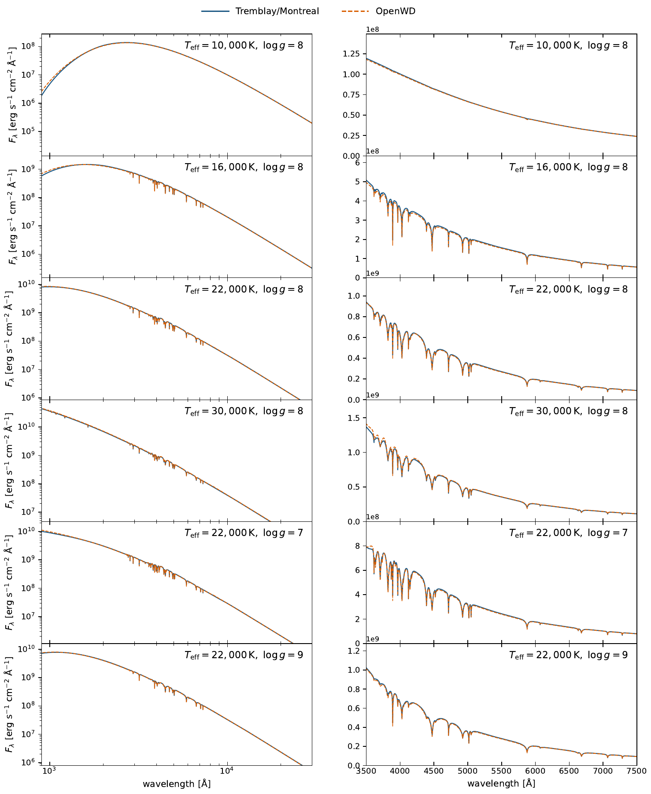
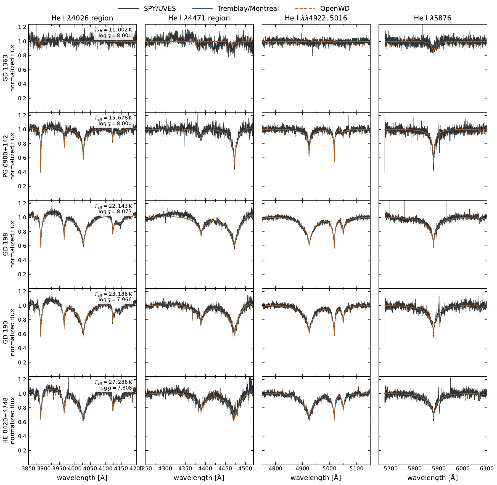
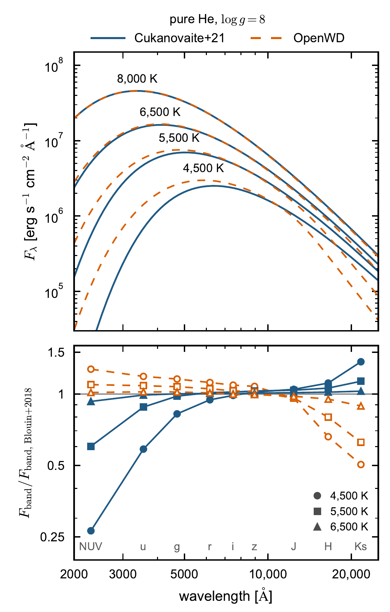
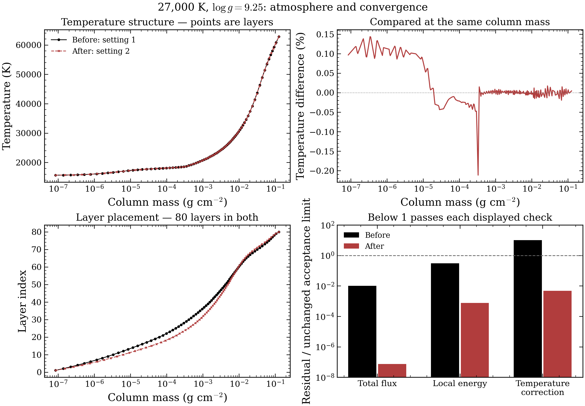

# DB module

[Model guide](README.md) · [Getting started](../getting-started.md)

`compute_db` solves a homogeneous pure-helium LTE atmosphere. It combines a
Hummer--Mihalas/Q-MHD helium EOS, He I/II/III continuum opacity, corrected
Doppler-convolved Beauchamp25-LD He I Stark profiles, Schoening/SYNSPEC He II
profiles, Unsold neutral-He broadening, and ML2/alpha=1.25 convection.

```bash
python examples/one_shot_db.py --teff 20000 --logg 8.0 \
  --quality standard --output results/db-20000-8.0
```

Typical standard calculations take roughly 3--10 minutes on a current laptop;
cool neutral-line models can be slower. No previous atmosphere is needed.

> **Cool DBs: use `run_model`.** `compute_db` is the dilute-helium preset. Below
> roughly 8500 K at log g = 8 (and at higher temperatures for higher gravity),
> the neutral photosphere is dense enough that its EOS and opacities no longer
> apply. `run_model(DBConfig(...), output_directory)` screens the photosphere and
> selects the [dense-helium workflow](#cool-helium) there. Asking `compute_db` to
> relax such a star raises `DenseHeliumPhotosphereError` (the same screen as
> `run_model`); pass `allow_dense_photosphere=True` only to study the dilute
> physics deliberately. The one-shot command line goes through `run_model`.

## Paper comparisons

The paper compares pure-He models with the one-dimensional ML2/alpha=1.25
Montreal/Tremblay grid of
[Cukanovaite et al. (2021)](https://doi.org/10.1093/mnras/staa3684).
The six points are 10000, 16000, 22000 and 30000 K at log g = 8, plus log g
= 7 and 9 at 22000 K. OpenWD relaxes its own helium atmosphere at each point
and synthesizes the spectrum using the corrected B25 He I profiles and
neutral-He broadening. The reference grid is used only for comparison.

[](../assets/db-paper-grid.pdf)

[Download the grid comparison (PDF)](../assets/db-paper-grid.pdf).
The left panels cover 900--30000 Å and the right panels show optical helium
lines. The curves retain their absolute surface-flux scale; no continuum
factor is applied to make the displayed spectra agree.

The second figure uses five SPY/UVES DBs at the fixed temperatures and
gravities of [Voss et al. (2007)](https://doi.org/10.1051/0004-6361:20077285),
from 11002 to 27288 K. An OpenWD atmosphere is calculated at each star's
parameters, and the Montreal grid is bilinearly interpolated to the same
point. Both models are convolved to `R = 18500`; data and predictions use
the same local continuum-fitting procedure in the stellar rest frame.

[](../assets/db-paper-spy.pdf)

[Download the SPY comparison (PDF)](../assets/db-paper-spy.pdf).
The sample follows the growth and subsequent weakening of the optical He I
lines. Noise, normalization and line-profile differences remain visible.
These atomic-helium comparisons do not test the cool dense-neutral extension
below, and normalized line agreement does not establish an absolute flux scale.

## Cool helium

### When the dense workflow is used

`run_model` evaluates a gray hydrostatic helium photosphere at Rosseland
optical depth 2/3 before solving. If that photosphere is neutral (electron
fraction below 1e-3) and the He-REOS.3 density differs from the dilute
Hummer--Mihalas density by at least 5%, it selects the dense-helium workflow
(`dense-db`); otherwise it runs `compute_db`. At log g = 8 the switch lies near
8500 K; at log g = 9.5 it is above 10000 K. The selection and its diagnostics are
recorded in `model-run.json`. `compute_db` applies the same screen and refuses
relaxing a dense photosphere (see above).

```python
from wd_spectra import DBConfig, run_model

run = run_model(
    DBConfig(effective_temperature=5000, logg=8.0, quality="production"),
    "results/db-5000",
    require_convergence=True,
)
print(run.selection.workflow)      # "dense-db"
spectrum = run.spectrum            # surface F_lambda, vacuum Angstrom
```

The dense workflow requires `quality="production"` and integer-K temperatures,
and runs in an isolated, single-threaded worker process. Cold starts at
4500--8000 K and log g = 8 take about 10--14 minutes each.

### Physics

The dense workflow is experimental. Its main ingredients are:

- **EOS:** bulk density and internal energy from the ab initio He-REOS.3 table
  (Becker et al. 2014), with the dilute EOS kept for warm ionized helium.
- **Trace ionization:** He+ and free electrons with non-ideal chemical
  potentials from integral-equation (HNC) fluid calculations and a DFT-based
  electron-insertion fit. Ions are split between bound He2+ and free He+ by the
  bound-neighbour count of the same HNC solution, so the bound pairs are not
  counted twice.
- **Continuum:** dense-fluid (Rogers--Young) correction to He- free--free
  absorption; He2+ bound--free and He--He+ free--free absorption (Stancil
  1994), with a computed temperature dependence below 4200 K; He--He--He
  collision-induced absorption (Kowalski 2014); Rayleigh scattering with the
  fluid structure factor. Refraction is not included.

Details and the evidence for each choice are in the
[dense-db v6 history note](../development/history/dense-db-v6-2026-10-22.md).

### Comparison with other models

[](../assets/db-cool-paper.pdf)

[Download the comparison (PDF)](../assets/db-cool-paper.pdf). The top panel
compares OpenWD with the 1D grid of
[Cukanovaite et al. (2021)](https://doi.org/10.1093/mnras/staa3684), which uses
ideal-gas ionization and no dense-fluid corrections. The bottom panel shows
band-averaged fluxes relative to the Montreal synthetic photometry, which uses
the dense-fluid models of
[Blouin et al. (2018)](https://doi.org/10.3847/1538-4357/aad4a9) below 8000 K.

- Down to about 6500 K, OpenWD agrees with Cukanovaite et al. to a few per cent
  between 3000 Å and 1.2 µm.
- At cooler temperatures, OpenWD agrees with Blouin et al. in the ultraviolet
  and blue optical (within 0.15 mag in GALEX NUV at 5000 K), where the
  Cukanovaite grid is much fainter.
- In the near-infrared, OpenWD is fainter than both (0.4 and 0.7 mag in H and Ks
  at 5000 K relative to Blouin). Nearly all of this comes from the strength of
  pressure ionization: with the Kowalski et al. (2007) ionization used by Blouin,
  OpenWD reproduces their photometry to 0.1 mag. Observations of the IR-faint
  white dwarf LHS 1126 favour weaker ionization, closer to OpenWD's
  ([Blouin et al. 2024](https://doi.org/10.3847/1538-4357/ad863b);
  [Farihi et al. 2026](https://doi.org/10.1093/mnras/stag1393)), but that rests
  on very few stars, so which treatment is more reliable remains open.

### Tested points

Fresh cold starts at log g = 8 converge and pass the independent audit at
4500, 5000, 5500, 6000, 6500, 7000 and 8000 K. Protected cold-start canaries
cover the established prescription at 10000 and 22000 K and the dense workflow
at 5000 and 8000 K. The dense driver propagates the
requested `logg` through hydrostatic column mass, ML2 initialization, the
structure solver and the independent spectrum audit; saved structures record
their gravity, and the audit rejects a mismatch with the request. The
material-domain checks still apply at every depth: accepting a parameter is not
a claim that its atmosphere or spectrum has been qualified. See
[tested points](../tested-temperature-ranges.md),
[cool-model setup](../getting-started.md#cool-helium-and-mixed-atmospheres), and
[physical limitations](../limitations.md#physical-approximations).

## Discretization by He- screen (2026-10-17)

`DBConfig(transfer_discretization="auto")` is the default. Before solving, it
measures how much of the cold seed's Rosseland-mean continuum opacity comes
from He- free-free between Rosseland depths 1e-6 and 1e-2. Where that share
exceeds one half (7000-11000 K at every gravity, and the cooler high-gravity
models up to about 14000 K), it uses the column-mass recipe below
(DB-production-v5). Elsewhere it uses the optical-depth discretization
(DB-production-v4). `"column-mass"` and `"optical-depth"` force either; the
latter restores v4 exactly. The chosen discretization and the He- share are
saved in the metadata.

Column mass alone (the 2026-10-13 default) failed or timed out at about 40
hot DBs of the October 16 grid, mostly 30000-45000 K below log g 8. Their
residuals were tiny but the temperature-stationarity check failed: hot DBs
have a steep upper-atmosphere temperature front (about 3000 K within a layer
near tau_R ~ 1e-8 to 1e-7) that the mass grid resolved too coarsely. Moving
its top boundary only shuffled which models passed. v4 converges these, and
the mechanism column mass was introduced for, He- free-free, is absent there.

On the optical-depth path, "auto" also extends the top boundary like the
lower one: if a cold solve fails with its worst residual in the top three
layers, the seed top moves from tau_R 1e-8 tenfold outward and the model is
re-solved cold, at most twice (`upper_boundary_extensions` in the metadata).
At 32000 K, log g 6.0 the default top is opaque in He II Lyman alpha and one
top layer stays hot; the 1e-9 top converges. Models that pass at once never
extend.

Fresh production cold starts on this default pass all five gates at
10000/8.0, 12000/6.0 and 13000/8.0 (column mass) and at 16000/9.0, 17000/6.0,
18000/7.0, 20000/8.0, 22000/8.0, 27500/8.125, 30000/6.25, 32000/6.0 (one top
extension), 32000/6.25, 34000/6.0, 34000/6.5, 36000/6.5, 36000/7.5, 38000/7.5, 40000/6.0, 40000/7.0,
40000/7.75, 45000/7.0, 55000/6.5 and 60000/6.25 (optical depth), and
22000/8.0 at standard resolution, in 3-29 minutes.

### Column-mass recipe (DB-production-v5, 2026-10-13)

`transfer_discretization="column-mass"` uses mass control volumes for the
structure's transfer, its cell-by-cell energy balance and the final spectrum
together, starts the cold-start grid at Rosseland tau = 1e-12, and whenever
the lower-boundary screen fails (also together with other failed checks)
deepens the mesh by a factor 4 in bottom pressure and re-solves it from the
first phase.

Why: the optical-depth cell width averages the two adjacent optical-depth
steps, so a cell's heating weight follows its neighbours' extinction. In cool,
low-gravity helium that extinction is He- free-free, proportional to the
electron density, which rises roughly as T^20. The linearized energy equations
then have growing odd-even temperature modes in the outer layers
(tau_R ~ 1e-8 to 1e-6); the solver stalls on a saw-tooth outer atmosphere.
PR18's grid failed or timed out at 36 DB points between 7000 and 11000 K,
mostly log g 6-7.5. Column-mass volumes take every factor of a cell's balance
from its own node. A thin top (tau_R = 1e-12) keeps the top cell optically thin
when it heats; with 1e-8 or 1e-10 the top node of hot DBs (20000-22000 K) could
become opaque in the He I continuum and run away. Low-gravity helium is
transparent far below a Rosseland-scaled bottom, so the bottom can leak more
than half the flux; deepening on any screen failure and restarting the solve
handles it.

Production cold starts with this structure recipe pass all five certificate
gates at 7000/6.0, 7500/6.5, 8000/6.5, 9000/7.0, 9500/6.0, 12000/9.5,
14000/7.0, 18000/8.0, 20000/7.5, 24000/8.5, 25000/7.0, 25000/9.0, 26000/8.0,
28000/7.5, 32000/9.0, 35000/8.0 and 40000/7.5 (Teff/log g), and at the canary
configurations 10000/8.0 and 22000/8.0 (production) and 22000/8.0 (standard).
The other former failures (7500/6.0, 8500/7.0, 8500/7.25, 9000/7.75, 9500/7.0,
10000/6.25) converged with intermediate versions of the recipe. The coolest
low-gravity points are the slowest: 7000/6.0 takes about 2.5 h and 7500/6.5
about 2 h, most of it a full solve on the first, too-shallow mesh before it
is deepened. Deepening right after the first solver phase (the opt-in
`early_deepening_escape_limit` of `solve_with_screened_boundary`) cut
7500/6.5 to 14 minutes but stalled 7000/6.0, so it is not used by default.

The final spectrum uses the same 4x depth refinement as the other modules.
Its shape is insensitive to the structure resolution, but its total flux runs
above sigma Teff^4 by 0.5-1.3% at the coolest low-gravity points (production:
1.0134 at 8000/6.5, 1.0078 at 9000/7.0, 1.0065 at 9500/6.0, 1.0051 at
10000/8.0). The same structures synthesized on the solved column-mass grid
(refinement 1) conserve it to 0.05%, but their spectral shape changes by about
1.25% in the optical between 40 and 80 layers.
Spectra differ from v4 by up to about 0.4% in the optical and infrared at
production resolution. The fixed-atmosphere spectral controls keep v4's
optical-depth synthesis.

## Flux conservation (2026-10-01)

Two numerics settings are on by default:

- `photospheric_depth_concentration=1` concentrates the structure depths
  across 0.01 < tau < 10 at an unchanged point count.
- `synthesis_transfer_depth_refinement=4` subdivides each depth interval for
  the final formal solution.

Before, the 40-point standard structures emitted up to 2-3% more than
sigma Teff^4. The bare-grid formal solution partly cancelled this, so the
totals looked right while the structure was not. Standard-quality totals
are now within about 0.75% (see the [DZ guide](DZ.md) for the method). Setting
both to 0 and 1 restores the previous numerics.

## Dense spectrum reconstruction

The experimental mass-conservative dense-He spectrum uses the existing
positive-intensity reconstruction option in both its coupled transfer solve
and independent prescribed-source check. This avoids tiny negative source
values caused by numerical cancellation in faint radiation fields. It does
not clip negative values, normalize the flux, change the atmosphere, or relax
the qualification limits. The selected transfer option is saved in the
metadata and retained by the independent spectrum audit. Older saved runs
without that flag retain their previous audit option.

The regression fixture is one transfer row from a 5,000 K/log g 7 development
calculation. It checks the transfer operation. Dense DB runs preserve the
requested gravity as described in [Cool helium](#cool-helium); individual
parameter points still require atmosphere and spectrum qualification.

## A tested warm-model setting

At 27,000 K/log g 9.25, a fresh production calculation with the default
`photospheric_depth_concentration=1` failed the temperature-stationarity check.
Changing this existing setting to 2 passed all five required structure checks
on the same unchanged source, with the same physics and acceptance limits:

```python
from wd_spectra.models import DBConfig, run_model

result = run_model(
    DBConfig(
        effective_temperature=27000,
        logg=9.25,
        quality="production",
        photospheric_depth_concentration=2,
    ),
    "results/db-27000-9.25-depth2",  # fresh output directory
    require_convergence=True,
)
```

Both runs used 80 layers. The solved atmospheres had 37 and 43 layers,
respectively, between Rosseland optical depths 0.01 and 10. The measured
unrestricted log-temperature correction decreased from 0.00299 to
0.00000145; the acceptance limit stayed at 0.0003. The maximum optical
surface-flux difference was 0.1504% over 3,000–10,000 Å, without normalization.
The failed default result remains an unfinished reference despite that small
spectral difference.

[](../assets/db-depth-concentration-before-after.pdf)

[Download the before/after figure (PDF)](../assets/db-depth-concentration-before-after.pdf).
The upper panels show temperature versus column mass and differences at the
same column mass. The latter use linear interpolation in log column mass
within the shared domain. The lower panels show the actual layer placement
and three residuals divided by their unchanged acceptance limits. Values below
one pass those displayed checks. Source closure and lower-boundary screening
also pass in both runs; the [evidence record](../assets/db-depth-concentration-evidence.json)
retains all five checks and the two exact configurations.

This is a demonstrated numerical setting for one model, not a new default or
automatic retry policy. Independent depth convergence and physical accuracy
at these parameters remain unverified. The opacity, equation of state,
convection prescription, solver limits, and production point count are unchanged.
