# DZ/DBZ module

[Model guide](README.md) · [Getting started](../getting-started.md)

`compute_dz` solves a helium-dominated polluted LTE atmosphere at fixed input
abundances. Metals contribute electrons, bound-free opacity, sampled line
blanketing, and therefore feed back on the relaxed structure. The default
metal database uses Stout v3.00b4, adding bundled Kurucz transitions with
independent atomic-data corroboration under a common selection rule
when those ions are present; see the [atomic-data notes](../../src/wd_spectra/data/atomic/README.md).
The GD 40 preset
includes levels through charge 3, dense-helium ionization shifts, and
available unified Mg I--He and Ca I--He profiles.
Observable helium and trace-hydrogen lines use the same policies as DB and
DAB. Evaluated NIST replacements for matched strong transitions remain
available as the explicit `strong_line_atomic_data="nist-asd"` alternative.
Trace-hydrogen Lyman lines likewise retain the figure's charged-particle
Stark treatment by default; `lyman_profile_source="allard"` explicitly
selects the later unified-profile option.

The metal physics was revised after a 2026-09-30 audit (physics revision
`metal-audit-2026-09-30`):

- Bound-free opacity is level-resolved Opacity-Project photoionization from
  every level of the bundled TLUSTY/SIROCCO model atoms (C I--II, O I--II,
  Mg I--II, Al II, Si I--II, S II, Fe II), including excited-level continua
  such as Mg I 3P and Si I 1D. Identified model terms are placed at their
  observed Stout energies. Other ions keep Verner et al. (1996) fits, which
  are applied to the whole LS ground term rather than its lowest ``J``
  level. `level_resolved_photoionization=False` restores Verner fits only.
- Metal partition functions use Hummer--Mihalas occupation probabilities
  (Q-MHD charged microfields and the neutral-He excluded volume), iterated
  with charge neutrality; the line opacity applies the same level survival.
  `occupation_probability_metal_partitions=False` restores the fixed 0.1-eV
  cutoff. Since 2026-10-12 the line-opacity survival counts every ion in the
  charged microfield, including the host He⁺/He²⁺ ions. Before, it counted
  the metal ions only, which in GD 61 is 10⁻³–10⁻⁵ of the electron density,
  so the line opacity applied almost no dissolution and was inconsistent
  with the partition functions. Spectra change by at most 3% (one pixel in
  the J0738 control).
- The Blouin et al. (2018) dense-He shift enters the Saha equation with the
  full partition functions, so it vanishes in the dilute limit. Outside the
  authors' tested 2000--10000 K and 0--1.5 g cm^-3 range the fit is held at
  its edge instead of being switched off.
- Metal lines use an exact Voigt profile evaluated in frequency (Humlicek
  W4), so impact wings keep their physical asymmetry. Unsold widths use the
  hydrogenic ``<r^2>`` with its ``1/Z^2`` core-charge factor, and levels
  above the first ionization limit are measured from their parent limit.
- Inside the published Ca I--He density range the unified 4227-A profile
  replaces the impact profile; below it, the impact core plus the
  density-scaled non-impact part of the unified profile is used.
- The structure solve computes opacity for exactly the lines its frequency
  grid samples.
- The measured Hammond (1975) Ca II H/K widths in helium are extended in
  temperature with impact theory for his own Lennard-Jones (12,6) fits to
  those widths and shifts. His two-shot exponent, which he advises against
  using, is no longer applied. At 15000 K the width is 1.58 times its
  5200-K value, against 1.27 for the old power law.
- The `strong_line_atomic_data="nist-asd"` option replaces every exactly
  matched Stout transition down to f = 1e-4 with evaluated NIST ASD values
  (accuracy C or better), including 115--300 nm (Mg I 2852, Mg II h/k, Si II,
  C II, Al II, Fe I/II). The default retains existing Stout transition data
  and uses the [independently corroborated Kurucz catalogue](../validation/independent-kurucz.md)
  for missing transitions. The same rule covers 30 neutral/singly ionized
  catalogues of 15 elements, admitting 19,966 absorption additions in seven
  ions, including 14,891 Cr II and 4,613 Fe II transitions. Original Stout
  oscillator strengths and damping records are retained; qualified weaker
  radiative branches also contribute to inferred natural widths. The two
  previously added Cr II/Fe II levels are retained; no further levels are
  imported. This replaces the earlier unfiltered Cr II and selected Fe II/Si II
  supplements. Selection and provenance are recorded in the
  [atomic-data notes](../../src/wd_spectra/data/atomic/README.md).
- Neutral trace H now contributes its impact broadening to ordinary metal
  lines using the neutral-H density from the same metal/H charge closure.
  For the Si II--He unified profile, this H width joins radiative and
  electron widths in `gamma_other`; the unified profile supplies the He
  contribution. Pure-He and fully ionized trace-H cases receive no added
  neutral-H width. No abundance or damping multiplier is fitted.
- Most Stout transitions carry no electron-impact (Stark) width, and the
  classical SYNSPEC fallback stays off. By default (`kurucz_electron_stark=True`,
  since 2026-10-11) OpenWD attaches Kurucz's tabulated `log Gamma_4/n_e` at 10^4 K, scaled as (T/10^4 K)^(1/6), to every
  E1 transition that has no width of its own and matches a Kurucz line
  (wavelength, level energies and statistical weights). Measured or
  previously tabulated widths are kept, and no other atomic data change.
  The constants come from `src/wd_spectra/data/stark/kurucz_stark_constants.csv.xz`
  (153,641 Stout transitions for charges 0--3, vacuum 900--11000 A), built by
  `scripts/build_kurucz_stark_table.py` from Kurucz `gfZZCC` lines between
  observed levels. The table is keyed by Stout level indices, because Stout
  has distinct levels with equal energy and weight, and the energies and
  weights are checked again on use. The source URLs and SHA-256 checksums
  are in the file's trailer. Lines outside that range still get no Stark
  width.
  For example, Si II 1260/1264/1265 gets `log Gamma_4/n_e = -5.75`, the same
  value VALD3 lists. A 54-window comparison, with GD 40, G241-6 and seven
  further optical DZ/DAZ targets at fixed published parameters, lowered the
  mean window residual by 1.2%: 20 windows improved, 5 got worse, and every
  change elsewhere was tiny. The COS Si II 1260 residual fell 16--18%, but
  the lines remain weaker than observed. `kurucz_electron_stark=False`
  restores the previous behaviour, with no Stark broadening for these lines.
- `si_ii_he_unified_profile=True` (the default since 2026-10-11; `False` restores
  the Unsöld Lorentzian) replaces the Lorentzian
  neutral-He broadening of the Si II 1260/1264/1265 Å triplet
  (3s² 3p ²P°–3s² 3d ²D) with a unified binary-collision profile. The bundled
  table `src/wd_spectra/data/profiles/si_ii_1260_he_unified.npz` (checksum
  verified) covers 4000–40000 K. It was computed from one-electron
  model-potential Si⁺–He adiabatic potentials, with dipole-weighted Λ
  components, straight classical paths, a Maxwell average and the
  Anderson–Talman autocorrelation. The same method reproduces Allard et al.
  (2016) Mg II–He widths to 0.3–2% and Hammond's (1975) laboratory Ca II H&K
  width to 13%. Electron and radiative damping still come from each line's own
  data, and the Doppler core from its Voigt profile, merged by an envelope as
  for the Mg II and Ca II He tables. Nothing is fitted to a stellar spectrum.
  With the stellar parameters, abundances and structures fixed, the COS
  1258–1269 Å residual falls from 0.221 to 0.153 for GD 40 and from 0.166 to
  0.104 for G241−6, and in three further DBZs computed from cold starts at
  their published parameters from 0.095 to 0.082 (GD 61), 0.069 to 0.056
  (GD 378) and 0.066 to 0.056 (WD 1425+540); every other COS window is
  unchanged. The triplet wings
  stay weaker than observed. Known approximations: LS potentials (no fine
  structure), no 3s² 3d–3s 3p² mixing, a constant transition dipole, and
  independent ab initio Si⁺–He potentials that give a smaller improvement.
- The common catalogue admits 17 Si II absorption additions, including
  1309.45/1309.73 Å. It holds out 1305.59 Å because its upper level is slightly
  above the ground ionization limit. This calls for an autoionization/profile
  treatment beyond the present bound-bound rule; it does not establish that
  the observed resonance is spurious. The broad Si II 1260/1265 Å wings remain
  weaker than observed. `si_ii_kurucz_transitions` is retained for configuration
  compatibility with the earlier 1471-line import; it cannot broaden the
  independently selected default atom. For a bare-Stout diagnostic, supply an
  atom read with `include_default_supplements=False` and disable that legacy flag.
- Verner's phfit2 fits supply ground-state edges for iron-group ions absent
  from `photo.dat` (Ti, Cr, Mn, Ni, ...). Bautista (1997) Fe I and NORAD Cr I
  level-resolved cross sections are bundled (xz-compressed, checksummed) and
  required; they are used for terms identified with observed levels within
  0.5 eV.
- Ca II H and K use complete-redistribution source functions solved
  exactly with the linear formal Lambda operator. Collisional transfer
  between the two 4p levels feeds the partner line instead of thermalizing
  the photon. Populations and extinction stay LTE.
- Trace hydrogen keeps charged-particle (Q-MHD) level dissolution only. An
  audit variant also applied the HM88 neutral-He hard-sphere term with
  `r_n = n^2 a_0`. That removed almost all n >= 6 population in DBA
  photospheres and erased the observed Hdelta of WD J1013+0259, so it was
  reverted.
- The emitted spectrum is flux conserving (1.000--1.003 of sigma Teff^4 at
  9000--15600 K, against 0.84--0.91 before). Three numerical changes do this:
  - The structure absorbs the synthesis line list (f >= 1e-4, the same
    20,000-line budget), opacity-sampled on a uniform R = 1000 grid
    (`structure_opacity_sampling_resolution`). The former 1000-line
    structure, with line-centered samples, left the extra synthesis
    blanketing unbalanced. Those samples also overweighted narrow cores.
  - The 40 structure depths are concentrated across 0.01 < tau < 10,
    taking points only from the optically thin top
    (`photospheric_depth_concentration=1`).
  - The final formal solution subdivides each depth interval four times
    (`synthesis_transfer_depth_refinement=4`), interpolating opacity
    log-log in column mass. On the bare structure grid the piecewise-linear
    formal solution lost 5--6% of the flux of these steep convective
    atmospheres.

  Together these add about 15--20% to a standard cold start.
  `structure_opacity_sampling_resolution=None`,
  `photospheric_depth_concentration=0` and
  `synthesis_transfer_depth_refinement=1` restore the previous numerics.

```bash
python examples/one_shot_dz.py --teff 15300 --logg 8.0 \
  --abundance O=-5.61 --abundance Mg=-6.24 --abundance Si=-6.76 \
  --abundance Ca=-6.88 --abundance Fe=-6.48 --log-h-he -6.16 \
  --quality standard --output results/gd40
```

Abundances are `log10[N(element)/N(He)]`; supplying any `--abundance` entries
replaces the entire default abundance dictionary. The model does not refit
`Teff`, `log g`, or composition. Standard line-rich atmospheres can take from
about 30 minutes to several hours. `dense_helium_eos="reos3"` is available in
the Python configuration as an explicitly experimental bulk-EOS option; the
validated production default remains the chemical-picture EOS.

The [DZ fitting notebook](../../examples/fit_dz_spectrum.ipynb) fits Ca, Mg and
Fe in four public VLT/UVES spectra of PG 1225-079, with Teff, log g and the
remaining composition held fixed. The observed coadd is included in the
repository. Each trial uses `relax_atmosphere=False` on one certified
cold-start structure. These are diagnostic fits, not a final abundance
solution. See the [fitting notes](../examples/fitting-dz.md) for data
provenance, error assumptions and the structural-feedback check.

Paper-spectrum regression and cold-start convergence are separate checks.
See [tested points](../tested-temperature-ranges.md) and
[reference-comparison limitations](../limitations.md#spectrum-accuracy-and-reference-comparisons)
for the status of PG 1225 and SDSS J0738+1835.

## Paper comparison

The paper compares seven polluted white dwarfs at fixed literature parameters
and abundances. Five have helium-dominated atmospheres and use DZ/DBZ; the
first and last panels are hydrogen-host [DAZ models](DAZ.md#paper-comparison).
The abundance labels in each panel specify the complete adopted mixture and
its H or He denominator.

| Object | Host | Teff (K) | log g | Observation | Parameter source |
| --- | --- | ---: | ---: | --- | --- |
| G149-28 | H | 8600 | 8.10 | DESI DR1 | [Zuckerman et al. (2011)](https://doi.org/10.1088/0004-637X/739/2/101) |
| PG 1225-079 | He | 10800 | 8.00 | VLT/UVES | [Klein et al. (2011)](https://doi.org/10.1088/0004-637X/741/1/64) |
| WD J1013+0259 | He | 12255 | 7.90 | VLT/X-shooter | [Izquierdo et al. (2023)](https://doi.org/10.1093/mnras/stad282) |
| SDSS J0738+1835 | He | 13950 | 8.40 | SDSS | [Dufour et al. (2012)](https://doi.org/10.1088/0004-637X/749/1/6) |
| WD J0259-0721 | He | 16390 | 8.26 | VLT/X-shooter | [Izquierdo et al. (2023)](https://doi.org/10.1093/mnras/stad282) |
| Ton 345 | He | 19780 | 8.18 | SDSS | [Wilson et al. (2015)](https://doi.org/10.1093/mnras/stv1201) |
| GALEX J1931+0117 | H | 20890 | 7.90 | VLT/UVES | [Vennes et al. (2011)](https://doi.org/10.1111/j.1365-2966.2011.18323.x) |

[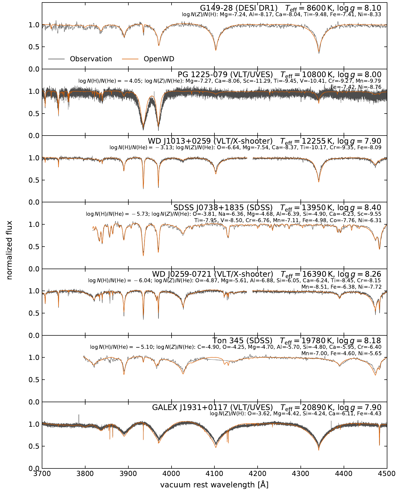](../assets/dz-daz-paper.pdf)

[Download the comparison (PDF)](../assets/dz-daz-paper.pdf).
Every plotted atmosphere was relaxed at its displayed composition. Metal
electrons, continuum opacity and line blanketing participate in the structure
calculation; the final synthesis adds the detailed Stout line list. Helium
models use the nonideal He EOS, trace hydrogen where listed, dense-He metal
ionization shifts and ML2/alpha=1.25 convection. The complete-redistribution
Ca II source affects the final line cores while retaining LTE populations.

Predictions are convolved to the corresponding instrumental resolution:
`R = 2000` (DESI), 19540 (PG 1225 UVES), 5453 (X-shooter), and 40970
(GALEX J1931 UVES), or Gaussian FWHM 2.23 and 2.57 Å for J0738 and Ton 345.
Data and models then receive the same independent pseudo-continuum procedure
and are plotted in rest-frame vacuum wavelengths. These display operations
leave the atmospheric parameters and abundances fixed.

The figure tests the metal-line pattern and normalized profiles across very
different mixtures. It does not establish an absolute continuum match or a
uniformly validated abundance grid. In particular, the older plotted J0738
atmosphere and a fresh calculation with the present certificate are distinct
checks; consult the linked tested-point record before treating it as a
qualified cold start.

## Xu et al. (2019) HIRES comparisons

These three comparisons use the helium-dominated stars in Figures 11--13 of
[Xu et al. (2019), AJ, 158, 242](https://doi.org/10.3847/1538-3881/ab4cee).
The black curves are public Keck/HIRES spectra retrieved from the
[Keck Observatory Archive](https://koa.ipac.caltech.edu/); the red curves are
OpenWD predictions at the paper's fixed parameters and detected abundances
(Tables 1 and 4). No atmospheric parameters or abundances were fitted.

The default metal line list includes the independently corroborated Kurucz
supplements, including the three Cr II HIRES recoveries at air 3368.05,
3433.31 and 3585.29 Å. It preserves original Stout transitions and oscillator
strengths while adding qualified absent transitions and their Kurucz damping
constants. The data are bundled and checksum-verified,
so these examples require no separate line-list download or custom atomic
database. It is used in both atmospheric line blanketing and the final
synthesis, subject to their normal line-selection budgets. See the
[atomic-data provenance](../../src/wd_spectra/data/atomic/README.md).

The plotted spectra were computed with OpenWD commit
[`57f95fc`](https://github.com/kareemelbadry/OpenWD/commit/57f95fc), plus this
earlier full Cr II supplement, using standard-quality relaxed atmospheres and
ML2/alpha = 1.25 convection. They predate the metal-physics audit described
above. The commands below generate new spectra with the current defaults at
the same stellar parameters; they do not exactly reproduce these archived
curves. Their convergence must be checked independently.

For display, the synthetic flux and line-free continuum were convolved to
`R = 40000` and integrated over native detector pixels. Observed orders were
coadded with inverse-variance weights without smoothing. Data and models were
normalized independently with matched local pseudo-continuum masks and
weights, including local fits around Ca II H/K that avoid extrapolating the
continuum. The plots use rest-frame **air** wavelengths; the generated model
files use rest-frame **vacuum** wavelengths. Residual line-depth and Ca/He
core differences remain, so these are comparisons at a literature composition,
not abundance fits or a claim of agreement in the absolute flux.

Run the commands from a source checkout with OpenWD installed. Abundances are
`log10[N(element)/N(He)]`, and the listed metals replace the entire default
mixture. Reported upper limits are omitted. Each command saves the intrinsic
surface flux in `spectrum.txt` (vacuum Å, erg s^-1 cm^-2 Å^-1), together with
the atmosphere and provenance. The fine wavelength grid covers the displayed
regions; it does not apply instrumental convolution or the observational
normalization used in the figures. `--require-convergence` rejects a run
that fails the model's convergence certificate. Use a fresh output directory
for each run.

### WD 1232+563

`Teff = 11787 K`, `log g = 8.30`, `log N(H)/N(He) = -5.90`. The HIRES blue
observations are from 2015 April 11 and 2016 April 1. This comparison covers
the blue metal-line windows and Ca II H/K in Figure 11; ESI data are not
included. The rest-frame correction uses the paper's photospheric velocity
of +19.0 km s^-1. Al and Ni are upper limits and are omitted.

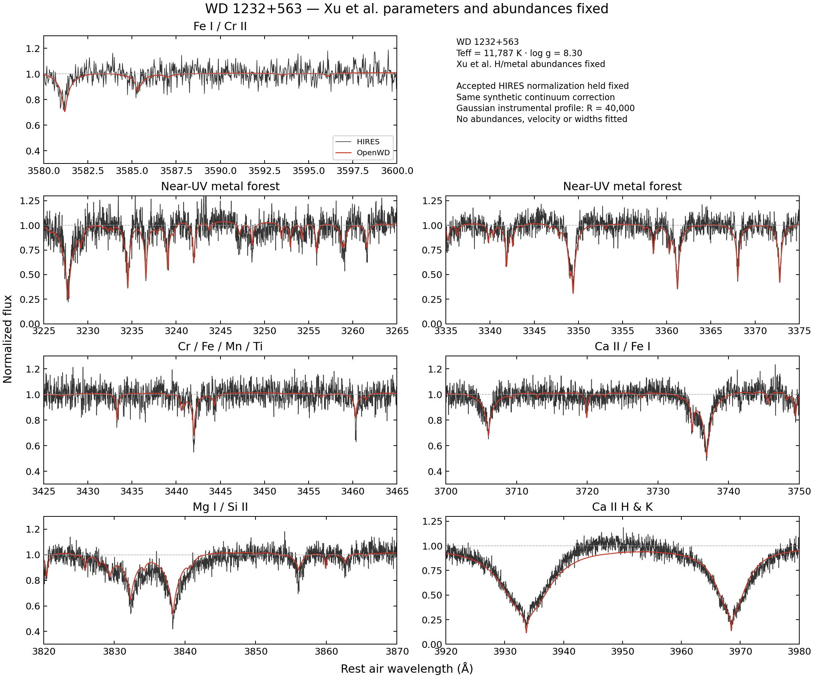

```bash
python examples/one_shot_dz.py --teff 11787 --logg 8.30 --log-h-he -5.90 \
  --abundance O=-5.14 --abundance Mg=-6.09 --abundance Si=-6.36 \
  --abundance Ca=-7.69 --abundance Ti=-8.96 --abundance Cr=-8.16 \
  --abundance Mn=-8.54 --abundance Fe=-6.45 \
  --wavelength-min 3200 --wavelength-max 8000 --wavelength-step 0.02 \
  --quality standard --require-convergence --output results/wd1232-xu2019
```

### WD 1551+175

`Teff = 14756 K`, `log g = 8.02`, `log N(H)/N(He) = -4.45`. The HIRES blue
observations are from 2013 May 8 and the red observations from 2015 April 9,
with a photospheric velocity of +22.9 km s^-1. Ni is an upper limit and is
omitted; Al is a detection. The Halpha region has an archive coverage gap.
The O I 7774-Å panel shows **only the model**: the available red-CCD products
lack a wavelength calibration for that region, so no observational comparison
is possible there.

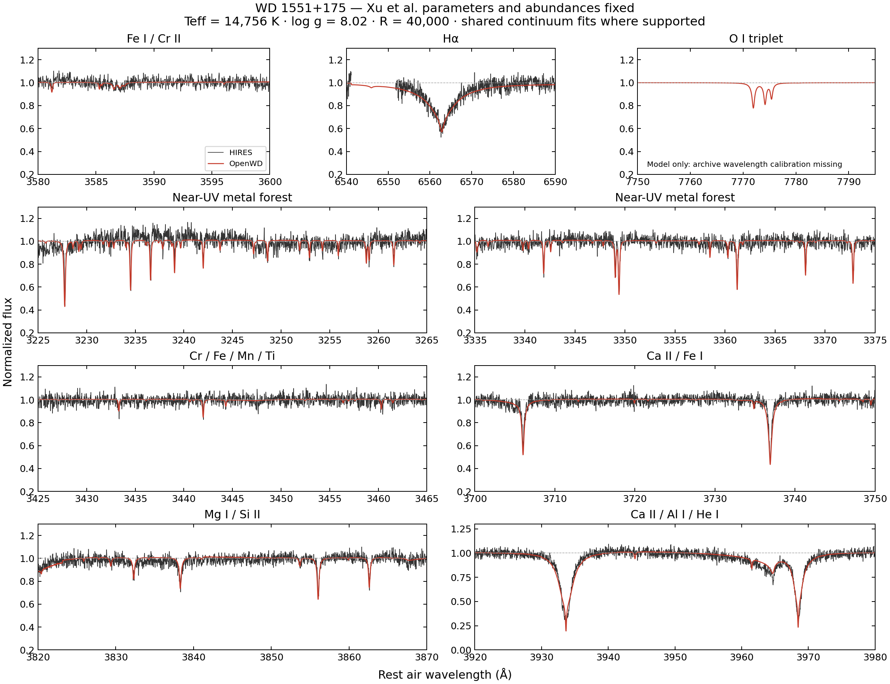

```bash
python examples/one_shot_dz.py --teff 14756 --logg 8.02 --log-h-he -4.45 \
  --abundance O=-5.48 --abundance Mg=-6.29 --abundance Al=-6.99 \
  --abundance Si=-6.33 --abundance Ca=-6.93 --abundance Ti=-8.68 \
  --abundance Cr=-8.25 --abundance Mn=-8.74 --abundance Fe=-6.60 \
  --wavelength-min 3200 --wavelength-max 8000 --wavelength-step 0.02 \
  --quality standard --require-convergence --output results/wd1551-xu2019
```

### WD 2207+127

`Teff = 14752 K`, `log g = 7.97`, `log N(H)/N(He) = -6.32`. The paper calls
this object **WD 2207+121 in its tables** and **WD 2207+127 in Figure 13**;
both identify the same target at RA = 332.3951°, Dec = +12.3934°
(J2209+1223). The HIRES blue observations are from 2012 October 28--29 and
the red observations from 2013 September 17, with a photospheric velocity
of +34.5 km s^-1. All ten listed metals, including Ni, are detections.
Faulty extracted orders were rejected before coaddition. Halpha has a
coverage gap, and the O I 7774-Å panel again shows **only the model** because
the archive red-CCD products lack a wavelength calibration there.

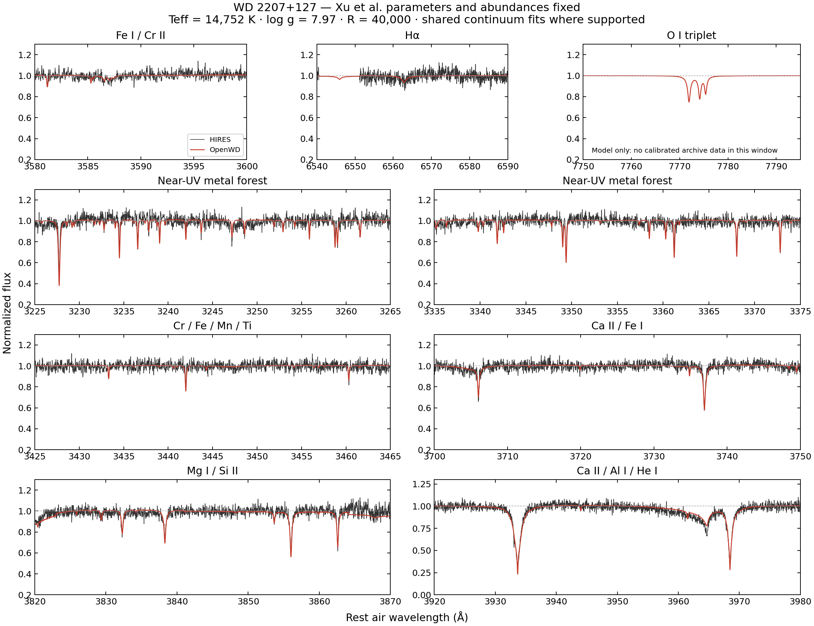

```bash
python examples/one_shot_dz.py --teff 14752 --logg 7.97 --log-h-he -6.32 \
  --abundance O=-5.32 --abundance Mg=-6.15 --abundance Al=-7.08 \
  --abundance Si=-6.17 --abundance Ca=-7.40 --abundance Ti=-8.84 \
  --abundance Cr=-8.16 --abundance Mn=-8.50 --abundance Fe=-6.46 \
  --abundance Ni=-7.55 \
  --wavelength-min 3200 --wavelength-max 8000 --wavelength-step 0.02 \
  --quality standard --require-convergence --output results/wd2207-xu2019
```

## Ultraviolet comparisons

These comparisons extend the HIRES examples to public HST/COS spectra of
seven helium-dominated DZ/DBZ stars and two hydrogen-dominated
[DAZ stars](DAZ.md). Effective temperatures, gravities and detected abundances
are held at the values adopted in the corresponding abundance papers.
Reported upper limits are omitted. Metal abundances are
`log10[N(element)/N(He)]` for DZ/DBZ and `log10[N(element)/N(H)]` for DAZ;
trace hydrogen in a helium atmosphere is specified separately.

Each plotted atmosphere passed OpenWD's required equilibrium checks at its
source revision. The seven original predictions use `221dc9c`, whose physics
matches merged main revision `e09e7da`, including the
[H₂ Lyman/Werner implementation](https://github.com/kareemelbadry/OpenWD/pull/26).
GD 40 and G241−6 use revision
[`943c146`](https://github.com/kareemelbadry/OpenWD/commit/943c146), including the
[additional Fe II transitions and trace-H broadening correction](https://github.com/kareemelbadry/OpenWD/pull/28).
The [figure provenance](../assets/uv-validation-provenance.json) records the
individual source revisions, observations, velocity choices, continuum fits
and checksums. Commands below use the current checkout's defaults at the same
published inputs, so their fluxes can differ from the archived predictions.

The far-UV figures use four wide wavelength rows in a single column. The
near-UV figures show all three separate detector strips, including their
broader wavelength coverage. Gray curves show COS observations binned over
three quality-valid native pixels; the red curve is OpenWD with linewidth 1.
Models are convolved with the observation's wavelength-dependent COS
line-spread function and integrated over detector pixels. Photospheric
velocity corrections align the spectra without adjusting individual lines.
Data and models are normalized independently: accepted local continuum fits
are retained around far-UV features, with smooth interpolation between them;
the near-UV figures retain the original quadratic continuum fit for each strip.
The Lyα interval 1208–1235 Å, marked airglow and foreground absorption are
excluded from the far-UV metal comparison. Detector gaps remain gaps.

The largest remaining model discrepancies in these figures are the
**Si II 1260–1265 Å wings in GD 40 and G241−6**, which remain shallower than
observed at the published compositions. These are comparisons of normalized
line profiles; the abundances and damping factors have not been fitted.

| Object | Model | Teff (K) | log g | log N(H)/N(He) | COS mode | Parameter and abundance source | Configuration key |
| --- | --- | ---: | ---: | ---: | --- | --- | --- |
| GD 40 | DZ/DBZ | 15300 | 8.00 | −5.10 | G130M | [Jura et al. (2012), Table 3](https://arxiv.org/abs/1203.2885) | `gd40` |
| G241−6 | DZ/DBZ | 15300 | 8.00 | −5.90 | G130M | [Jura et al. (2012), Table 4](https://arxiv.org/abs/1203.2885) | `g241minus6` |
| PG 1225−079 | DZ/DBZ | 10800 | 8.00 | −4.05 | G185M | [Xu et al. (2013), Table 5](https://arxiv.org/abs/1302.4799) | `pg1225` |
| GD 61 | DZ/DBZ | 17280 | 8.20 | −3.89 | G130M | [Farihi et al. (2013), Supplement Table 2](https://arxiv.org/abs/1310.3269) | `gd61` |
| GD 378 | DZ/DBZ | 15620 | 7.93 | −4.48 | G130M | [Klein et al. (2021), Table 5](https://faculty.epss.ucla.edu/~eyoung/reprints/Klein_2021.pdf) | `gd378` |
| WD 1425+540 | DZ/DBZ | 14490 | 7.95 | −4.20 | G130M | [Xu et al. (2017), Table 1, Model I](https://arxiv.org/abs/1702.02868) | `wd1425` |
| G29−38 | DAZ | 11820 | 8.40 | — | G130M | [Xu et al. (2014), Table 3](https://arxiv.org/abs/1401.4252) | `g29_38` |
| GD 133 | DAZ | 12600 | 8.10 | — | G130M | [Xu et al. (2014), Table 3](https://arxiv.org/abs/1401.4252) | `gd133` |
| GD 362 | DZ/DBZ | 10540 | 8.24 | −1.14 | G185M | [Xu et al. (2013), Table 4](https://arxiv.org/abs/1302.4799) | `gd362` |

The complete detected mixtures and numerical settings are in
[uv-validation-configs.json](../assets/uv-validation-configs.json).
GD 378's Be detection and GD 362's Sr detection are recorded there but omitted
because the bundled metal database does not support those elements.
DZ/DBZ models use ML2/alpha = 1.25; the DAZ models use ML2/alpha = 0.8 and
explicitly enable H₂ Lyman and Werner lines and molecular equilibrium.
WD 1425+540 uses production resolution; the other entries use standard resolution.

Run each command below from a source checkout with OpenWD and its compiled C
backend installed. The example generates **one** atmosphere and intrinsic
spectrum, requires a passing convergence certificate, and defaults numerical
libraries to one thread. Choose a fresh output directory for each run.
It saves `spectrum.txt` (vacuum Å, erg s^-1 cm^-2 Å^-1), the atmosphere and
provenance. The fine wavelength grids are 1125–1460 Å for G130M and
1785–2055 Å for G185M, with 0.01 Å spacing. Instrumental convolution and
observational normalization are separate display steps.

### GD 40

The model uses Jura et al. (2012), Table 3's final detected abundances.
The broad far-UV view includes the strong Si II multiplet together with
weaker Si II, O, Mg and Fe features.

```bash
python examples/uv_validation_model.py gd40 --output results/gd40-uv
```

[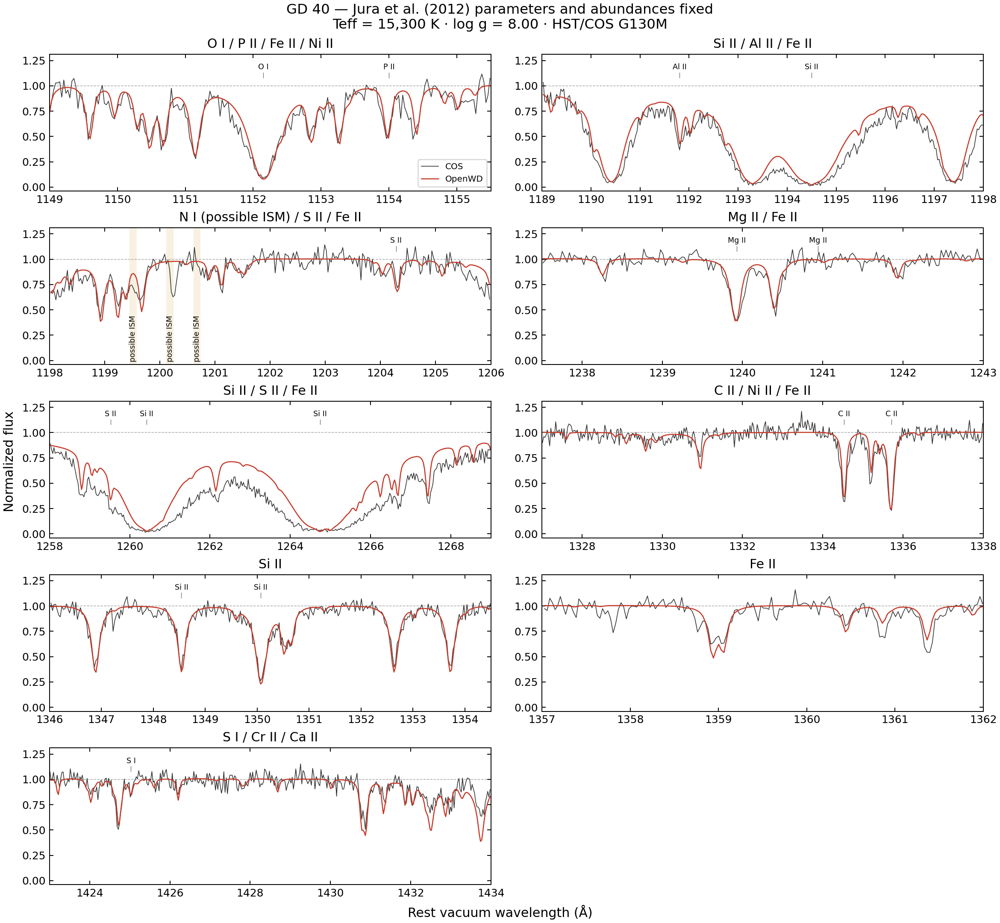](../assets/uv-gd40.pdf)

### G241−6

The model uses Jura et al. (2012), Table 4's final detected abundances, with
oxygen from the UV column. Its similar temperature and gravity to GD 40
provide a comparison of different metal mixtures in helium atmospheres.

```bash
python examples/uv_validation_model.py g241minus6 --output results/g241minus6-uv
```

[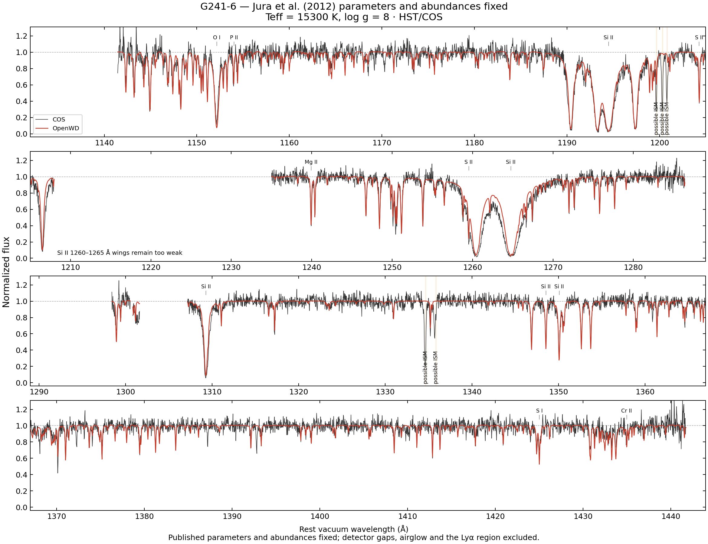](../assets/uv-g241minus6.pdf)

### PG 1225−079

The model uses Xu et al. (2013), Table 5, including detected carbon and the
optical metal abundances. Three full near-UV strips show Si II, C I, Mg I and
Fe-group lines. Sparse continuum support at the strip edges gives up to
16% formal normalization uncertainty; the figure marks the estimates and
extrapolated edges. Calibration and rebinning covariance are not included.

```bash
python examples/uv_validation_model.py pg1225 --output results/pg1225-uv
```

[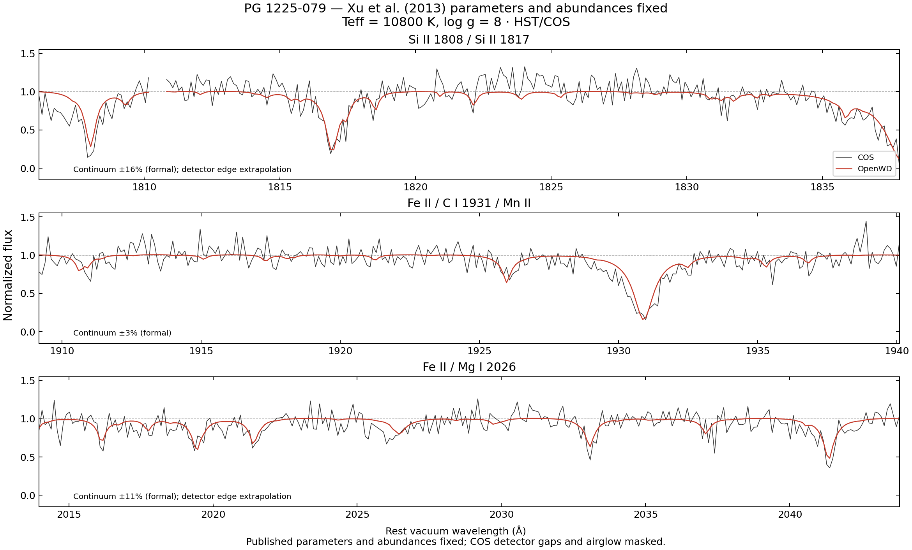](../assets/uv-pg1225.pdf)

### GD 61

The model uses the adopted abundance column of Farihi et al. (2013), with
trace hydrogen and detected O, Mg, Si, S, Ca and Fe. Foreground N I, Si II and
C II features are marked at the approximately 40 km/s blueward offset
reported in the paper's Figure 2 caption.

```bash
python examples/uv_validation_model.py gd61 --output results/gd61-uv
```

[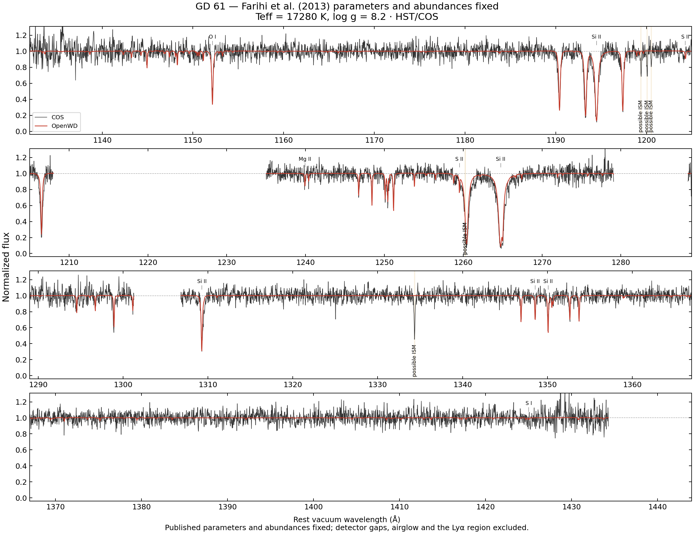](../assets/uv-gd61.pdf)

### GD 378

The model uses Klein et al. (2021), Table 5, including nitrogen from its
footnote and omitting unsupported Be (`log N(Be)/N(He) = −11.44`). N I and
C II components associated with the reported foreground cloud are marked
separately from photospheric lines.

```bash
python examples/uv_validation_model.py gd378 --output results/gd378-uv
```

[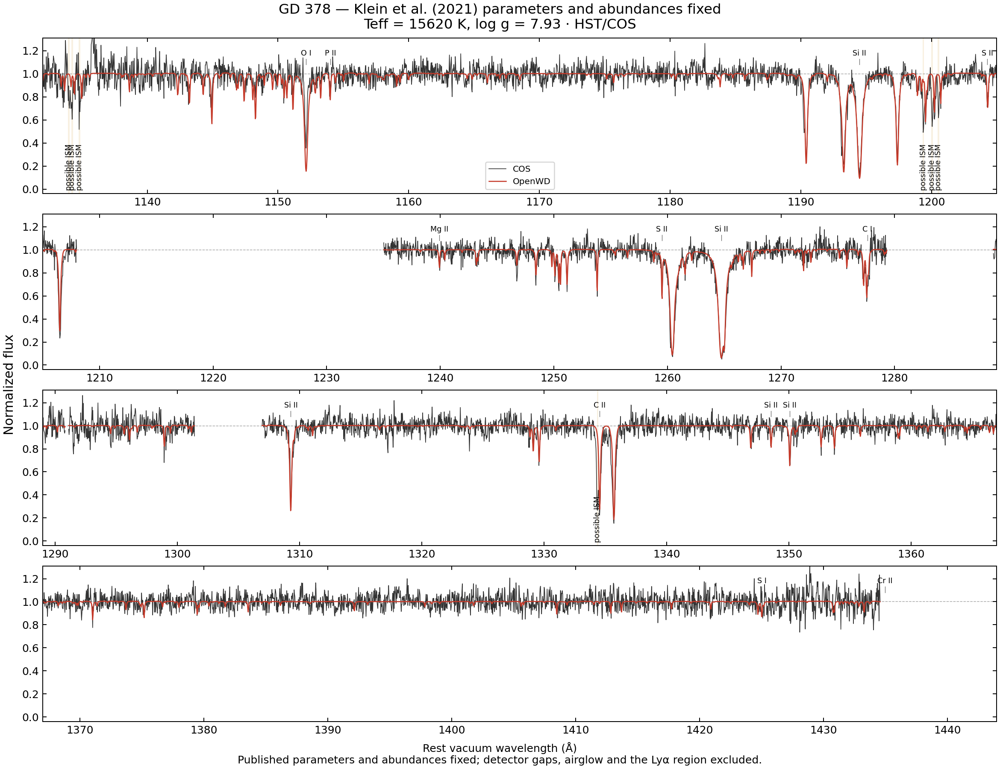](../assets/uv-gd378.pdf)

### WD 1425+540

The model consistently uses **Model I** of Xu et al. (2017), including its
`log N(H)/N(He) = −4.20`. The all-time coadd has possible N I airglow at
observed-frame 1199.0–1201.2 Å, which is marked and excluded from comparison
and continuum anchors; N I 1134 Å remains the nitrogen comparison.

```bash
python examples/uv_validation_model.py wd1425 --output results/wd1425-uv
```

[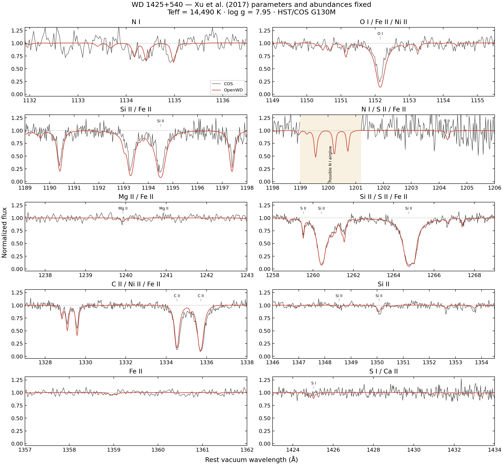](../assets/uv-wd1425.pdf)

### G29−38

The hydrogen-host model uses Xu et al. (2014)'s detected abundances, with
photospheric H₂ Lyman and Werner lines enabled. The observations combine the
usable 1999 s first-visit exposure with the 7035 s second visit; exposures
affected by the reported gyro malfunction are excluded. Marked foreground
components are excluded from the photospheric comparison.
The broad residual around 1260–1283 Å depends on local continuum placement;
this normalized comparison does not isolate it as a line-profile error.

```bash
python examples/uv_validation_model.py g29_38 --output results/g29_38-uv
```

[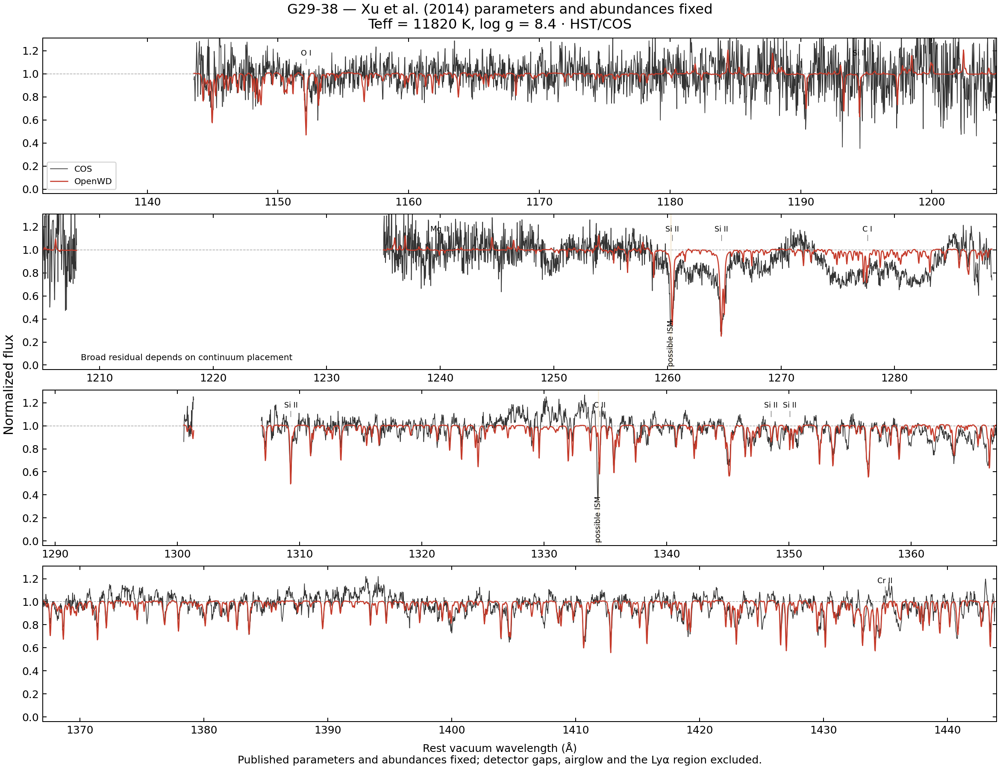](../assets/uv-g29_38.pdf)

### GD 133

The DAZ model uses the four detected abundances O, Mg, Si and Ca from
Xu et al. (2014), with H₂ Lyman and Werner lines enabled. O I airglow near
1302–1306 Å in the all-time coadd is excluded from comparison; the paper's
oxygen measurement used night-only data.

```bash
python examples/uv_validation_model.py gd133 --output results/gd133-uv
```

[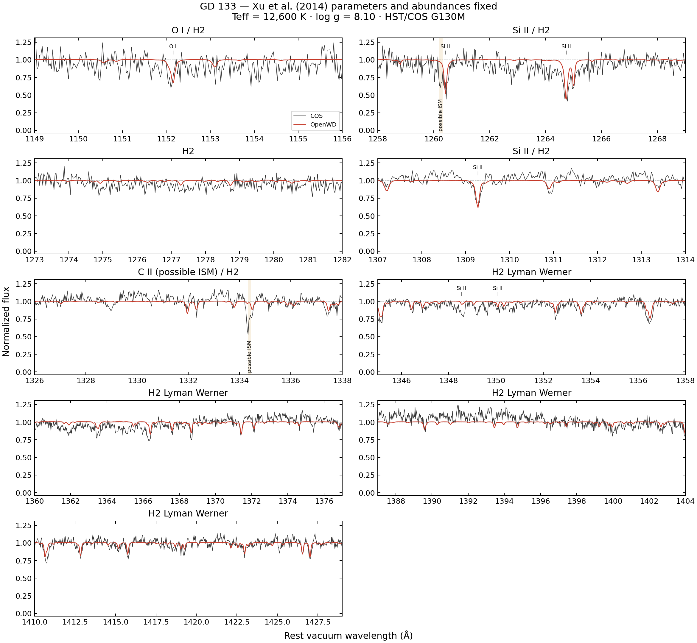](../assets/uv-gd133.pdf)

### GD 362

The model uses Xu et al. (2013), Table 4's detected mixture, omitting
unsupported Sr (`log N(Sr)/N(He) = −10.42`). The wider view shows the full
available strips at approximately **1800–1841, 1903–1943 and 2008–2047 Å**,
including Si II, C I, Mg I and Fe-group lines. The data have lower
signal-to-noise than PG 1225−079. Formal continuum uncertainty reaches 15%
at the strip edges; estimates and extrapolation are marked in the figure.
The NUVA and NUVC strips retain the published
48 km/s apparent velocity because their template shifts are poorly
constrained; the NUVB carbon strip uses 46.3 km/s.

```bash
python examples/uv_validation_model.py gd362 --output results/gd362-uv
```

[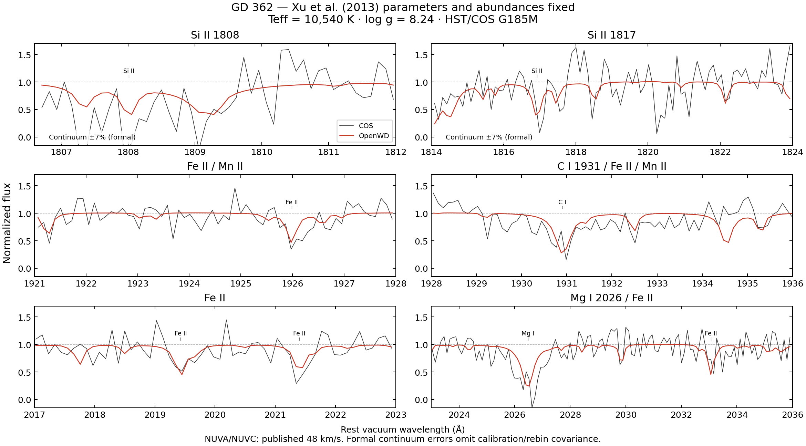](../assets/uv-gd362.pdf)
