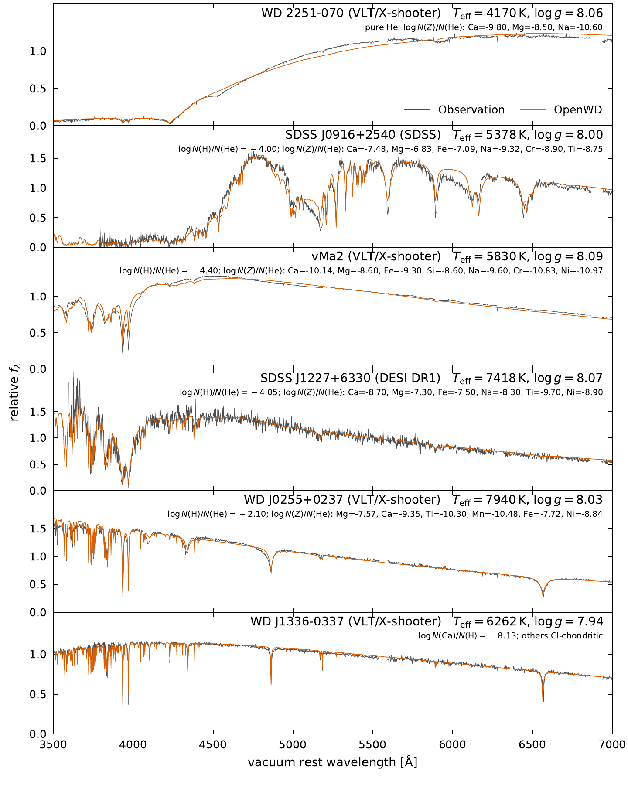

# Observational comparisons: DZ, DBZ and DAZ

[Model usage and physics](../models/DZ.md) · [Documentation home](../README.md)

These comparisons retain the observations, model versions, abundances and
display choices recorded below. Use the model guide for current defaults.
The commands generate new calculations; the figures retain their recorded
source versions.

## Paper comparisons

### Seven polluted white dwarfs

This figure keeps its recorded source versions; it has not been recomputed
for the cool-DZ defaults. It compares seven polluted white dwarfs at fixed
literature parameters and abundances. Five have helium-dominated atmospheres
and use `DZConfig`; the first and last panels are hydrogen hosts and use
`DAZConfig`. The abundance labels in each panel specify the complete adopted
mixture and its H or He denominator.

| Object | Host | Teff (K) | log g | Observation | Parameter source |
| --- | --- | ---: | ---: | --- | --- |
| G149-28 | H | 8600 | 8.10 | DESI DR1 | [Zuckerman et al. (2011)](https://doi.org/10.1088/0004-637X/739/2/101) |
| PG 1225-079 | He | 10800 | 8.00 | VLT/UVES | [Klein et al. (2011)](https://doi.org/10.1088/0004-637X/741/1/64) |
| WD J1013+0259 | He | 12255 | 7.90 | VLT/X-shooter | [Izquierdo et al. (2023)](https://doi.org/10.1093/mnras/stad282) |
| SDSS J0738+1835 | He | 13950 | 8.40 | SDSS | [Dufour et al. (2012)](https://doi.org/10.1088/0004-637X/749/1/6) |
| WD J0259-0721 | He | 16390 | 8.26 | VLT/X-shooter | [Izquierdo et al. (2023)](https://doi.org/10.1093/mnras/stad282) |
| Ton 345 | He | 19780 | 8.18 | SDSS | [Wilson et al. (2015)](https://doi.org/10.1093/mnras/stv1201) |
| GALEX J1931+0117 | H | 20890 | 7.90 | VLT/UVES | [Vennes et al. (2011)](https://doi.org/10.1111/j.1365-2966.2011.18323.x) |

[](../assets/dz-daz-paper.pdf)

[Download the comparison (PDF)](../assets/dz-daz-paper.pdf).
Every plotted atmosphere was relaxed at its displayed composition. Metal
electrons, continuum opacity and line blanketing participate in the structure
calculation; the final synthesis adds the detailed Stout line list. Helium
models use the nonideal He EOS, trace hydrogen where listed, dense-He metal
ionization shifts and ML2/alpha = 1.25 convection. The two DAZ models retain
the paper's Stout strengths, Unsöld neutral-H metal-line widths and Stark-only
Lyman setting. The complete-redistribution Ca II source affects the final
line cores while retaining LTE populations.

Predictions are convolved to the corresponding instrumental resolution:
`R = 2000` (DESI), 19540 (PG 1225 UVES), 5453 (X-shooter), and 40970
(GALEX J1931 UVES), or Gaussian FWHM 2.23 and 2.57 Å for J0738 and Ton 345.
Data and models then receive the same independent pseudo-continuum procedure
and are plotted in rest-frame vacuum wavelengths. These display operations
leave the atmospheric parameters and abundances fixed.

The figure tests the metal-line pattern and normalized profiles across very
different mixtures. It does not establish an absolute continuum match or a
uniformly validated abundance grid. Remaining differences, including the
broad Balmer lines of GALEX J1931+0117 (likely continuum normalization) and
the PG 1225-079 Ca II cores, are visible in the panels. The older plotted
J0738 atmosphere and a fresh calculation with the present certificate are
distinct checks; consult the linked tested-point record before treating it
as a qualified cold start.

### Cool DZs and a cool DAZ

This figure was computed with the PR #38 defaults (models at commit
`275410e`, whose `src` tree is identical to merged `main` after PR #38). It
compares five helium-dominated DZs at 4170–7940 K and one cool DAZ with
public spectra, at fixed published parameters and abundances; only the listed
elements are included.

| Object | Host | Teff (K) | log g | Observation | Parameter and abundance source |
| --- | --- | ---: | ---: | --- | --- |
| WD 2251-070 | He | 4170 | 8.06 | VLT/X-shooter | [Blouin et al. (2019)](https://doi.org/10.3847/1538-4357/ab1266) Teff, log g, Ca; [O'Brien et al. (2026)](https://doi.org/10.1093/mnras/stag1669) Mg, Na |
| SDSS J0916+2540 | He | 5378 | 8.00 | SDSS | [Hollands et al. (2017)](https://doi.org/10.1093/mnras/stx250) |
| vMa2 | He | 5830 | 8.09 | VLT/X-shooter | [O'Brien et al. (2026)](https://doi.org/10.1093/mnras/stag1669) |
| SDSS J1227+6330 | He | 7418 | 8.07 | DESI DR1 | [Coutu et al. (2019)](https://doi.org/10.3847/1538-4357/ab46b9) Teff, log g; [Swan et al. (2023)](https://doi.org/10.1093/mnras/stad2867) abundances |
| WD J0255+0237 | He | 7940 | 8.03 | VLT/X-shooter | [Izquierdo et al. (2026)](https://doi.org/10.1093/mnras/stag1353) |
| WD J1336-0337 | H | 6262 | 7.94 | VLT/X-shooter | [Kilic et al. (2026)](https://doi.org/10.3847/1538-4357/ae825f): photometric Teff, log g and Ca; other metals CI-chondritic |

[](../assets/dz-cool-paper.pdf)

[Download the comparison (PDF)](../assets/dz-cool-paper.pdf).
Each model is convolved to the instrumental resolution, shifted to one
measured radial velocity and multiplied by a single constant, with no slope or
continuum normalization, so the panels test the SED shape as well as the line
profiles. For X-shooter, the UVB arm is first put on the VIS flux scale from
the observation alone, by matching the two arms at the dichroic junction.
For WD J1336-0337, the X-shooter continuum shape is then tied to the star's
DESI spectrum with a quadratic fitted to the ratio of the two observed spectra
in 30-Å bins; this step does not use the model. Against the model, the
X-shooter continuum rises by about 8% from 4500 to 7000 Å while the
independently calibrated DESI spectrum is flat to about 1% over 4400–8900 Å.
Reddening cannot explain this: the star is at 87 pc and Galactic latitude
+57°, where even the full line-of-sight E(B−V) = 0.03 would change the
4500/7000 Å ratio by only about 3%. Chromatic slit losses are likely, because
the X-shooter UVB/VIS atmospheric dispersion correctors are disabled.
Data and models are averaged in 2-Å bins; gaps in the data are the X-shooter
junction and masked telluric and instrumental artifacts, and the model is
drawn through them.

The models reproduce the broad continuum shapes, including the strong
suppression of the blue flux of WD 2251-070 and SDSS J0916+2540, and most
metal-line strengths and widths. Compared with the previous defaults, the
broad-band residual is about nine times smaller for WD 2251-070 and three
times smaller for vMa2. The clearest remaining differences are a shallow
depression at 4300–4700 Å in WD 2251-070 that the model lacks (plausibly
He-induced Ca I ¹S–¹D absorption at 4576 Å, which is not included), weak
blue wings of Mg I b and Na I D in SDSS J0916+2540, and a weak red wing of
Ca II H in vMa2. At the Montreal parameters, the OpenWD Ca II K equivalent
widths of WD J1336-0337 and two other DAZs from the same sample are 0.91–0.98
times those of the Montreal model spectra.

The code that made the figure is in [`research/cool_dz_paper`](../../research/cool_dz_paper):
[`objects.json`](../../research/cool_dz_paper/objects.json) lists the inputs and
archive identifiers. To regenerate it from scratch (each model takes minutes
to half an hour; run them one at a time):

```bash
python -I research/cool_dz_paper/fetch_spectra.py data/cool-dz
for key in wd2251 j0916 vma2 j1227 j0255 j1336; do
  python research/cool_dz_paper/run_model.py $key results/cool-dz/$key
done
python research/cool_dz_paper/plot_figure.py results/cool-dz data/cool-dz cool-dz.pdf
```

The fetcher downloads ten X-shooter products from the ESO archive (about
11 MB in total), one SDSS DR17 spectrum and one DESI DR1 coadd row. The plot
script refuses models that failed their convergence certificate or whose
stored parameters differ from `objects.json`.

## Xu et al. (2019) HIRES comparisons

These three comparisons use the helium-dominated stars in Figures 11--13 of
[Xu et al. (2019), AJ, 158, 242](https://doi.org/10.3847/1538-3881/ab4cee).
The black curves are public Keck/HIRES spectra retrieved from the
[Keck Observatory Archive](https://koa.ipac.caltech.edu/); the red curves are
OpenWD predictions at the paper's fixed parameters and detected abundances
(Tables 1 and 4). No atmospheric parameters or abundances were fitted.

The default metal line list includes the independently corroborated Kurucz
supplements, including the three Cr II HIRES recoveries at air 3368.05,
3433.31 and 3585.29 Å. It preserves original Stout transitions and oscillator
strengths while adding qualified absent transitions and their Kurucz damping
constants. The data are bundled and checksum-verified,
so these examples require no separate line-list download or custom atomic
database. It is used in both atmospheric line blanketing and the final
synthesis, subject to their normal line-selection budgets. See the
[atomic-data provenance](../../src/wd_spectra/data/atomic/README.md).

The plotted spectra were computed with OpenWD commit
[`57f95fc`](https://github.com/kareemelbadry/OpenWD/commit/57f95fc), plus this
earlier full Cr II supplement, using standard-quality relaxed atmospheres and
ML2/alpha = 1.25 convection. They predate the [metal-physics changes](../models/DZ.md#metal-physics-both-hosts)
described in the model guide. The commands below generate new spectra with the current defaults at
the same stellar parameters; they do not exactly reproduce these archived
curves. Their convergence must be checked independently.

For display, the synthetic flux and line-free continuum were convolved to
`R = 40000` and integrated over native detector pixels. Observed orders were
coadded with inverse-variance weights without smoothing. Data and models were
normalized independently with matched local pseudo-continuum masks and
weights, including local fits around Ca II H/K that avoid extrapolating the
continuum. The plots use rest-frame **air** wavelengths; the generated model
files use rest-frame **vacuum** wavelengths. Residual line-depth and Ca/He
core differences remain, so these are comparisons at a literature composition,
not abundance fits or a claim of agreement in the absolute flux.

Run the commands from a source checkout with OpenWD installed. Abundances are
`log10[N(element)/N(He)]`, and the listed metals replace the entire default
mixture. Reported upper limits are omitted. Each command saves the intrinsic
surface flux in `spectrum.txt` (vacuum Å, erg s^-1 cm^-2 Å^-1), together with
the atmosphere and provenance. The fine wavelength grid covers the displayed
regions; it does not apply instrumental convolution or the observational
normalization used in the figures. `--require-convergence` rejects a run
that fails the model's convergence certificate. Use a fresh output directory
for each run.

### WD 1232+563

`Teff = 11787 K`, `log g = 8.30`, `log N(H)/N(He) = -5.90`. The HIRES blue
observations are from 2015 April 11 and 2016 April 1. This comparison covers
the blue metal-line windows and Ca II H/K in Figure 11; ESI data are not
included. The rest-frame correction uses the paper's photospheric velocity
of +19.0 km s^-1. Al and Ni are upper limits and are omitted.


```bash
python examples/one_shot_dz.py --teff 11787 --logg 8.30 --log-h-he -5.90 \
  --abundance O=-5.14 --abundance Mg=-6.09 --abundance Si=-6.36 \
  --abundance Ca=-7.69 --abundance Ti=-8.96 --abundance Cr=-8.16 \
  --abundance Mn=-8.54 --abundance Fe=-6.45 \
  --wavelength-min 3200 --wavelength-max 8000 --wavelength-step 0.02 \
  --quality standard --require-convergence --output results/wd1232-xu2019
```

### WD 1551+175

`Teff = 14756 K`, `log g = 8.02`, `log N(H)/N(He) = -4.45`. The HIRES blue
observations are from 2013 May 8 and the red observations from 2015 April 9,
with a photospheric velocity of +22.9 km s^-1. Ni is an upper limit and is
omitted; Al is a detection. The Halpha region has an archive coverage gap.
The O I 7774-Å panel shows **only the model**: the available red-CCD products
lack a wavelength calibration for that region, so no observational comparison
is possible there.


```bash
python examples/one_shot_dz.py --teff 14756 --logg 8.02 --log-h-he -4.45 \
  --abundance O=-5.48 --abundance Mg=-6.29 --abundance Al=-6.99 \
  --abundance Si=-6.33 --abundance Ca=-6.93 --abundance Ti=-8.68 \
  --abundance Cr=-8.25 --abundance Mn=-8.74 --abundance Fe=-6.60 \
  --wavelength-min 3200 --wavelength-max 8000 --wavelength-step 0.02 \
  --quality standard --require-convergence --output results/wd1551-xu2019
```

### WD 2207+127

`Teff = 14752 K`, `log g = 7.97`, `log N(H)/N(He) = -6.32`. The paper calls
this object **WD 2207+121 in its tables** and **WD 2207+127 in Figure 13**;
both identify the same target at RA = 332.3951°, Dec = +12.3934°
(J2209+1223). The HIRES blue observations are from 2012 October 28--29 and
the red observations from 2013 September 17, with a photospheric velocity
of +34.5 km s^-1. All ten listed metals, including Ni, are detections.
Faulty extracted orders were rejected before coaddition. Halpha has a
coverage gap, and the O I 7774-Å panel again shows **only the model** because
the archive red-CCD products lack a wavelength calibration there.


```bash
python examples/one_shot_dz.py --teff 14752 --logg 7.97 --log-h-he -6.32 \
  --abundance O=-5.32 --abundance Mg=-6.15 --abundance Al=-7.08 \
  --abundance Si=-6.17 --abundance Ca=-7.40 --abundance Ti=-8.84 \
  --abundance Cr=-8.16 --abundance Mn=-8.50 --abundance Fe=-6.46 \
  --abundance Ni=-7.55 \
  --wavelength-min 3200 --wavelength-max 8000 --wavelength-step 0.02 \
  --quality standard --require-convergence --output results/wd2207-xu2019
```

## Ultraviolet comparisons

These comparisons extend the HIRES examples to public HST/COS spectra of
seven helium-dominated DZ/DBZ stars and two hydrogen-dominated
[DAZ stars](../models/DZ.md#hydrogen-hosts-daz). Effective temperatures, gravities and detected abundances
are held at the values adopted in the corresponding abundance papers.
Reported upper limits are omitted. Metal abundances are
`log10[N(element)/N(He)]` for DZ/DBZ and `log10[N(element)/N(H)]` for DAZ;
trace hydrogen in a helium atmosphere is specified separately.

Each plotted atmosphere passed OpenWD's required equilibrium checks at its
source revision. The seven original predictions use `221dc9c`, whose physics
matches merged main revision `e09e7da`, including the
[H₂ Lyman/Werner implementation](https://github.com/kareemelbadry/OpenWD/pull/26).
GD 40 and G241−6 use revision
[`943c146`](https://github.com/kareemelbadry/OpenWD/commit/943c146), including the
[additional Fe II transitions and trace-H broadening correction](https://github.com/kareemelbadry/OpenWD/pull/28).
The [figure provenance](../assets/uv-validation-provenance.json) records the
individual source revisions, observations, velocity choices, continuum fits
and checksums. Commands below use the current checkout's defaults at the same
published inputs, so their fluxes can differ from the archived predictions.

The far-UV figures use four wide wavelength rows in a single column. The
near-UV figures show all three separate detector strips, including their
broader wavelength coverage. Gray curves show COS observations binned over
three quality-valid native pixels; the red curve is OpenWD with linewidth 1.
Models are convolved with the observation's wavelength-dependent COS
line-spread function and integrated over detector pixels. Photospheric
velocity corrections align the spectra without adjusting individual lines.
Data and models are normalized independently: accepted local continuum fits
are retained around far-UV features, with smooth interpolation between them;
the near-UV figures retain the original quadratic continuum fit for each strip.
The Lyα interval 1208–1235 Å, marked airglow and foreground absorption are
excluded from the far-UV metal comparison. Detector gaps remain gaps.

The largest remaining model discrepancies in these figures are the
**Si II 1260–1265 Å wings in GD 40 and G241−6**, which remain shallower than
observed at the published compositions. These are comparisons of normalized
line profiles; the abundances and damping factors have not been fitted.

| Object | Model | Teff (K) | log g | log N(H)/N(He) | COS mode | Parameter and abundance source | Configuration key |
| --- | --- | ---: | ---: | ---: | --- | --- | --- |
| GD 40 | DZ/DBZ | 15300 | 8.00 | −5.10 | G130M | [Jura et al. (2012), Table 3](https://arxiv.org/abs/1203.2885) | `gd40` |
| G241−6 | DZ/DBZ | 15300 | 8.00 | −5.90 | G130M | [Jura et al. (2012), Table 4](https://arxiv.org/abs/1203.2885) | `g241minus6` |
| PG 1225−079 | DZ/DBZ | 10800 | 8.00 | −4.05 | G185M | [Xu et al. (2013), Table 5](https://arxiv.org/abs/1302.4799) | `pg1225` |
| GD 61 | DZ/DBZ | 17280 | 8.20 | −3.89 | G130M | [Farihi et al. (2013), Supplement Table 2](https://arxiv.org/abs/1310.3269) | `gd61` |
| GD 378 | DZ/DBZ | 15620 | 7.93 | −4.48 | G130M | [Klein et al. (2021), Table 5](https://faculty.epss.ucla.edu/~eyoung/reprints/Klein_2021.pdf) | `gd378` |
| WD 1425+540 | DZ/DBZ | 14490 | 7.95 | −4.20 | G130M | [Xu et al. (2017), Table 1, Model I](https://arxiv.org/abs/1702.02868) | `wd1425` |
| G29−38 | DAZ | 11820 | 8.40 | — | G130M | [Xu et al. (2014), Table 3](https://arxiv.org/abs/1401.4252) | `g29_38` |
| GD 133 | DAZ | 12600 | 8.10 | — | G130M | [Xu et al. (2014), Table 3](https://arxiv.org/abs/1401.4252) | `gd133` |
| GD 362 | DZ/DBZ | 10540 | 8.24 | −1.14 | G185M | [Xu et al. (2013), Table 4](https://arxiv.org/abs/1302.4799) | `gd362` |

The complete detected mixtures and numerical settings are in
[uv-validation-configs.json](../assets/uv-validation-configs.json).
GD 378's Be detection and GD 362's Sr detection are recorded there but omitted
because the bundled metal database does not support those elements.
DZ/DBZ models use ML2/alpha = 1.25; the DAZ models use ML2/alpha = 0.8 and
explicitly enable H₂ Lyman and Werner lines and molecular equilibrium.
WD 1425+540 uses production resolution; the other entries use standard resolution.

Run each command below from a source checkout with OpenWD and its compiled C
backend installed. The example generates **one** atmosphere and intrinsic
spectrum, requires a passing convergence certificate, and defaults numerical
libraries to one thread. Choose a fresh output directory for each run.
It saves `spectrum.txt` (vacuum Å, erg s^-1 cm^-2 Å^-1), the atmosphere and
provenance. The fine wavelength grids are 1125–1460 Å for G130M and
1785–2055 Å for G185M, with 0.01 Å spacing. Instrumental convolution and
observational normalization are separate display steps.

### GD 40

The model uses Jura et al. (2012), Table 3's final detected abundances.
The broad far-UV view includes the strong Si II multiplet together with
weaker Si II, O, Mg and Fe features.

```bash
python examples/uv_validation_model.py gd40 --output results/gd40-uv
```

[](../assets/uv-gd40.pdf)

### G241−6

The model uses Jura et al. (2012), Table 4's final detected abundances, with
oxygen from the UV column. Its similar temperature and gravity to GD 40
provide a comparison of different metal mixtures in helium atmospheres.

```bash
python examples/uv_validation_model.py g241minus6 --output results/g241minus6-uv
```

[](../assets/uv-g241minus6.pdf)

### PG 1225−079

The model uses Xu et al. (2013), Table 5, including detected carbon and the
optical metal abundances. Three full near-UV strips show Si II, C I, Mg I and
Fe-group lines. Sparse continuum support at the strip edges gives up to
16% formal normalization uncertainty; the figure marks the estimates and
extrapolated edges. Calibration and rebinning covariance are not included.

```bash
python examples/uv_validation_model.py pg1225 --output results/pg1225-uv
```

[](../assets/uv-pg1225.pdf)

### GD 61

The model uses the adopted abundance column of Farihi et al. (2013), with
trace hydrogen and detected O, Mg, Si, S, Ca and Fe. Foreground N I, Si II and
C II features are marked at the approximately 40 km/s blueward offset
reported in the paper's Figure 2 caption.

```bash
python examples/uv_validation_model.py gd61 --output results/gd61-uv
```

[](../assets/uv-gd61.pdf)

### GD 378

The model uses Klein et al. (2021), Table 5, including nitrogen from its
footnote and omitting unsupported Be (`log N(Be)/N(He) = −11.44`). N I and
C II components associated with the reported foreground cloud are marked
separately from photospheric lines.

```bash
python examples/uv_validation_model.py gd378 --output results/gd378-uv
```

[](../assets/uv-gd378.pdf)

### WD 1425+540

The model consistently uses **Model I** of Xu et al. (2017), including its
`log N(H)/N(He) = −4.20`. The all-time coadd has possible N I airglow at
observed-frame 1199.0–1201.2 Å, which is marked and excluded from comparison
and continuum anchors; N I 1134 Å remains the nitrogen comparison.

```bash
python examples/uv_validation_model.py wd1425 --output results/wd1425-uv
```

[](../assets/uv-wd1425.pdf)

### G29−38

The hydrogen-host model uses Xu et al. (2014)'s detected abundances, with
photospheric H₂ Lyman and Werner lines enabled. The observations combine the
usable 1999 s first-visit exposure with the 7035 s second visit; exposures
affected by the reported gyro malfunction are excluded. Marked foreground
components are excluded from the photospheric comparison.
The broad residual around 1260–1283 Å depends on local continuum placement;
this normalized comparison does not isolate it as a line-profile error.

```bash
python examples/uv_validation_model.py g29_38 --output results/g29_38-uv
```

[](../assets/uv-g29_38.pdf)

### GD 133

The DAZ model uses the four detected abundances O, Mg, Si and Ca from
Xu et al. (2014), with H₂ Lyman and Werner lines enabled. O I airglow near
1302–1306 Å in the all-time coadd is excluded from comparison; the paper's
oxygen measurement used night-only data.

```bash
python examples/uv_validation_model.py gd133 --output results/gd133-uv
```

[](../assets/uv-gd133.pdf)

### GD 362

The model uses Xu et al. (2013), Table 4's detected mixture, omitting
unsupported Sr (`log N(Sr)/N(He) = −10.42`). The wider view shows the full
available strips at approximately **1800–1841, 1903–1943 and 2008–2047 Å**,
including Si II, C I, Mg I and Fe-group lines. The data have lower
signal-to-noise than PG 1225−079. Formal continuum uncertainty reaches 15%
at the strip edges; estimates and extrapolation are marked in the figure.
The NUVA and NUVC strips retain the published
48 km/s apparent velocity because their template shifts are poorly
constrained; the NUVB carbon strip uses 46.3 km/s.

```bash
python examples/uv_validation_model.py gd362 --output results/gd362-uv
```

[](../assets/uv-gd362.pdf)
