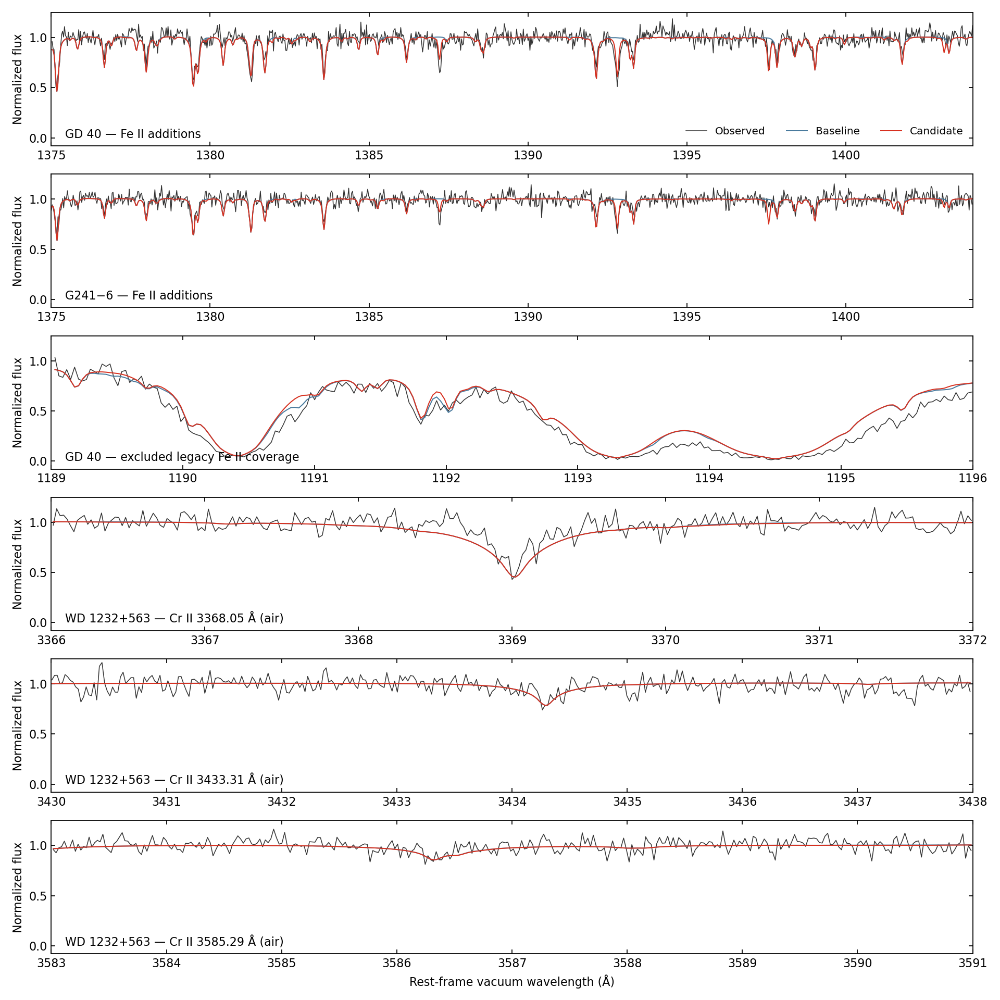
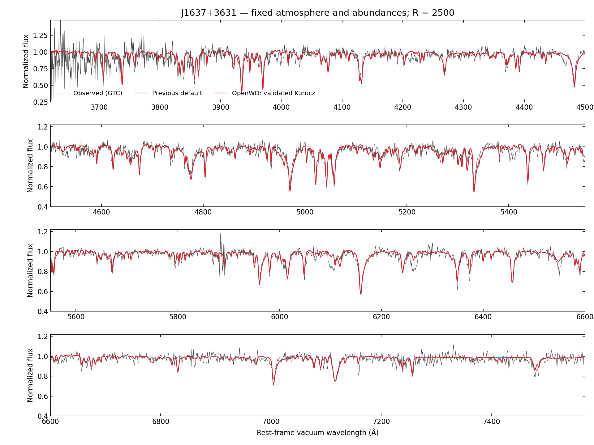

# Independently corroborated Kurucz default supplements

The default Stout reader uses one prospective atomic-data rule for missing
Kurucz transitions. No white-dwarf observation enters the selection, and no
oscillator strength, width, abundance or atmospheric parameter is fitted.
The catalogue replaces the former full Cr II and selected Fe II/Si II
supplements. Original Stout records and the two existing level extensions
are retained. The data work offline and are checksum-pinned.

## Selection and cost control

All 30 neutral/singly ionized catalogues of C, N, O, Na, Mg, Al, Si, P, S,
Ca, Ti, Cr, Mn, Fe and Ni were screened. An addition must have observed
Kurucz level energies, unique energy/statistical-weight matches within
0.1 cm⁻¹ to the existing atom, both levels below the ground ionization
limit, and a qualified independent oscillator strength. The Kurucz strength
must agree with that independent value within a factor of ten. Source
preference is reviewed NIST C-or-better or measured branching-fraction
evidence, then the 2024 silicon calculation with gauge discrepancy ≤0.25,
then an independent calculation between known levels. Conflicting duplicate
strengths are rejected. Independent energy matches use a 1 cm⁻¹ tolerance;
the Si II GRASP calculation uses configuration/term/J identities instead.

This admits **19,966 absorption additions with f ≥10⁻⁴**:

| Ion | Added absorption transitions |
|---|---:|
| C I | 1 |
| Si I | 433 |
| Si II | 17 |
| S I | 7 |
| Ti I | 4 |
| Cr II | 14,891 |
| Fe II | 4,613 |

Cr II receives the same rule as every other ion. Its previous 90,421 additions
are reduced to 14,891; the three HIRES recoveries at air 3368.05, 3433.31 and
3585.29 Å qualify normally. Weaker qualified downward channels contribute
to inferred natural widths without creating absorption lines below the floor.
Kurucz oscillator strengths and damping constants are used unchanged.

The existing LTE ranking and total line budgets remain in force. Formal
synthesis additionally drops supplement lines whose thermal-Doppler peak
opacity/background ratio stays below 10⁻³ at every depth. This conservative
screen protects unified profiles and strong ground-state resonances, bypasses
NLTE departure-coefficient calculations, and never changes original Stout
lines or explicitly declared structural line sets. The working arrays are
chunked rather than expanded over the full wavelength/depth/line volume.

The [atomic bundle](../../src/wd_spectra/data/atomic/independent-kurucz/README.md)
records the independent sources, exact checksums and per-transition evidence.
The [reproduction scripts](../../scripts/independent_kurucz/README.md) regenerate
and verify the selection from pinned public inputs. Most corroboration is
independent theory; it is not laboratory certification. The factor-ten and
gauge screens are eligibility checks, not precision uncertainty estimates.

The reviewed NIST strength references are Haris & Kramida's C I evaluation
(T9787), Nahar & Pradhan's Si-like Opacity Project calculation (T6066, with
LS-split components identified), Civiš et al.'s S I infrared data (T10762),
Zatsarinny & Bartschat's S I strengths (T7952), Smith & Kühne's Ti I hook
measurements (T3499, including NIST's normalization flag), and Blackwell et al.'s
Ti I relative strengths (T4922). Their
[NIST bibliography URLs and saved-page checksums](independent-kurucz/nist-reference-pages.json)
make the allowlist's original provenance inspectable.

## Observational and runtime validation

The experiment compared the previous defaults with this exact selection at
fixed published parameters, compositions, observed normalizations, velocities,
LSFs and masks. Each synthetic spectrum uses its own physical continuum at
its solved thermal state; the dimensionless observation/model transfers stay
fixed. Metal-line-free continuum diagnostics also exclude the coupled Ca II
line emissivity whenever Ca opacity is excluded.

Fourteen objects were checked: GD 40, G241−6, GD 61, GD 378, WD 1425+540,
PG 1225−079, GD 362, WD 1232+563, WD 1551+175, WD 2207+127, G29−38,
GD 133, G149−28 and GALEX J1931+0117. All 22 pairs and continuum diagnostics
completed. Fixed-state comparisons cover ten DZ/DBZs and four DAZs; eight
pairs across six objects also re-solve the atmosphere. All required
equilibrium-certificate checks passed in those re-solved pairs.

No corrected whole-object score crossed the exploratory 5% degradation
threshold. Representative fixed-state χ² changes are −3.08% for GD 40,
−1.85% for G241−6 and +0.28% for GD 362. The checkpoint-started WD 1232
comparison improves 1.81%. The optical G149−28 and GALEX J1931 products
lack errors: their unweighted squared-residual changes are +0.000413%
and −0.015399%, respectively, and are **not χ²**. These comparisons assess
regression relative to the existing model, not perfect absolute fits.



Black is observed, blue is the previous default and red is the qualified
candidate. The UV panels use vacuum wavelengths; the lower HIRES panels use
air wavelengths as indicated. The 1190–1196 Å panel also displays a local
loss caused by the common evidence rule.

The three clean gray-start pairs sampled AC power throughout:

| Object | Previous defaults (s) | Qualified catalogue (s) | Runtime change |
|---|---:|---:|---:|
| G29−38 | 300.4 | 280.4 | −6.66% |
| GD 61 | 769.8 | 731.0 | −5.04% |
| G149−28 | 702.8 | 746.2 | +6.18% |

All meet the requested +20% allowance. These are representative measurements,
not a universal runtime guarantee. The original GD 40 baseline included
battery intervals and is excluded from the clean timing evidence; it was
not repeated. Models ran sequentially with one numerical thread and a
4 GiB RSS watchdog; the largest measured peak was 3.75 GiB.

The experiment used commit `3a9a9a8`, whose full `src` tree matched main
`9aa0463`, with the candidate applied locally. This production change starts
from newer main `6e5074e`, including subsequent H₂-rate and DB/DAB fixes.
The timing table reports the completed experiment, rather than claiming
it was repeated on that newer main. Repository component, spectrum and
protected-model checks separately exercise the production integration.

The shared reader also changes narrow J1637 (D6) line pixels, by up to 37.6%
at native sampling, while its integrated 3400–7700 Å flux changes −0.0873%.
At R=2500, reusing the baseline continuum transfer for both models, the
fixed-state squared residual improves 0.34% against the bundled GTC
digitization and 0.81% against the paper's Koester curve. No candidate
continuum or physical input is fitted. The
[D6 observation check](independent-kurucz/d6-fixed-observation.json) records
per-panel scores. Historical J1637 controls are retained under their original
atomic policies; the qualified atom has its own versioned spectrum and
two-update warm-trajectory control, with unchanged tolerances. This bounded
trajectory is not a new cold-start qualification.
The production J1637 capture completed below the same 4 GiB watchdog,
at 3.973 GiB peak RSS; its memory use is separate from the 3.75 GiB maximum
in the DZ/DAZ experiment.



Gray is the GTC spectrum, blue is the previous default and red is the qualified
atom on the same historical atmosphere. This raw-data plot uses the established
upper-envelope display normalization, with its baseline model continuum reused
for the candidate. The numerical scores above instead use the bundled paper
digitization and its existing baseline quadratic continuum transfer.

[Per-object observation scores](independent-kurucz/observation-scores.json)
([full window scores, xz-compressed JSON](independent-kurucz/observation-window-scores.json.xz))
and the [paired calculation audit](independent-kurucz/assessment.json)
preserve measured scores, hashes, power samples, convergence checks and
the original continuum-inconsistent WD 1232 flag alongside its corrected
assessment.

## Accepted limitations

- Local residuals increase near 1167, 1191 and 1403 Å in GD 40 and near
  1167 Å in G241−6 despite improved whole-object scores. The common rule
  excludes 111 of the 142 earlier Fe II additions at 1189–1198 Å. In
  particular, the real Fe II 1190.882 Å line involves 6p, outside the loaded
  independent Fe II calculation's coverage. It receives no empirical exception.
- Si II 1305.59 Å is held out because its upper level is slightly above
  the ground ionization limit. A suitable autoionization/profile treatment
  remains future work. The 1309.45/1309.73 Å companions qualify. The broad
  Si II 1260/1265 Å wing discrepancies remain without width retuning.
- The added C I line at 7.47 μm, S I lines at 0.95–2.29 μm and much Si I
  infrared coverage lie outside these observed windows. They have independent
  atomic evidence but no direct observational validation here. Ions with
  no qualifying additions are not thereby certified complete.
- G149−28's weak Ca I/Mg I b predictions and the GALEX J1931 Ca/Hε mismatch
  remain baseline limitations.

## Usage

Existing `compute_dz` and `compute_daz` calls include the qualified lines
automatically. No line-list download or model-command change is required.
For a raw-Stout diagnostic through the low-level reader:

```python
from wd_spectra.metals import read_stout_atomic_database
from wd_spectra.models import ModelData

stout = read_stout_atomic_database(
    ModelData.default().stout,
    elements=("Mg", "Si", "Ca", "Cr", "Fe"),
    maximum_charge=3,
    include_default_supplements=False,
)
```

The legacy explicit augmentation functions remain available for bare/custom
atoms. They leave an already qualified default atom unchanged, so they cannot
silently reintroduce lines rejected by the common rule. The legacy
`si_ii_kurucz_transitions` configuration field consequently does not remove
qualified Si II lines already present in the default reader.
